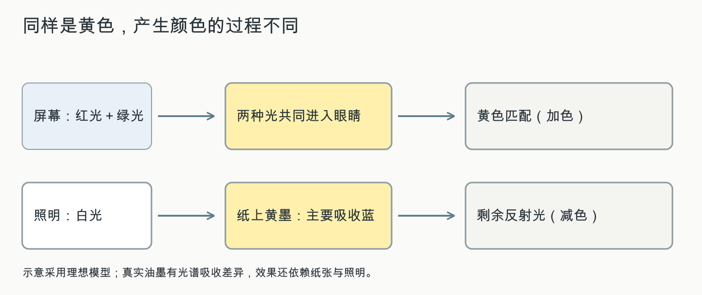
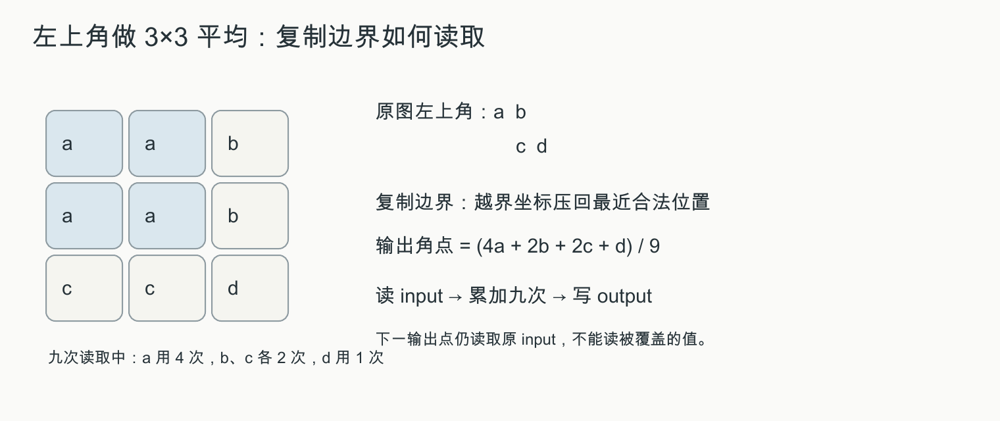
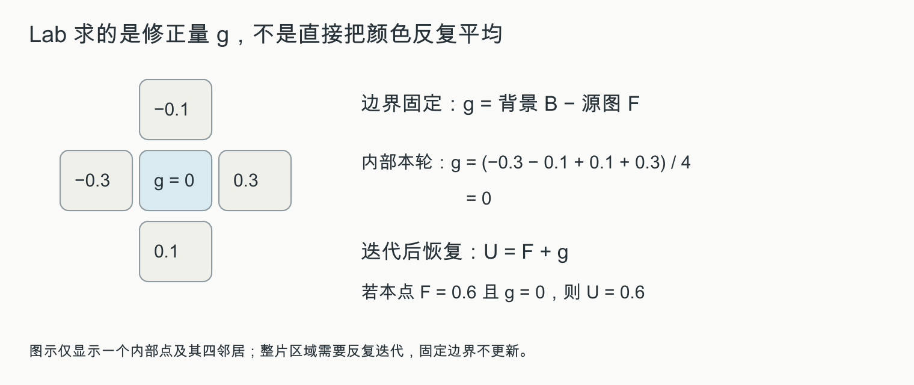
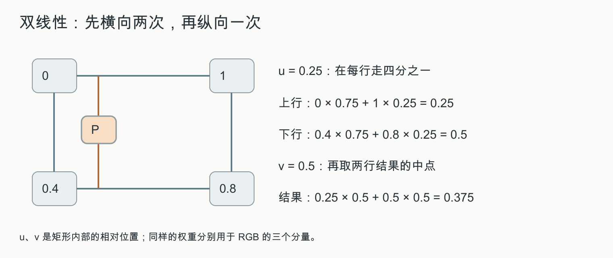
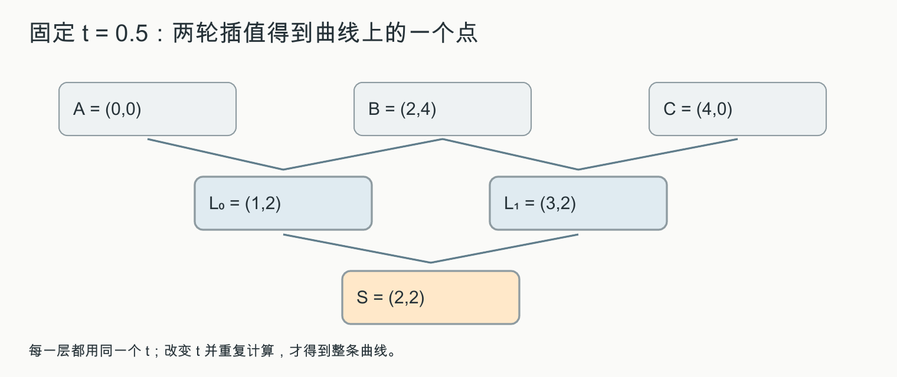
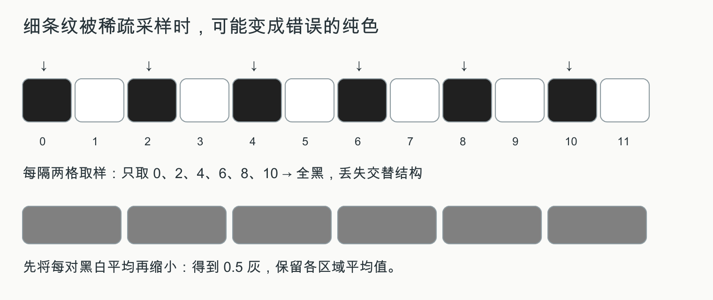

# 阅读路线与范围

**讲解版 · 2026 年 10 月 12 日。** 这版按“做过 Lab 1，但尚未系统学过其他内容”来讲。会写实验代码，不代表已经学过颜色科学、微积分里的图像算子或样条理论；需要的基础在第一次使用时补充。

先想一张在屏幕上显示的三角形：它的形状由顶点描述，内部需要填像素，像素需要颜色，斜边可能有锯齿，显示器再把数字变成光。你在 Lab 1 写过其中几步。这门课把这些步骤串成系统，并进一步解释颜色为何这样表示、算法为何这样计算。

## 阅读时先分清三种内容

**正文解释** 用来建立理解，第一次从头读。**公式与推导** 紧接解释，先认清每个字母，再跟着算一遍。**延伸与使用条件** 用来补齐知识和避免误用，可以在基础读懂后回看；保留这些内容不代表它们都是今年确定的考点。

章节编号是这份复习讲义的编号，不是原课程第几讲。第 13 章是去年真题的参考解析，初读可先跳过；第 14 章是独立练习，网页答案默认折叠，打印版答案另册。

## 看公式时常用的几个记号

| 写法 | 在这份讲义中怎样读 |
|:--|:--|
| $a[x,y]$ | 图像 a 在第 x 列、第 y 行存的数；彩色时可能是三个数 |
| $(R,G,B)$ | 同一像素的三个颜色通道；通道就是分别存储、计算的分量 |
| $\sum_i w_i a_i$ | 每项先乘自己的权重，再全部加起来；权重和为 1 时常用来做加权平均 |
| $\int$ 或 $\iint$ | 把连续区间或区域中无数很小的贡献累加；离散代码通常用有限次求和近似 |
| $P_1-P_0$ | 从点 $P_0$ 指向点 $P_1$ 的向量：坐标分别相减 |
| $f'$、$f''$ | 一阶导描述变化率，二阶导描述变化率怎样改变；涉及它们的章节会具体解释 |
| $\|v\|^2$ | 向量各分量平方后相加，如 $(a,b)$ 对应 $a^2+b^2$；因此不让正负差异相互抵消 |

不用先背整张表。遇到长公式，先问“输入是什么、要算哪个量、每一项起什么作用”，比先背符号更容易进入正文。

这份讲义以文件夹中的 **《Quiz_Review_01》复习笔记** 为基础，重新核对本学期 PPT、当前 Lab 1 实现和 2025 年第一次小测。保留原笔记按概念解释算法、再给出公式的思路，补入之前缺少的第一章，同时把真题要求的推导和计算单独展开。

本阶段的主线是：**怎样表示视觉内容，怎样把连续的形状和颜色变成有限的像素，又怎样减少离散化带来的误差。** 引言说明这门课在研究什么；颜色与显示说明像素如何被看见；图像处理改变像素值；光栅化决定哪些像素被画出；曲线描述形状；反走样处理采样误差。

## 四类材料分别怎样使用

| 材料 | 在本讲义中的作用 |
|:--|:--|
| 本学期 PPT：01 的两部分及 02–07，共 8 份 PDF | 确定知识覆盖范围和课程使用的术语；第一章重新补齐 |
| 当前 Lab 1 的 `tasks.cpp` | 把公式对应到实际变量、循环、边界处理和显示效果 |
| `Quiz_Review_01.pdf` 及同名 `.tex` | 作为结构和解释的基础；核正公式、方向及过于绝对的表述 |
| 2025 年第一次小测扫描件 | 分析已经出现的题型，提供逐题参考解析和针对性练习 |

文件夹中的两份真题 PDF，虽然文件哈希不同，但逐页渲染得到的 5 页图像完全一致，因此按 **同一套试题** 处理。材料没有附官方答案；本讲义的解答均为根据题意推导的参考解答。

**范围说明。** 原笔记里“抖动和反走样不在第一次考试范围内”的话对应它当时的安排，不能作为今年删去内容的依据。新版保留它们，因为它们出现在本学期提供的 PPT 和 Lab 1 中。引言课件的课程表还把“几何表示、几何处理”安排在第一次测试之前，但当前 `ppt资料` 中没有对应课件，也没有单独的今年考试范围通知。因此，本讲义覆盖已提供的 01–07 和 Lab 1，**不把它宣称为老师确认的全部考纲**。

## 真题告诉我们要练什么

| 去年板块 | 分值 | 对应本讲义 | 复习时应做到 |
|:--|--:|:--|:--|
| 基础知识：会议、应用、颜色混合 | 22 | 第 1、2 章 | 会辨别概念，能说明原因 |
| 二次贝塞尔曲线 | 18 | 第 8 章 | 从插值推表达式、求端点切向、解释包含区域 |
| 滤波与图像修复 | 30 | 第 4、5 章 | 会写核、逐项计算、写优化目标与边界条件 |
| 直线、圆与通用 Bresenham | 30 | 第 6 章 | 会定义决策量、推增量、按变量定义填代码 |
| 椭圆附加题 | 5 | 第 13 章 | 理解对称性、增量更新与程序执行顺序 |

其中会议和应用领域共 **15 分**，说明“引言”不能完全跳过。表中的分值只描述这一份真题，不能据此预测今年的分布。

## 建议的复习顺序

1. **第一轮：建立知识框架。** 按第 1–11 章阅读，先能用自己的话解释每种方法解决的问题。
2. **第二轮：动手推导。** 重点做第 4–6、8 章中的计算，再用第 12 章把它们对应到自己的 Lab 代码。
3. **第三轮：闭卷检查。** 先独立做原卷，再读第 13 章解析；最后做第 14 章变式，检查是否只是记住了原题答案。

这里的先后是复习建议，不是官方重点。公式中的颜色默认归一化到 $[0,1]$，真题给出的 15、30、60 则保留其原始灰度数值。引用的 PPT 页码均是 **PDF 阅读器的实际页码**。二维推导采用数学坐标；代码中的行号可能向下增大，判断时以明确定义的公式为准。

# 1 引言：可视计算与交互在研究什么

## 1.1 五个相关领域，先按输入和目标区分

想象制作一个可旋转的茶壶：给程序茶壶的三维形状，让它画出照片般的画面，这是图形学；给程序一张茶壶照片，让它估计茶壶形状，这是计算机视觉。如果把每个位置的温度用颜色画出来，是可视化；拖动鼠标让茶壶转动并立即看到结果，是人机交互。VR、AR 则把这些技术组织成一种观看和操作环境。

这里的“领域”按研究问题划分，不是按软件名称划分。同一个项目可以同时包含图形、视觉和交互。下面的表用来归纳刚才这些差别。

| 领域 | 主要问题 | 典型例子 |
|:--|:--|:--|
| 计算机图形学 Computer Graphics | 怎样表示、生成和呈现虚拟对象与场景 | 三维建模、动画、电影特效、游戏渲染 |
| 计算机视觉 Computer Vision | 怎样从图像或视频理解世界 | 识别物体、估计姿态、重建几何 |
| 可视化 Visualization | 怎样把数据映射成可观察、可比较的图形 | CT 数据可视化、流场显示、统计图表 |
| 人机交互 HCI | 用户怎样向系统表达意图，系统怎样反馈 | 鼠标拖动、触摸、手势、眼动、触觉反馈 |
| 虚拟／增强现实 VR／AR | 怎样让用户体验虚拟环境或现实与虚拟的融合 | VR 训练、现实场景中的虚拟标注 |

图形学常从场景、几何、材质和光照出发生成图像；视觉常从图像出发估计对象、几何或其他信息，因此课程把两者称为相互联系的“正向／逆向任务”。这是理解研究目标的方式，不表示两者能完全无损地互相求逆：一张图像会丢失遮挡后的信息，逆问题通常需要额外假设。

**应用辨别看实际工作。** 从 CT 数据重建、显示器官属于可视计算；在游戏中生成角色、计算光照也属于图形学。仅仅“用 GPT 生成文本”不能据此归为图形学；非对称加密的核心目标是信息安全。某项技术可以参与图形系统，但不能因为“用了计算机”就把它当成图形学任务。

## 1.2 图形学的三条主线

以游戏里一只滚动的球为例：先定义它的形状和表面，再决定每一时刻它在哪里，最后从玩家的视角画出来。这三步分别是建模、动画／仿真和渲染。

**几何** 是位置与形状；**材质** 描述表面如何与光相互作用，例如光滑金属和粗糙布料反光不同；**相机／视点** 决定从哪里看、看向哪里；**光照** 决定有哪些光到达场景。只有球的坐标，还不足以知道屏幕上应该是什么颜色，所以需要渲染。

网格用顶点、边和面拼表面；点云是一组空间采样点；体素像三维的小格子。这些都是“怎样把形状存进计算机”的选择，不是三种不同的渲染效果。

**建模 Modeling：物体是什么样。** 表示或构造几何，例如曲线、网格、点云、体素，也包括从现实采集数据后进行重建。

**动画／仿真 Animation／Simulation：物体怎样随时间变化。** 动画可以用关键帧、运动捕捉或控制方法描述运动；物理仿真根据力学等规律推进状态。动画不一定来自物理仿真，仿真也不只是“播放很多张图片”。

**渲染 Rendering：从某个视点看起来怎样。** 根据场景、相机、材质和光照计算图像。几何正确不等于图像已经完成，外观还取决于这些成像条件。

把它们连起来：建立一个角色模型 → 决定它怎样运动 → 计算各时刻相机看到的画面。Lab 1 主要涉及二维图像处理、曲线表示和光栅化，属于这条大流程中的基础环节。

## 1.3 会议、人物与经典对象

学术会议是研究者发表、讨论成果的场合。这里记会议名称，是为了识别研究领域，并不是要求掌握会议组织方式。经典模型则是大家反复使用的共同测试对象：使用同一个茶壶或盒子，才更容易比较不同算法对曲面、阴影和反射的处理。

| 名称 | 这阶段需要记住的联系 |
|:--|:--|
| **ACM SIGGRAPH** | 图形学与交互技术的重要学术会议；去年会议选择题选它 |
| CVPR | 计算机视觉与模式识别，不是那道题所问的图形学会议 |
| NeurIPS | 机器学习等方向；不能和 SIGGRAPH 混淆 |
| ACL | 自然语言处理方向 |
| Ivan Sutherland、Sketchpad、1963 | 早期交互式计算机图形系统的重要起点 |
| Utah Teapot、Martin Newell | 经典图形学测试模型 |
| Cornell Box | 经典的场景与光照研究示例，用于比较渲染效果 |

引言还提到 SIGGRAPH 与游戏、HCI、VR、可视化等方向的联系。先掌握领域对应和典型贡献；不用把每张人物照片、每个软件名称都当成同等重要的背诵条目。

## 1.4 把应用说具体

CT 的一组切片可以理解为不同高度的二维图像。把它们组织成体数据、提取器官表面，再显示成可旋转的三维对象，就把难以直接看懂的数字变成了形状。CAD 是计算机辅助设计，例如用曲面精确描述零件；运动捕捉是测量人的动作再用于数字角色。

“智能体”指会根据环境作出行动的系统；“具身”强调它要通过身体或机械装置与环境发生作用。虚拟机器人若能直接穿墙，训练出来的行为就未必能用于现实，这就是下文模拟与现实差距的直观来源。

- **影视和游戏：** 建模、运动捕捉、动画、着色和渲染共同生成画面。
- **CAD 与制造：** 表示和编辑零件几何，辅助设计、检验和制造。
- **科学与医学可视化：** 把体数据、流场等难以直接阅读的数据转成可观察的图像。
- **训练与教育：** 用可控制的虚拟环境训练驾驶、飞行或操作技能。
- **具身智能：** 在虚拟环境中训练、测试智能体，需要几何、外观以及可交互的物理行为。

引言中的 AIGC、Agentic Graphics 示例说明，生成对象不止是“生成一张好看的图”：若要用于机器人训练，还需要正确的连接关系、可动部件、碰撞和物理行为。课件用 **Sim2Real Gap** 表示模拟环境与现实条件的差距。这里掌握概念联系即可，不需要把展示模型的参数量当作基础定理。

## 1.5 交互的关键是反馈

交互不只有输入动作，还包括系统对动作的响应与反馈。例如在 Lab 中拖动控制点，程序更新控制点坐标、重算曲线并显示，用户再依据画面调整。这形成“操作 → 计算 → 反馈 → 再操作”的过程。

**自检：** 能否分别用一句话解释建模、动画、渲染？为什么 CT 三维重建与显示属于课程应用，而仅生成文字不直接属于图形学？为什么拖动控制点属于交互？

来源：01-intro-part1，PDF 2、7–19、22–49、50–63 页；01-intro-part2，PDF 7–33、36–52 页；真题第一大题第 1、2 小题。

# 2 颜色：光、数字和感知

## 2.1 光谱为什么能用三个数来表示

先把**光、物体和数字**分开。一束光可以同时含有多个波长；波长描述光波的空间周期，nm 是纳米。白纸把照到它的一部分光反射进眼睛，屏幕则可以直接向眼睛发光。电脑文件里的 RGB 只是颜色编码，文件本身并没有光。

如果画一个图，横轴放波长、纵轴放该波长附近的光强，得到的就是**光谱**。它像一份“各波长成分有多少”的清单。人眼不会逐项读取这份完整清单，而是由感光细胞产生响应，视觉系统再处理这些信号。因此不同的光谱，有时会给人相同的颜色感觉，这叫同色异谱。

后面的积分式就是“把各波长的贡献按敏感程度加起来”。$\lambda$ 是波长，$I(\lambda)$ 是光谱，$\bar r(\lambda)$ 是对应颜色匹配表示中的权重函数，$d\lambda$ 表示很窄的波长区间。结果是一个数，而不是另一条光谱。屏幕 RGB、颜色匹配的三刺激值和视锥的三类响应彼此有关，但不是无需变换就相同的三个数。

课件把可见光范围近似写作 $400$–$700\,\mathrm{nm}$。真实光可以含有许多波长；光谱 $I(\lambda)$ 描述不同波长处的光强。人眼通过三类视锥的联合响应感知颜色，显示系统因而可以用三种基色的混合来匹配许多颜色。

三刺激表示可概括为 $R=\int I(\lambda)\bar r(\lambda)d\lambda$，$G,B$ 类似。这里是颜色匹配函数；不要把它直接等同于某一类视锥的响应曲线。**同样的颜色外观不代表同样的光谱。** 三个数字没有完整保存连续的光谱。

| 细胞 | 主要作用 | 分布与特点 |
|:--|:--|:--|
| 视杆 rods | 弱光下的明暗感知 | 外周较多，对弱光敏感，不支持通常的三色辨别 |
| 视锥 cones | 颜色辨别与精细视觉 | 中央凹密集；S、M、L 三类的波长响应范围重叠 |

S、M、L 分别取自 Short、Medium、Long，表示相对偏短波、中波、长波敏感。每类都对一段波长有响应，不是只接收一个波长。比如同一束绿色光可同时刺激 M、L 两类，但相对强弱不同，视觉系统据此获得辨色信息。所谓“响应范围重叠”是波长范围重叠，不是细胞挤在一起。

S、M、L 不是“只接收蓝、绿、红”的三个开关。颜色还受到周围环境和视觉处理的影响。

[Q002：S、M、L 三类视锥分别是什么？波长响应范围重叠是什么意思？](补充问答.md#Q002)

光感受的基本通路是：光被感光细胞吸收，转换为电信号，再经视网膜神经通路和视神经传向大脑。课件用约 1–1.2 亿个视杆、700–800 万个视锥说明两者数量差异：视杆总体更多，约在 500 nm 附近最敏感；视锥需要较强照明，中央凹负责精细颜色视觉，外围在弱光下仍较敏感，但辨色较差。视杆在明亮环境下会趋于饱和，不能代替视锥完成日间颜色视觉。

## 2.2 加色和减色：去年的直接考点

先看屏幕上的黄色和纸上的黄色：你都可能把它们叫黄色，但光到达眼睛之前经历的过程不同。这正是 RGB 和 CMYK 要分开理解的原因。

### RGB：调节三种光有多强

R、G、B 分别是 Red、Green、Blue，即红、绿、蓝。RGB 的一个**通道**就是记录一种基色有多少的分量。Lab 常把通道归一化到 0 到 1：0 表示该分量没有，1 表示该编码范围内的最大值。理想化地，$(0,0,0)$ 是不发光的黑，$(1,0,0)$ 是红，$(1,1,0)$ 是红绿共同发光形成的黄，$(1,1,1)$ 是三基色按系统约定的配比产生的白。

“红加绿得到黄”说的是两束光进入眼睛后产生黄色匹配，不是把它们的波长算个平均，也不是两束光变成了一束新波长的黄光。光的贡献在相加，所以叫**加色混合**。具体数字与实际光强的关系还要看第 2.5 节的编码方式。

### CMYK：调节油墨吸收哪些光

C 是 Cyan，青；M 是 Magenta，品红；Y 是 Yellow，黄；K 表示黑色油墨通道。普通打印纸依靠外界照明：没有油墨时，白纸反射较多可见光；加上油墨后，一部分光被吸收，能返回眼睛的光减少。因此叫**减色混合**。

先用简化的红、绿、蓝成分理解理想油墨：

| 油墨 | 主要减去哪一类成分 | 剩余成分形成的外观 |
|:--|:--|:--|
| 青 C | 红 | 绿和蓝形成青 |
| 品红 M | 绿 | 红和蓝形成品红 |
| 黄 Y | 蓝 | 红和绿形成黄 |

例如青和黄叠印：青吸收红，黄吸收蓝，主要剩下绿。三种理想油墨充分叠加时三类成分都受到吸收，趋向黑。现实油墨的光谱吸收并不完美，纸张也有影响，三色叠印通常难以得到理想的深黑，因此额外使用黑墨 K；黑色文字等也可以直接由黑墨形成。



这张图只说明光的传递和理想混色，不是某台打印机的颜色测量结果。在完全没有照明的环境里，普通印刷纸不会像点亮的屏幕那样自己发出图像的光。

### 四个通道，为什么不意味着能显示更多颜色

“能表示更多颜色”容易混用两件事。第一件是**数值有多少种组合**，例如每通道 8 bit 的 RGB 有 $256^3$ 种编码组合；第二件是**设备实际能产生哪些颜色**，这个范围叫色域。组合数多，不等于覆盖的颜色范围一定更大：不同配方还可能产生近似的外观。

CMYK 的 K 也不是一种扩大颜色方向的第四种彩色光，它首先是黑色油墨。要比较具体色域，需要指定 RGB 色彩空间或显示设备，以及 CMYK 的油墨、纸张和印刷条件。一般印刷品难以复现某些明亮饱和的屏幕颜色，但不能把这一经验反过来写成所有 RGB 色域都必然完整包含所有 CMYK 色域。

所以原文“不是 CMYK 一定比 RGB 能表示更多颜色”的意思是：**打印使用 CMYK，是为了符合油墨吸收光的工作方式；不能用通道数从 3 变成 4 来解释其原因。** 第 2.4 节继续用同一条线索区分色域、色深和分辨率。

传统绘画中的红、黄、蓝颜料也属于减色语境，但不与理想 CMY 逐项等同。白色外观不要求光谱包含所有波长：适当比例的 RGB 光也能形成白色匹配。

[Q003：怎样理解 RGB、CMYK 与“能表示更多颜色”？](补充问答.md#Q003)

## 2.3 感知现象怎样区分

把同一块灰色分别放在黑底和白底上，你可能觉得黑底上的更亮，即使文件里两个灰块的 RGB 完全相同。这说明**测量值**与**看到的感觉**有关，却不是一回事。再看白纸从日光下拿到暖色灯下，进入眼睛的光变了，人仍可能把它认作白纸，这引出颜色恒常性。

下面的表先给现象名称；表后保留课件里的数量和分类。这里的“等亮度”是让比较对象尽量没有明暗差，主要比较颜色差异；“对立色”指视觉处理中相互对立的颜色方向，例如红与绿，而不是简单把 RGB 三个数都取负。

| 现象 | 含义 | 容易误解的地方 |
|:--|:--|:--|
| 颜色恒常性 | 照明变化时，人仍倾向于识别物体相对稳定的颜色 | 不是相机测得的 RGB 永远不变 |
| 色诱导、同时对比 | 周围颜色影响内部色块的感知 | 同一数值可能看起来不同 |
| 边界效应 | 边界信息影响对区域内部颜色的判断 | 不能只看孤立像素解释感知 |
| 色彩立体效应 | 不同颜色可能产生前后感 | 是深度错觉，不等于真实几何距离 |
| 等亮度条件 | 缺少明暗对比时轮廓可能变得难辨 | 仅改色相不一定提高文字可读性 |

课程强调蓝色目标的空间辨别能力较弱。界面设计中，重要信息应结合明暗、形状或文字区分，不能只依赖红绿差异。课件中的颜色辨别数量是在特定呈现条件下的说明，不应扩写成人人都固定只能区分某个数量。

**颜色辨别与基本类别。** 原笔记列出的数量来自颜色 PPT 第 5 页：并排比较可分辨几千种；单独呈现、间隔数秒时，可靠辨别约几十种；课件所述等亮度条件下约 7 种。应一起记住呈现条件和数量，重点是直接对照减少后，辨别能力明显下降。第 4 页还列出红、黄、绿、蓝四个基本颜色类别，并将其与神经基础联系起来；这四类是感知分类，不是说人眼有四种视锥，也不同于显示器 RGB 三基色。

**色诱导的方向。** 周围颜色可能使内部灰色区域带上它的对立色；例如课件中青色条带周围的灰暗区域可能看起来偏红。因此它不只是“附近颜色有影响”，还常有对立色偏移这一表现。

**冷暖色。** 红、橙、黄常被称为暖色，蓝、青、白常被称为冷色，分别与火、阳光或冰、水的经验联系。课件在绘画语境下说“加白会变亮、变冷”，它不是任意颜色模型下的严格温度公式。暖色前进、冷色后退也是常见感知倾向，不代表物体真的移动。

**色彩立体效应的课件解释。** 长波红色常显得靠前，短波蓝色常显得靠后；课件用眼睛对不同波长的成像差异作解释：以黄色附近调焦时，红光示意焦点在视网膜后，蓝绿光在前。这里记住波长相关的光学差异与深度错觉之间的联系，不把这一示意当成任何观察条件下都固定不变的前后关系。

**色觉缺陷的三个层次。** 异常三色视觉仍有三类视锥色素，但颜色响应与通常的三色视觉不同；二色视觉只有两类有效色素；单色视觉缺少通常的三色辨别能力。缺少长波、中波、短波色素分别对应 protanopia、deuteranopia、tritanopia，其中前两类主要涉及红绿混淆，后一类常称蓝黄色觉缺陷。不能把“色弱”一概解释成直接少了一类视锥。

色度图上的 **混淆线** 表示某类色觉缺陷观察者容易混淆的一组颜色。

色度图是把颜色的色度信息画到二维平面上的图，读者可先把它看成“颜色位置图”；它暂时不把所有亮暗差别都作为独立轴。混淆线把某类观察者难以分开的那些颜色连起来：图上距离远，不保证对每种色觉条件都好区分。设计红绿状态灯时再加“通过／失败”文字，就是不把信息只押在辨色上。配色时应避免只沿同一混淆线改变颜色，尽量增大横跨混淆线方向的区分，并同时使用亮度、形状或文字。等亮度下轮廓和深度辨别容易受影响，但遮挡、运动视差等其他几何线索仍可提供信息。

## 2.4 RGB、HSV、色域和色深

RGB 回答“红绿蓝各给多少”；HSV 则更接近调色时的问法：“选哪种颜色、离灰色多远、调多暗？”它是组织同一套 RGB 颜色信息的另一种方式，不是换成一种色域必然更大的设备。

**H：色相 Hue。** 红、黄、绿、青、蓝、品红沿一个首尾相接的环排列，用角度表示。红约为 $0^\circ$，绿 $120^\circ$，蓝 $240^\circ$，$360^\circ$ 回到红。

**S：饱和度 Saturation。** 在给定 V 下，颜色相对灰色有多鲜明。$S=0$ 时三通道相等，呈灰、白或黑，没有唯一的可见色相；在固定且非零的 V 下，随着 S 增加，最大与最小通道值的差变大。降低 S 是减弱彩色倾向，不等于变黑：$S=0,V=1$ 是白色，$S=0,V=0.5$ 是灰色，$V=0$ 才是黑色。

[Q004：饱和度越低越接近黑色吗？S 为 0 时是什么颜色？](补充问答.md#Q004)

**V：明度 Value。** 在这个模型里直接取最大 RGB 通道值。它是模型中的数，不等于人眼感知的亮度，也不是严格的物理光强。HSL 是另一种模型，它的 L 不能直接替换 HSV 的 V。

令 $M=\max(R,G,B)$，$m=\min(R,G,B)$，公式为

$$
V=M,\qquad S=\begin{cases}(M-m)/M,&M>0,\\0,&M=0.\end{cases}
$$

例如 $(0.8,0.4,0.4)$：最大值 0.8、最小值 0.4，所以 $V=0.8$，$S=(0.8-0.4)/0.8=0.5$。R 最大且 G=B，它偏红，H 为 $0^\circ$。改成 $(0.8,0.8,0.8)$，V 仍为 0.8，但 S 降为 0，成了灰色。这个例子把“明度不变”和“饱和度降低”分开了。

RGB 常画成三轴立方体，沿 $R=G=B$ 的黑白对角线是灰色。HSV 常用六角锥模型理解：H 绕轴变化、S 表示离灰轴的程度、V 从黑向上增加。S、V 归一化到 $[0,1]$，也可记为百分数。

### 色域、色深、分辨率与 HDR 分别在问什么

| 概念 | 它回答的问题 | 改变它意味着什么 |
|:--|:--|:--|
| 色域 gamut | 实际能覆盖哪些颜色？ | 换基色定义、设备或印刷条件，可能改变可达范围 |
| 色深 bit depth | 在编码范围内分多少档？ | 同一通道从 8 bit 增至 10 bit，等级由 256 增至 1024；范围未必扩大 |
| 分辨率 resolution | 一张图横向、纵向有多少像素？ | 从小图变大图是空间采样数量改变，不直接改变颜色编码范围 |
| 动态范围／HDR | 最暗与最亮之间能覆盖多大明暗跨度？ | 关注亮暗范围，不能只由像素数判断 |

**色深可以先理解为“颜色调节旋钮有多少档”。** 对一张黑白灰度图，只有 2 档时只能选黑或白；有 4 档时可以选黑、深灰、浅灰、白；档位更多，就能记录更多细微的灰色，渐变更容易平滑。RGB 则相当于红、绿、蓝各有一个旋钮：这里每通道 8 bit 表示每个旋钮有 256 档，10 bit 表示有 1024 档。色深增加是把档位分得更细，不表示颜色变得更暗。

[Q005：色深是什么？8 bit、10 bit 和“分多少档”怎么理解？](补充问答.md#Q005)

每个 bit 有 0、1 两种状态，$b$ bit 有 $2^b$ 种编码。因此 RGB8 是每通道 8 bit，共 $256\times256\times256=2^{24}$ 种编码组合。它不是说人眼一定能逐个区分这 1600 多万种，也不是说已经包含人眼能见的全部颜色。

可以把“在同一段范围里分得更细”与“把范围扩得更远”分开想：增加色深更接近前者，扩大色域更接近后者。这里只是帮助区分两件事，真实色域是多维颜色范围，不是一把单轴尺子。

## 2.5 Gamma 不要只记“变亮”

假设一边发出的光强为 0，另一边为 1，我们希望得到物理光强 0.5。若存储数字和光强成正比，直接取两数平均就行；这种表示叫**线性光表示**。但图像中的编码值不一定与光强成正比，所以“数字 0.5”未必就是“一半光强”。

先用灰度理解：$L$ 是归一化的线性亮度，以参考白为 1，$L=0.5$ 表示参考白一半的线性亮度；$V$ 是归一化到 0 到 1 的编码值，是用来存储这种亮度的数字。这里的 $V$ 不是上一节 HSV 的 V。$\gamma$ 是指数，课程用约 2.2 的幂函数近似描述两者的关系：

$$
L\approx V^\gamma,\qquad \gamma\approx2.2.
$$

**解码**是从存储数字求对应的线性光量，用 $V^\gamma$；**编码**是把线性光量转回存储数字，用 $V=L^{1/\gamma}$。这里是乘方，不是乘以 $\gamma$。严格 sRGB 是分段传递函数，2.2 只是本节教学近似。

V 的实际例子是图像像素的通道值：常见 8 bit 图像中，某个通道存着整数 128，把它除以 255，就得到 $V=128/255\approx0.502$。若灰色像素三个通道都是 128，按本节近似解码，线性亮度约为参考白的 22%，并不是 50%。这说明“存储数字处在中间”和“光量处在中间”是两回事。反过来，要表示 $L=0.5$，编码后 $V\approx0.730$，乘以 255 并取整，得到约 186。

推广到彩色时，通常分别对 R、G、B 通道做这种编码或解码，得到相应的线性 RGB 分量；不能把任一彩色通道解码后的值直接当成整个像素的亮度。归一化的 L 也不是屏幕实际亮度的绝对单位，更不表示人眼主观感觉的百分比。

算一次黑白平均就能看出差别：直接平均编码值，得到 $V=0.5$；按上述关系，它对应 $L=0.5^{2.2}\approx0.218$。如果希望光强为 0.5，应编码成 $V=0.5^{1/2.2}\approx0.730$。所以物理意义上的混光、平均通常要先在线性光空间计算，再编码显示。

你在 Lab 中按输入数组数值计算，是按实验框架的数值约定实现；不能仅凭变量叫 RGB 就断言它一定是线性光强。

另一个容易混淆的场景，是用类似的幂函数**主动调整图像明暗**。先解释“点处理”：这里的点是一个像素，点处理就是按已经选定的规则，只根据这个像素自己的原值计算新值，不需要读取周围像素。比如每个像素各自反色，就是点处理；模糊通常要取周围像素一起平均，则属于邻域处理，第 4.1 节会继续讲。

假设 $v$ 是一个像素原来的灰度值，已归一化到 0 到 1；$p>0$ 是我们选定的调整参数。一种可选规则是把 $v$ 改成 $v^p$，即“取 p 次方”，不是乘以 p。这不是点处理的必选步骤，而是选择了幂函数来调明暗。比如取 $p=1/2$，每个像素各自开平方：0.25 变为 0.5，0.81 变为 0.9；位置不动，只改数值。

选幂函数的便利在于：$p>0$ 时黑端点 0、白端点 1 不变，中间灰度可以调节，数值仍落在 0 到 1 内，原来较亮的像素也仍比原来较暗的像素亮。对 $0<v<1$，$0<p<1$ 会增大数值，如 $0.25^{1/2}=0.5$；$p>1$ 会减小，如 $0.25^2=0.0625$；$p=1$ 不变。在输入输出按同一编码方式显示时，这就会调整中间灰度的明暗。

**点处理说的是“每个像素怎样独立计算”，编码、解码或调色说的是“为什么计算”。** 前面的 Gamma 编码、解码在实现上也可以是点处理；区别在于它们转换同一光量的表示，而这里选择 p 是为了改变图像外观。不是看到乘方就一定在调亮，也不能把任意选定的 p 自动当成编码标准里的 $\gamma$。

[Q006：Gamma 中的 L、V 是什么？点处理为什么用幂函数？](补充问答.md#Q006)

来源：02-color，PDF 2–46 页；原复习笔记“颜色”；真题第一大题第 3 小题。数值演算为本讲义补充。

# 3 图像表示与显示

## 3.1 矢量、光栅、采样与量化

同样画一个圆，有两种存法。一种只存圆心、半径、线条颜色，让程序在显示时算哪些位置该亮；另一种直接存一格格像素颜色。前者是矢量表示，后者是光栅表示。Lab 的线段端点和贝塞尔控制点是几何描述，你画进 `ImageRGB` 的结果是像素数组。

**采样先决定在哪些位置看。** 原来横向每单位长度看 100 次，改成看 10 次，小细节可能漏掉。**量化再决定每次看到的值能记多细。** 若只许 0 和 1，0.4 必须选黑或白，即使采样位置完全没变，颜色细节仍会丢失。Lab 超采样主要帮助前一类问题，抖动主要帮助后一类问题。

$E(x,y,\lambda,t)$ 不是要求你实现一个四维数组，只是提醒图像相关的光可以随空间位置 $(x,y)$、波长 $\lambda$ 和时间 $t$ 改变。静态 RGB 图像已经在这些维度上作了简化和离散化。

矢量图保存几何对象及属性，例如线段端点和曲线控制点；光栅图保存像素数组。矢量图可以按新尺寸重新光栅化，光栅图的原始空间分辨率固定。矢量图并不意味着在像素屏幕上显示时不需要光栅化。

连续图像可抽象为 $E(x,y,\lambda,t)$。**采样** 离散化位置或时间，**量化** 离散化数值。空间采样不足联系锯齿和摩尔纹；颜色等级不足联系色带和抖动。两者都是离散化，但不是同一个问题。

## 3.2 帧缓存与存储题

**帧缓存**是保存一幅待显示画面的内存。把像素想成数组中的元素，W 列 H 行就有 $W\times H$ 个元素；再乘每个元素占多少字节，就得到未压缩的数据量。1 Byte 等于 8 bit，不能把两者混用。

例如 $640\times480$ 的 RGB8：先算像素数 $640\times480=307200$；每像素三个通道、每通道一字节，所以总量 $307200\times3=921600$ Byte。这里不含文件头、行对齐等额外开销。

**索引色**像给整组颜色编号码：以 8 bit 索引为例，每个像素只存一个 0 到 255 的编号，颜色表的每个条目则保存完整的 R、G、B 三个数。比如规定“17 号 = (255,0,0)，18 号 = (255,255,255)”，像素存 17 就查出红色，存 18 就查出白色。17 是整组颜色的编号，不是某个通道的数值；三个数 (255,255,255) 本身就是白色的 RGB，不需要再查一张表把它们转换成 RGB。编号对应什么颜色由这张表决定，没有“17 号固定是红色”的规定。LUT 就是这张查找表，也叫调色板。所以需要像素编号数组和调色板两部分，下面的公式会把它们相加。

深度缓冲可以理解为为屏幕每个位置另存一个“当前看到的表面有多远”的值；新物体投到同一位置时据此比较遮挡。它跟 R、G、B 不是同一类信息。双缓冲则像一张画已经给观众看，另一张在后台画，完成后交换角色。

$$
\text{未压缩字节数}=WH\times\frac{\text{每像素 bit 数}}8.
$$

RGB8 是每像素 24 bit，即 3 Byte；RGBA8 是每像素 32 bit，即 4 Byte。索引色保存一个调色板索引，再查 LUT 得到颜色。若用 8 bit 索引和 256 项 RGB8 调色板，总大小为 $WH+256\times3$ Byte，而非 $3WH$。

这两个加数分别来自：**WH 个像素每个存 1 Byte 编号，共 WH Byte；一张共享的颜色表有 256 项，每项存 RGB 三个字节，共 768 Byte。** 表只存一份，不要给每个像素再配一张表。$3WH$ 则对应每个像素直接存 3 Byte RGB、不使用索引的存法。例如 $100\times100$ 图像，前一种给定配置占 $10000+768=10768$ Byte，直接 RGB8 占 $3\times10000=30000$ Byte。这里都不计文件头、压缩和内存对齐等额外因素。

课件中“96 bit/像素”的例子是 $(24+8+16)\times2$：24 bit RGB、8 bit alpha、16 bit 深度，按两套完整缓冲计算。**这只是给定配置，不是所有系统固定采用 96 bit。** 文件经过压缩后，也不能用这个公式直接推断磁盘文件大小。

逐步换成字节看更清楚：一套缓冲中，每个像素位置需要 $3+1+2=6$ Byte，分别保存 RGB、alpha、深度；课件明确两套都含这些数据，所以乘 2，变成每个位置合计 12 Byte，即 96 bit。整幅图对应的两套缓冲共 $12WH$ Byte。这里的 96 bit 包含辅助数据和两套缓冲，不能理解为 RGB 本身用了 96 bit。

[Q007：索引色怎样查表？两种存储量公式怎样计算？](补充问答.md#Q007)

Alpha 表示前景贡献或不透明度，通常 $\alpha=0$ 完全透明，$\alpha=1$ 完全不透明。Z-buffer 保存深度以处理遮挡，不是颜色通道。双缓冲是一套显示、一套绘制，完成后交换；避免撕裂还涉及交换时机与同步。

## 3.3 显示设备与立体显示

先区分两层：一层是怎样把一个像素点亮，另一层是怎样让双眼或不同观看位置收到不同画面。LCD、OLED 属于前一层；双目立体、裸眼 3D 主要涉及后一层。

LCD 可以粗略理解为背光前的一组可控透光结构，液晶改变光的通过情况；偏振表示光振动方向的特性，偏振片用它筛选光。OLED 则让对应单元自身发光。CRT 用电子束扫过屏幕，使荧光层发亮；随机扫描沿线条走，光栅扫描按行覆盖整幅画面。

伸出一根手指，轮流闭上左右眼，会看到它相对远处背景的位置有变化，这就是双眼视差的直观来源。立体显示给两眼不同视图，让视觉系统利用这种差异判断深度；偏振眼镜的作用是让每只眼主要接收属于它的那幅图。

| 类型 | 原理 |
|:--|:--|
| CRT | 电子束激发荧光层；随机扫描沿图形轨迹，光栅扫描逐行扫描 |
| LCD | 借助液晶和偏振结构调节透光量；液晶本身不发光 |
| OLED | 有机发光单元自发光 |
| 双目立体 | 向左右眼分别提供有视差的图像 |
| 偏振 3D | 利用偏振区分送给左右眼的图像 |
| 裸眼 3D | 用柱透镜或视差屏障把不同视图导向不同位置 |
| 全息 | 利用干涉记录、衍射重建波前，与两眼各看一张图的原理不同 |

VR 主要构建虚拟环境，AR 将虚拟内容与现实结合。光学透视直接观察现实并叠加虚拟信息；视频透视先由相机拍摄现实，再合成显示。头部或眼部跟踪使视图能随用户位置改变。

**帧率** 是生成画面的速率，**刷新率** 是显示器更新的速率，二者不必相等。GPU 适合大量结构相似的并行任务；不能把某页示意图里的核心数量当成所有设备的定义。

## 3.4 扫描方式与其他显示、交互设备

这一节补充课件中的设备术语，先抓住每个术语增加的是哪种信息。帧率关心每秒生成几幅图；刷新率关心屏幕每秒更新几次；光场关心从哪个方向看；触觉、手势等则把交互扩展到视觉之外。

“波前”可以先理解为光波在空间中相同相位的位置集合；相位描述波动进行到周期中的哪一步。普通像素照片主要保存强度／颜色，不能直接保存全部波前信息。后面的全息定义是在说明它通过干涉和衍射处理波动信息，不是要求现在就推导波动光学。

GPU 即图形处理器，擅长把大量类似运算分配给很多执行单元，例如不同像素上的相似计算；这与一幅图里常有大量可并行任务有关。并行不等于完全没有依赖，后面的误差扩散就是需要注意先后顺序的例子。

**像素** 是光栅图像或像素屏幕中的基本采样／显示单元；CRT 课件把它描述为可被电子束点亮的屏幕点。**帧** 是一幅完整画面。若像素是方形，图像的 **纵横比** 是列数除以行数，即宽除以高；非方形像素时，像素数量比与实际显示宽高比还要区分。

**隔行扫描** 将一帧分成奇数行、偶数行两场交替扫描。它曾用于在有限传输带宽下提高场更新频率、减轻闪烁；场率不等于完整帧率，运动画面也可能产生梳齿伪影。它与逐行扫描按顺序更新所有行不同。

**数码管与 LED 显示。** 数码管用若干可控发光段拼出数字；大型 LED 屏则通过大量发光单元组成图像阵列。两者都能利用发光二极管，但数码管的分段结构不能直接等同于任意像素阵列。

**光场显示。** 除了控制不同位置的光，还控制不同传播方向的光，使不同观察位置接收到相应视图。双目立体主要强调给左右眼不同图像；光场进一步关注位置与方向的组合。全息则利用干涉记录相关波前信息、通过衍射重建，重点包括相位信息，不能把普通投影或双目视频都称为全息。

体感、手势和动作捕捉都是交互相关技术：体感交互使用身体状态或动作，手势提供操作意图，动作捕捉记录人体运动以驱动数字角色或供分析。它们可使用不同传感设备，不是三种固定的同一硬件。

**常见文件格式。** JPEG 常用于有损照片压缩；PNG 支持无损压缩与透明；TIFF 可容纳多种位深、图像组织与压缩方式，不能仅凭扩展名断言都采用同一种压缩。RGB、LUT 描述像素表示，JPEG、TIFF 等描述文件编码与组织，两层概念要区分。

来源：03-display，PDF 2–26 页；04-image，PDF 2–15 页；原复习笔记“显示”“图像表示与存储”。

# 4 图像滤波：从核到手算

## 4.1 点处理与邻域处理

在 Lab 中，把每个像素反色，只需读它自己；把图模糊，则必须看它附近是什么。这个区别决定程序是一层“逐像素变换”，还是还要加一层“遍历邻居”。**滤波核**就是写明每个相邻位置应乘多少的一张小表，核的中心对齐当前输出位置。

例如一维邻域为 $[0.2,0.8,0.2]$，核为 $[1/4,1/2,1/4]$，输出就是 $0.2/4+0.8/2+0.2/4=0.5$。两个侧边贡献较少，中间贡献较多；核没有移动像素，而是用邻域重新计算中心位置的值。二维核只是把这个小表扩成多行。

后面的双重求和可以按循环读：外层枚举纵向偏移 $d_y$，内层枚举横向偏移 $d_x$；每访问一个邻居，就“输入值乘对应权重”累加。$d_x=-1$ 表示左边一格，$d_y=-1$ 表示数组中上一行；加 1 是把偏移 $-1,0,1$ 换成核数组下标 $0,1,2$。

点处理写成 $b[x,y]=f(a[x,y])$，每个输出值只依赖同一位置的输入，例如取反 $1-v$、幂函数 $v^p$。

滤波会用周围像素。以中心对齐的 $3\times3$ 核为例，Lab 常见的代码形式是

$$
b[x,y]=\sum_{d_y=-1}^{1}\sum_{d_x=-1}^{1}K[d_y+1,d_x+1]\,a[x+d_x,y+d_y].
$$

严格说，这个写法是 **互相关**；数学卷积使用 $a[x-d_x,y-d_y]$，相当于先把核旋转 $180^\circ$，不是做矩阵转置。对中心对称核，两者结果相同；对 Sobel，可能影响梯度符号，但同时反号不会改变最终梯度幅值。

## 4.2 模糊：用局部平均抑制变化

设九个像素中只有中心为 1，其余是 0。均值后中心变成 $1/9$；邻近输出位置的窗口也可能包含这一个亮点，所以亮度会分散到附近。孤立亮点被摊开，急剧变化变缓，视觉上就模糊了。同样，噪声的小尖峰能被减弱，但真实的细线也可能被减弱。

对任意恒定值 c，输出是 $c\sum K$。要让纯灰色区域仍保持原灰度，就需要权重和为 1；“归一化核”在这里就是把所有权重按总和缩放到和为 1。高斯核的 $1/16$ 来自整数权重总和为 16，不是凭空选的常数。

高斯分布像中间高、两侧低的钟形；$\sigma$ 控制它展开多宽。滤波中用这个形状给附近点较大权重、较远点较小权重。实际有限大小的核还需截取并归一化。

均值核为

$$
K_{\mathrm{mean}}=\frac19\begin{bmatrix}1&1&1\\1&1&1\\1&1&1\end{bmatrix}.
$$

将九个对应位置的值相加后除以 9。RGB 图像对三个通道分别计算；`glm::vec3 sum` 可以同时累加三通道。核权重之和为 1，所以在正确边界延拓下，常量图像保持不变。

一种常用的离散高斯近似核是

$$
K_{\mathrm{gauss}}=\frac1{16}\begin{bmatrix}1&2&1\\2&4&2\\1&2&1\end{bmatrix}.
$$

它让离中心更近的位置权重更大。更宽的模糊核通常能更强地抑制噪声，同时也更容易损失细节。连续高斯中的 $\sigma$ 是标准差，$\sigma^2$ 才是方差。

## 4.3 Sobel：两个方向的差分

**边缘**是颜色或亮度变化明显的位置。左边一直为 0、右边一直为 1，分界处就是竖直边缘；沿水平方向穿过它时数值突然改变。差分用相邻值相减，测量这种改变；梯度则把各方向变化组织在一起。

Sobel 用两个小表，也就是核，估计一个像素附近的左右、上下灰度变化。把核中心对准当前像素后，按位置把核里的数与 $3\times3$ 图像块里的数相乘，再全部相加，得到当前中心位置的一个方向响应。横向核可按“右列加权和减左列加权和”读，中间一行权重为 2；它在做方向差分时，也对另一个方向作了加权平滑。

**线性**在这里表示：先把两张输入相加再滤波，与分别滤波再相加结果一致；缩放输入也相应缩放输出。加权求和满足这一点，开平方得到向量长度一般不满足，所以要把方向响应与最终幅值分开。

按课件的符号约定：

$$
K_x=\begin{bmatrix}-1&0&1\\-2&0&2\\-1&0&1\end{bmatrix},\qquad
K_y=\begin{bmatrix}1&2&1\\0&0&0\\-1&-2&-1\end{bmatrix}.
$$

先逐项计算 $G_x$、$G_y$，再求 $G=\sqrt{G_x^2+G_y^2}$。$G_x$ 测量沿水平方向的变化，因此对竖直边缘敏感；$G_y$ 测量竖直方向的变化，对水平边缘敏感。方向的命名依据 **变化方向**，不要与边缘本身的朝向混淆。

求 $G_x,G_y$ 是线性运算；把它们平方相加再开方得到幅值，这一步不是线性运算。有些课件示意核带 $1/4$ 等缩放因子，数值题要先声明采用哪个核。

具体算一次：令 A 表示中心像素附近的灰度块，0 是黑、1 是白，取

$$
A=\begin{bmatrix}0&0.5&1\\0&0.5&1\\0&0.5&1\end{bmatrix}.
$$

按上面的整数核原样逐项乘加（即第 4.6–4.7 节会区分的互相关约定），水平方向是右列减左列：$G_x=(1+2\times1+1)-(0+2\times0+0)=4$。竖直方向按本节核是上行减下行：$G_y=(0+2\times0.5+1)-(0+2\times0.5+1)=2-2=0$。这里上下抵消，是因为上、下两行完全相同；仅知道左列 0、右列 1，并不足以单独保证这一点。最终幅值为 $G=\sqrt{4^2+0^2}=4$。

“加权平滑”可从横向计算看出：它把上、中、下三行的“右减左”按 1、2、1 汇总，而不是只看中间一行。这个方向上的权重除以 4 就是加权平均；本节整数核没有除以 4，所以整体数值较大。这样会缓和某些局部扰动，但不能完全消除噪声。

Sobel 的用途是突出灰度变化明显的位置，给边缘检测提供线索。例如白色纸张放在深色桌面上，纸张内部和桌面内部的响应可能较小，交界处较大；再选取响应较大的位置，就能为后续轮廓定位、分割或尺寸测量提供候选边缘。它也可用于生成边缘效果图。Sobel 本身不判断“这是不是纸张”：阴影、纹理和噪声也会产生响应。

4 是变化强度的响应，不是输出颜色必须等于 4；它可以超出输入灰度的 0 到 1 范围。显示成图时可以另行缩放，但手算原响应时不要自行截断。在本节“右减左”的约定下，$G_x>0$ 表示加权比较后右边更亮，$G_x<0$ 表示左边更亮；将黑白对调会使符号反转，但幅值不变。

[Q008：Sobel 怎么算？权重 2、方向与幅值是什么意思？有哪些用途？](补充问答.md#Q008)

## 4.4 Lab 的 Edge 不是 Sobel

这里不是把“检测边缘”换个名字，而是换了具体测量方式。Sobel 近似一阶导，比较一侧与另一侧；Lab 的核比较中心与周围整体的差异，属于二阶差分型。你可以把它读成 $8\times(\text{中心}-\text{八邻居平均})$，更容易理解为何中心突起也会响应。

取绝对值，是把亮突起和暗凹陷都显示成非负强度；裁剪到 $[0,1]$ 是为了输出图像能显示。这些后处理不是求导本身。手算题给原灰度时应先保留原响应，除非题目明确要求显示归一化或裁剪。

当前 `Edge` 用的是八邻域二阶差分型核：

$$
K_{\mathrm{edge}}=\begin{bmatrix}-1&-1&-1\\-1&8&-1\\-1&-1&-1\end{bmatrix}.
$$

即“中心乘 8，减去周围八点”。权重和为零，所以常量区域响应为零。代码再逐通道取绝对值，并限制在 $[0,1]$ 以便显示。**真题明确要求 Sobel 时，要用两个一阶核计算，不能拿 Lab 的这个核替代。**

选择时先看目的：需要边缘的变化强度和方向，Sobel 的两个方向响应更直接；需要突出中心相对周围的亮暗突起、细线或局部突变，Lab 的 Edge 可生成这类局部差异效果图。两者都能突出物体边界，没有按“纸张用 Sobel、其他物体用 Edge”这样的固定分工。这里 Edge 只是 Lab 函数名，其他软件的同名功能未必使用同一个核。

上一节三行都是 $(0,0.5,1)$ 的例子中，Sobel 在中心给出 $G_x=4$，因为左右不同；Lab 的 Edge 却为 $8\times0.5-4=0$，因为八邻居之和为 4，中心正好等于邻居平均。它们回答的确实是不同问题。二阶差分对噪声敏感，Lab 又没有先平滑，零散噪点也可能被突出；Sobel 同样不能自动排除噪声和纹理。

[Q008：Sobel 和 Lab 的 Edge 分别适合什么用途？](补充问答.md#Q008)

## 4.5 去年原题：对称图像块

这里只求图像块**中心位置**滤波后的一个输出，不是求九个输出。先把核的中心压在数值 60 上，再逐位置相乘相加。均值不区分位置权重，所以可合并相同数：四个角都是 15，四个边中点都是 30。

下面高斯计算的三个 60、240、240 分别来自：四角 $4\times1\times15$，四边 $4\times2\times30$，中心 $4\times60$。先写权重能看清它为什么比均值结果更大：较亮的中心得到更多份额。

给定

$$
A=\begin{bmatrix}15&30&15\\30&60&30\\15&30&15\end{bmatrix}.
$$

若设计均值模糊核，中心输出为

$$
\frac{4\times15+4\times30+60}{9}=\frac{240}{9}=\frac{80}{3}\approx26.67.
$$

若明确选择上面的高斯近似核，中心为 $(60+240+240)/16=33.75$。原题允许自己设计核，因此应先写清核，不能只给一个孤立结果。

Sobel 的水平方向计算为

$$
G_x=(-15+15)+(-60+60)+(-15+15)=0.
$$

上下也对称，因此 $G_y=0$，$G=0$。中心比周围亮不意味着中心的一阶梯度一定非零；这个局部峰值的两侧变化正好抵消。作为对照，Lab 的八邻域核在中心给出 $8\times60-180=300$，但这不是原题所问的 Sobel 幅值。

## 4.6 边界与循环顺序

左上角的 $3\times3$ 邻域会要求读取列号 -1、行号 -1，但图像数组没有这些位置。边界策略就是规定“原图以外当作什么”，不是编译器会自动解决的事。

对左上角 $(0,0)$，复制边界把 $(-1,-1)$、$(0,-1)$、$(-1,0)$ 都映射回 $(0,0)$。角像素因此在九次采样中被用四次，其余有效邻居被用两次或一次。若整图恒为 0.6，九次仍都读到 0.6，平均不变；若补零，只有四项为 0.6，平均成为 $4\times0.6/9$，边角变暗。



`clamp(a,lo,hi)` 的意思是：a 小于 lo 就取 lo，大于 hi 就取 hi，其余保留 a。宽度为 width 的数组最后一个合法下标是 `width-1`，因为编号从 0 开始。`int` 可以表示负数，`static_cast<int>` 用来把原来的尺寸类型显式转换为有符号整数。

当前 Lab 用 `clamp` 把越界采样投到最近的合法像素：

```cpp
int nx = std::clamp(x + dx, 0, width - 1);
int ny = std::clamp(y + dy, 0, height - 1);
sum += input.At(nx, ny) * kernel[dy + 1][dx + 1];
```

这叫复制边界。它不会“自动忽略边界”，边缘像素仍参与滤波，只是某些边缘值被重复使用。补零、镜像、周期延拓和只对有效邻居归一化是其他约定，结果可能不同。

`sum` 必须在每个输出像素开始时归零；源值读 `input`，结果写 `output`。若边算边覆盖同一张输入图，后面的像素会读到已经修改的值，结果随遍历顺序改变。边界下标要防止无符号数减一变成很大的正数，因此带负偏移的循环使用有符号整数更容易检查。

## 4.7 卷积的完整定义与有限图像下标

**这一节是把前面的邻域计算写成一般数学形式。** 第一次读可以先抓住“移动一个权重模板，在每个位置求和”，再看积分和通用下标；不必先背复杂的上下界。

**第一次测试的复习优先级：** 先练熟 3×3 核的逐项乘加、模糊与 Sobel 的原理和中心像素计算；理解卷积翻核、离散求和式以及越界要按约定处理。连续积分的具体计算、性质证明和长串 max/min 上下界的背诵可后置。依据是现有复习笔记列出了卷积定义，而 25 秋卷第三大题的滤波题直接考查原理、用途与 3×3 中心值手算；这只是基于已有材料的优先级建议，不是今年考试范围的保证。

[Q009：准备第一次测试，第 4.7 节需要掌握到什么程度？](补充问答.md#Q009)

以一维核 $[1,2,3]$ 为例，互相关直接让它与邻域按顺序相乘；卷积则先反转为 $[3,2,1]$ 再计算。在二维中要同时反转行列，等价于旋转 180°。转置只交换行列，效果并不相同。对均值核来说旋转前后没变，所以早先实验里不易察觉这一区别。

在连续式中，t 是正在计算的输出位置，$\tau$ 是遍历输入用的临时位置，$h(t-\tau)$ 决定该输入点应占的权重。离散式把连续积分换成求和。结合律表示连续做两个卷积可先合成核；分配律表示对输入的和可以分开处理。有限图像若每步截断或采用不同边界扩展，实际程序还需注意这些操作是否仍满足相应条件。

后面的上下界公式只是两组限制取交集。例如横向输入合法要求 $0\le x+k_x-c_x\le W-1$，移项得到 $c_x-x\le k_x\le W-1+c_x-x$；核自身还要求 $0\le k_x\le K_w-1$。两个下限取较大者，两个上限取较小者，就得到 max 与 min。

连续一维卷积、离散一维卷积和离散二维卷积依次为

$$
(f*h)(t)=\int_{-\infty}^{\infty}f(\tau)h(t-\tau)\,d\tau,
$$

$$
(a*h)[x]=\sum_{k=-\infty}^{\infty}a[k]h[x-k],
$$

$$
(a*h)[x,y]=\sum_u\sum_v a[u,v]h[x-u,y-v].
$$

核通常只在有限邻域非零，因此实际无需遍历无限范围。在满足相应可积或可求和条件时，卷积满足 **交换律** $f*h=h*f$、结合律和分配律。原笔记所说的“对称性”在这里应理解为交换输入与核不改变卷积，而不是卷积结果一定左右对称。互相关一般不满足同样的交换形式。

核大小为 $K_w\times K_h$，中心索引为 $c_x=\lfloor K_w/2\rfloor,c_y=\lfloor K_h/2\rfloor$。若采用互相关写法，并只累加落在 $W\times H$ 输入图内的位置，则

$$
\begin{aligned}
l_x&=\max(0,c_x-x),&r_x&=\min(K_w-1,W-1+c_x-x),\\
l_y&=\max(0,c_y-y),&r_y&=\min(K_h-1,H-1+c_y-y),\\
b[x,y]&=\sum_{k_y=l_y}^{r_y}\sum_{k_x=l_x}^{r_x}
h[k_y,k_x]a[x+k_x-c_x,y+k_y-c_y].
\end{aligned}
$$

上下界来自要求 $0\le x+k_x-c_x<W$、$0\le y+k_y-c_y<H$，同时核索引也必须合法。这种“跳过越界项但保留原权重”的计算与补零等价；若再按有效权重重新归一化，就是另一种边界处理，不要和 Lab 的复制边界混为一谈。

一般 $n\times n$ 均值核的每个权重为 $1/n^2$，常取奇数 $n=2k+1$ 以便定义中心。点处理中还有恒等变换 $f(v)=v$；它与取反、亮化、暗化共同说明“只改当前像素数值”的含义。

来源：04-image，PDF 17–18、41–50 页；Lab 1 Task 2；真题第三大题第 1 小题。

# 5 修复、融合与抠图

## 5.1 三种任务不要混在一起

想象把一张人脸照片的一部分贴到另一张背景里。直接复制 RGB 可能出现清晰的方形接缝：源图整体较亮，背景较暗。希望“内部的眼睛、鼻子等细节仍在，边缘颜色又接得上”，就是本章无缝融合的出发点。若原区域本来就是空的，只求填入合理内容，则是补全；若要从原照片提取头发边缘及其透明度，则是抠图。

先用灰度讲解，一格只存一个数；RGB 情况通常对各通道分别做相应运算。$\Omega$ 读作 Omega，表示需要编辑的内部区域；$\partial\Omega$ 表示这片区域与外界相接的边界。这里的边界是编辑区域的边缘，不一定是整张图像的四条外边。

**图像补全** 填补缺失区域；课程介绍的简单模型让填充尽量平滑。**无缝融合** 将源图的内容接入背景，保留源图变化，同时与背景边界衔接。**抠图** 从混合图像里估计前景、背景与 alpha，重点是分离内容，不是把边界做平滑。

下面用 $U$ 表示待求结果，$F$ 表示源图，$B$ 表示背景，$\Omega$ 表示编辑区域，$\partial\Omega$ 表示其边界。这样可以避免“同一个 g 一会儿是源图、一会儿是修正量”的混淆。

## 5.2 优化目标、边界条件和方程

先看一行源图数值 $[0.6,0.7,0.9]$。相邻变化是 $+0.1,+0.2$。若结果改为 $[0.3,0.4,0.6]$，整体暗了 0.3，但这两个差值保留下来；纹理和轮廓与这种局部变化密切相关。无缝融合因此可以允许整体颜色调整，同时尽量保留变化。

**梯度 $\nabla U$** 是“横向变化率、纵向变化率”组成的向量。连续图像写偏导数 $(U_x,U_y)$；像素网格上用差分近似。**优化**就是在满足条件的许多结果中，找使某个评分最小的结果；这里评分叫能量。平方差不让正负抵消，区域积分再把所有位置的代价加起来。

所以第二个目标可从内到外读：$\nabla U-\nabla F$ 是“结果与源图的变化差”；平方是每处的惩罚；积分是区域总代价；$\min_U$ 是选择总代价最小的 U。右边 $U|_{\partial\Omega}=B|_{\partial\Omega}$ 读作“把 U 限制在边界上看，它必须等于背景 B”。

**拉普拉斯 $\Delta U$** 把横、纵方向的二阶变化相加。一阶变化比较相邻值；二阶变化再比较这些变化是否一致。下面从优化目标到泊松方程用到变分法；初学先理解优化的含义，下一节会给像素上能直接计算的方程，考试若问离散式就从那里展开。

平滑补全：

$$
\min_U\iint_\Omega\|\nabla U\|^2\,dxdy,
\qquad U|_{\partial\Omega}=B|_{\partial\Omega}.
$$

无缝融合：

$$
\min_U\iint_\Omega\|\nabla U-\nabla F\|^2\,dxdy,
\qquad U|_{\partial\Omega}=B|_{\partial\Omega}.
$$

第一式压低变化，第二式让结果的梯度接近源图梯度。写第二式时不能遗漏 $\nabla F$，否则就丢掉了保留纹理的目标。边界条件固定结果与背景接触处的颜色；不是把整个内部都设成背景。

从图像效果看，主要区别是**区域内部要不要保留来源图的纹理和形状**，并非简单地谁更亮。这里的平滑补全只根据边界平滑填充，均匀灰墙上的空洞会被补成灰色，复杂纹理不能凭空恢复；无缝融合则借助来源图，例如把一个图案贴到灰墙上，尽量保留图案内部的变化，同时调整颜色或明暗，让边界接上墙面。两者都固定背景边界，融合并不是简单把接缝模糊掉。

[Q010：平滑补全与无缝融合的区别是亮度吗？看图像效果对比。](补充问答.md#Q010)

通过欧拉–拉格朗日方程，融合对应

$$
\Delta U=\Delta F,\qquad \Delta=\frac{\partial^2}{\partial x^2}+\frac{\partial^2}{\partial y^2}.
$$

平滑补全对应 $\Delta U=0$。**拉普拉斯为零不意味着内部一定是纯色**：边界不同，调和解可以变化，例如 $U(x,y)=x$ 的拉普拉斯为零。

## 5.3 五点差分与符号

**这一节的任务，是把上一节的图像处理要求，变成电脑能求解的像素方程。** 第 5.2 节说清“希望补成什么效果”，这里回答“每个待填像素应满足什么关系”，第 5.4 节再用迭代计算它们。图像由一个个像素组成，所以需要用相邻像素的加减运算，近似连续公式中的导数；这叫有限差分。“五点”指中心加上、下、左、右四个邻居。

对平滑补全，这套离散方程要求每个内部像素等于四邻居平均。一个洞里往往有许多未知像素，邻居也可能未知，所以要为它们分别列方程，结合固定的背景边界一起求解，不能只平均一次就算完。无缝融合的方程还包含来源图的变化，不能直接把最终颜色全部当作四邻居平均；下一节改求修正量后，才得到平均更新。

[Q011：五点差分这一节在做什么？怎样用它算出待填像素？](补充问答.md#Q011)

先只看左、中、右三点，间距都是 h。右侧斜率近似 $(U_{i+1}-U_i)/h$，左侧近似 $(U_i-U_{i-1})/h$；把“右侧斜率减左侧斜率”再除以 h，就得到 $(U_{i+1}-2U_i+U_{i-1})/h^2$。纵向也做一次，中心合计出现四次负号，于是形成五点模板。

若 $\Delta U=0$，单位间距下就是“上+下+左+右−4×中心=0”，移项后中心等于四邻居平均。**平均约束不等于所有像素必须相同。** 例如一行线性渐变，每点都可以等于左右平均，同时整个区域仍从暗逐渐变亮。

后面的矩阵式把未知邻居留在左边，已知边界值移到右边。$p$ 表示当前点，$N(p)$ 表示它的四邻居集合，$\cap$ 表示只取同时属于指定区域的邻居。例如只有一个未知点，四周边界为 0.2、0.4、0.6、0.8，平滑补全的方程是 $4U=2.0$，所以 $U=0.5$。

像素间距为 $h$ 时，二阶导近似为

$$
U_{xx}(i,j)\approx\frac{U_{i+1,j}-2U_{i,j}+U_{i-1,j}}{h^2}.
$$

加上纵向一项得到

$$
\Delta U_{i,j}\approx\frac{U_{i+1,j}+U_{i-1,j}+U_{i,j+1}+U_{i,j-1}-4U_{i,j}}{h^2}.
$$

真题默认单位网格时可取 $h=1$。要记的是“四邻居之和减四倍中心”，不要误写成 Sobel，也不要把四邻域与 Lab 的八邻域边缘核混在一起。

若设 $b_p=\Delta F_p$，并采用正对角的矩阵写法，则

$$
4U_p-\sum_{q\in N(p)\cap\Omega}U_q
=\sum_{q\in N(p)\cap\partial\Omega}B_q-b_p.
$$

左侧改成 $-4U_p+\sum U_q$ 时，右侧也要整体变号。二维网格每个内部未知量联系四个邻居，矩阵每行通常至多五个非零项；它不只是“一维三对角矩阵”。

## 5.4 Lab 为什么只求邻居平均

直接解 U 的方程右边含源图的拉普拉斯。Lab 换了未知量：先问“每个前景像素要加多少修正”，这个修正叫 g。由于线性差分满足 $\Delta(U-F)=\Delta U-\Delta F$，源图项抵消，内部只需让 g 的拉普拉斯为零。

整个流程是：先在边界算出“背景减源图”；固定这些边界修正量；反复用四邻居平均更新内部修正量；最后每个源图像素加上对应 g。内部初值只是迭代的起点，不是最终答案，边界不能跟着内部一起随意更新。



假设某个内部点四邻修正量是 -0.3、-0.1、0.1、0.3，本次更新得到 0；其前景颜色若为 0.6，恢复后仍是 0.6。若平均修正量是 -0.2，恢复后才变成 0.4。分清“修正值”和“最终颜色”才能解释为什么中间数组允许负数。

代码里的修正量是 $g=U-F$。由 $\Delta U=\Delta F$ 得

$$
\Delta g=0,\qquad g|_{\partial\Omega}=B-F.
$$

于是内部可迭代为

$$
g_{i,j}\leftarrow\frac{g_{i-1,j}+g_{i+1,j}+g_{i,j-1}+g_{i,j+1}}4.
$$

最后恢复 $U=F+g$。所以 `g` 不是最终颜色，可以为负；边界必须是 **背景减前景**。例如背景 0.2、前景 0.5，修正量为 $-0.3$，加回前景才得到 0.2。

[Q011 追问：为什么 g 可以为负？内部平均迭代与五点差分是什么关系？](补充问答.md#Q011)

`offset` 把前景局部位置 $(x,y)$ 对应到背景 $(x+o_x,y+o_y)$。当前实现依赖前景贴入区域位于背景之内，不能把它当成已经处理所有越界粘贴情况的通用函数。

当前代码直接在 `g` 上原地更新，后面的格点会用到本轮的新值，属于 **Gauss–Seidel 型更新**；注释虽然写 Jacobi，严格的 Jacobi 应使用独立新旧数组。理解时以实际读写方式为准。

## 5.5 合成与抠图

[Q012：准备第一次测试，5.5、5.6 应掌握哪些内容？附基础解析与复习优先级。](补充问答.md#Q012)

先看已知前景和背景时怎么叠图：红色 $F=(1,0,0)$ 以 $\alpha=0.25$ 叠到蓝色 $B=(0,0,1)$，结果为 $(0.25,0,0.75)$。alpha 描述这个模型里前景贡献多少，剩余贡献给背景。这里假设颜色按直通形式存储，也就是 F 尚未预先乘 alpha；预乘颜色表示会把这一步包含在存储值里。

**合成**已知 F、B、alpha 求 C；**抠图**从拍到的 C 反求未知部分，方向相反。一个观测值可以由不同配方得到，例如灰度 0.5 可以是黑白各半，也可以是不透明的 0.5 灰，所以没有额外条件时不能唯一倒推。

蓝幕推导额外假设前景没有蓝分量，才把蓝通道用于估计背景比例。若 $B_b=1,C_b=0.6$，则 $1-\alpha=0.6$，所以 $\alpha=0.4$；再除以 0.4 恢复前景红、绿通道。真实前景含蓝时，这个简化算法可能把它错当背景。

在通常的直通颜色表示下，前景叠到不透明背景的公式是

$$
C=\alpha F+(1-\alpha)B.
$$

抠图把这个关系反过来求。单个 RGB 像素只有 3 个观测，却有 $F,B$ 六个通道和一个 $\alpha$，共 7 个未知量，因而需要额外信息。

已知蓝背景 $B=(0,0,B_b)$，再假设前景蓝通道 $F_b=0$，可由 $C_b=(1-\alpha)B_b$ 得到 $\alpha=1-C_b/B_b$。当 $\alpha>0$ 时再求 $F_r=C_r/\alpha$、$F_g=C_g/\alpha$；当 $\alpha=0$ 时，前景颜色不能由观测确定。前景带蓝色或发生背景颜色溢出时，这个简单假设就会失效。

这里 $B_b$ 是已知且非零的背景蓝通道，不一定等于 1。三个通道方程明确写为 $C_r=\alpha F_r$、$C_g=\alpha F_g$、$C_b=(1-\alpha)B_b$。绿幕使用同样思路，只是换成绿色通道的相应假设。

**分割与抠图的区别。** 原笔记讨论的是二类前景／背景分割，输出通常是 0 或 1 的硬蒙版；一般图像分割也可以有多个类别。Matting 则估计连续 alpha，适合半透明、毛发、像素部分覆盖等情况；alpha 不是简单的“类别标签”，也不应一概当成分类置信概率。

## 5.6 从一阶差分到方程组

[Q012：怎样理解从五点差分到方程组、迭代求解？哪些细节可以后置？](补充问答.md#Q012)

这一节把算法与线性方程组接起来。**向量**在这里可以只理解成把未知数排成一列；矩阵 A 的一行记录“当前像素乘几、各邻居乘几”，右侧记录已知边界的贡献。

例如两个相邻未知点 a、b，每点另有三个已知邻居：a 的边界邻居和为 0.6，b 的为 1.2。方程是 $4a-b=0.6$、$4b-a=1.2$。代入 $b=4a-0.6$ 得 $15a=3.6$，所以 $a=0.24,b=0.36$。像素多时未知数也多，才需要系统的矩阵或迭代求解。

**稀疏**表示绝大多数系数为零，因为一个像素不直接联系所有远处像素；**对称**表示相邻两点互相联系的系数一致；**弱对角占优**表示对角系数绝对值不小于该行其他系数绝对值之和。Dirichlet 边界就是直接规定边界处的函数值。

Jacobi 像全班先抄上一轮答案再各自更新；Gauss–Seidel 按顺序更新，可以立刻使用刚算出的邻居值。两者都需要合适问题和迭代设置才会收敛，不能把“做过一次平均”当成“已经解出全图”。残差是把当前近似值代回方程后左右差多少，用来衡量还有多不满足约束。

加权 Jacobi 的 $\omega$ 控制更新幅度：新值等于“旧值加 $\omega$ 倍的目标平均与旧值之差”。$\omega=1$ 完全移到邻居平均；$0<\omega<1$ 只走一部分。下文换残差写法时必须连同符号一起换。

平滑补全的两条建模直觉是 **空间局部性** 与 **奥卡姆剃刀原则**：邻近区域往往相似，未知区域尽量不引入没有证据支持的额外结构。这解释了为什么基础模型最小化梯度能量，但不能保证真实缺失纹理一定能被恢复。

五点拉普拉斯也可以从半网格位置的一阶导推出来：

$$
U_x(i+\tfrac12,j)\approx\frac{U_{i+1,j}-U_{i,j}}h,
\qquad U_x(i-\tfrac12,j)\approx\frac{U_{i,j}-U_{i-1,j}}h.
$$

再把这两个位置的导数之差除以间距 $h$，得到第 5.3 节的二阶中心差分。$y$ 方向同理，相加才是二维拉普拉斯。

将内部未知像素按逐行等固定顺序排成向量 $\mathbf u$，每个像素的差分方程对应矩阵的一行，组合为 $A\mathbf u=\mathbf b$。规则四邻接下，正对角形式的矩阵 **稀疏、对称、弱对角占优**；与固定边界相连的行提供相应约束。固定足够的 Dirichlet 边界后，可以避免任意加常数等不唯一性。规则矩形网格常出现对应左右、上下邻接的带状结构，跨行交界不能误连。

**直接法** 通过矩阵分解等方式求解；**迭代法** 反复更新近似解，例如 Jacobi、Gauss–Seidel。对 $\Delta g=0$，正确的 Jacobi 是所有内部点都从旧数组读取四邻值，写入新数组，整轮结束后再交换数组；边界保持固定。

加权 Jacobi 可写成

$$
g_p^{\mathrm{new}}=(1-\omega)g_p^{\mathrm{old}}
+\frac{\omega}{4}\sum_{q\in N(p)}g_q^{\mathrm{old}}.
$$

$\omega=1$ 就是普通邻居平均。若改写为 $g_p^{\mathrm{new}}=g_p+\alpha(4g_p-\sum_qg_q)$，同一更新对应 $\alpha=-\omega/4$；不能把残差符号反过来却仍随意取正步长。实际停止条件可依据残差足够小，而不只依赖固定迭代次数。

来源：04-image，PDF 13–15、52–75 页；原笔记“图像编辑”“图像分割与抠图”；Lab 1 Task 3；真题第三大题第 2 小题。

# 6 光栅化：直线、圆与增量算法

## 6.1 从朴素算法到 Bresenham

数学直线可以经过 $(1,0.4)$，但像素网格只允许选某些格点。**光栅化**先解决“究竟选哪几个像素”；第 11 章反走样进一步解决“边缘像素应贡献多少颜色”。Bresenham 本身不会自动把斜边变得完全平滑。

斜率 $m=\Delta y/\Delta x$ 的含义是向右走一单位，理想 y 增加多少。若 $0\le m\le1$，每前进一列，最接近的行要么保持，要么加 1，因此只需比较两个候选。这一条件解释了下面算法为什么可以每次固定把 x 加 1。

光栅化把连续几何形状转成离散像素。目标既包括像素选择准确，也包括计算高效。

对 $0\le m\le1$ 且端点从左到右的直线，朴素方法每列计算 $y=mx+b$，然后舍入。DDA 利用 $y(x+1)=y(x)+m$，把每步乘法换成加法，但仍要维护浮点数并舍入。Bresenham 再把“下一列选哪个像素”的判断改写为整数决策量，避免在循环中反复计算直线方程。

这里的“整数更高效”是算法结构上的优势；不需要扩写成所有现代硬件上整数运算必然总比浮点快。

## 6.2 决策量到底在比较什么

假设下一列有下方候选行 y 和上方候选行 y+1。它们的分界高度是 $y+0.5$：理想直线更高，就离上方候选近；更低，就离下方候选近。**决策量**就是给这次上下比较起的变量名，它的符号足够决定选择，并不需要精确求距离。

E 表示 East，向右；NE 表示 North-East，右上。这里的 y 向上是数学坐标约定。若图像数组 y 向下增大，变量加 1 在画面上可能向下，应以代码坐标约定为准。

设 $d_x=x_1-x_0>0$，$d_y=y_1-y_0$，且 $0\le d_y\le d_x$。当前像素是 $(x,y)$，下一列候选为 $E=(x+1,y)$ 与 $NE=(x+1,y+1)$。中点是 $M=(x+1,y+\tfrac12)$。

定义

$$
D=2\left[d_y(x+1-x_0)-d_x\left(y+\frac12-y_0\right)\right].
$$

括号内是直线隐式函数在中点的值。若 $D\ge0$，理想直线位于中点上方或通过中点，选 $NE$；若 $D<0$，选 $E$。等号选哪边可以另定，但整段程序必须一致。

在起点代入得到 $D_0=2d_y-d_x$。注意：**我们要判断的是下一列的中点，所以初值通常不为零。**

## 6.3 为什么每次加 $2d_y$，上移时再减 $2d_x$

这里先保留没有放大的差值 $\delta=y_{\mathrm{line}}(x+1)-y-1/2$。向右一列，直线高度多 $d_y/d_x$，所以差值加 $d_y/d_x$；若候选行跟着上移一格，差值又减 1。算法把整个差值乘正数 $2d_x$，符号不变，却同时消掉分母 $d_x$ 和中点的 $1/2$。因此更新从分数加减变成整数加减。

代码中先检查 D，是用当前保存的比较来选下一行；`D -= 2*dx` 记录该行上移；最后 `D += 2*dy` 记录下一列带来的理想高度增长。每一句都在维护同一个几何比较，不能把更新量看成靠试出来的常数。

把真实直线高度记作 $y_{\mathrm{line}}(x)$。当前比较量也可写成

$$
D=2d_x\left(y_{\mathrm{line}}(x+1)-y-\frac12\right).
$$

每向右一列，理想高度增加斜率 $d_y/d_x$；乘上 $2d_x$ 后，增量就是 $2d_y$。若同时把选中的整数行 $y$ 增加 1，括号内再减 1，放大后就是减 $2d_x$。

因此

$$
D_{\mathrm{next}}=
\begin{cases}
D+2d_y,&\text{选 }E,\\
D+2d_y-2d_x,&\text{选 }NE.
\end{cases}
$$

**以前讨论过的比例应是 $d_y/d_x$，不是 $d_x/d_y$。** 分子表示向右一列后纵向增加多少；乘 2 是为消去中点中的 $1/2$。

```cpp
int dx = x1 - x0, dy = y1 - y0;
int D = 2 * dy - dx;
int y = y0;
for (int x = x0; x <= x1; ++x) {
    draw_pixel(x, y);
    if (D >= 0) {
        ++y;
        D -= 2 * dx;
    }
    D += 2 * dy;
}
```

这段只针对前述斜率与方向。去年填空题先把变量定义成 `dx=2*(x1-x0)`、`dy=2*(y1-y0)`，所以其初值应为 **`dy-dx/2`**。不能把这里的 `2*dy-dx` 原样填过去，再多乘一次 2。

## 6.4 一次完整手算

从 $(0,0)$ 到 $(5,2)$，$d_x=5,d_y=2,D_0=-1$：

| 当前绘制点 | 当前 $D$ | 下一步 | 更新后的 $D$ |
|:--|--:|:--|--:|
| $(0,0)$ | -1 | 只加 $x$ | 3 |
| $(1,0)$ | 3 | $x,y$ 都加 | -3 |
| $(2,1)$ | -3 | 只加 $x$ | 1 |
| $(3,1)$ | 1 | $x,y$ 都加 | -5 |
| $(4,2)$ | -5 | 只加 $x$ | -1 |
| $(5,2)$ | -1 | 已到终点 | 无需再更新 |

手算时先写清“表中的决策量是更新前还是更新后”，否则很容易把点与判断错开一行。

## 6.5 八个方向怎样统一

若一条线横跨 2 列却升高 5 行，每列只画一次最多只有几个点，纵向会断开。于是选变化更大的坐标作为**主轴**，每步在主轴前进一格，另一坐标为副轴。交换 x、y 只是把陡线转成已经会处理的缓线；画回屏幕时再把坐标还原。

下方通用版本采用另一套误差定义。`sx,sy` 只表示各方向该加 1 还是减 1；`e2` 保存本轮旧误差的两倍，避免第一个 if 改了 err 后影响第二个 if 的判断基准。它是“两方向分别判断”，所以可能只走横、只走纵、或两个都走。

八种情况来自主轴选择以及横、纵方向的正负。陡线若仍然每列只画一个像素，会在纵向留下空缺。

当前 Lab 的办法是：若 $|\Delta y|>|\Delta x|$，交换横纵坐标；把主轴方向整理成递增；记录副轴步长 `yStep`；按基本算法画；落笔时再交换回来。检查画布边界必须使用还原后的 `drawX,drawY`。

另一种常见通用实现如下，两次判断必须使用 **同一个旧的 `e2`**：

```cpp
int dx = std::abs(x1 - x0), dy = std::abs(y1 - y0);
int sx = (x0 < x1) ? 1 : -1;
int sy = (y0 < y1) ? 1 : -1;
int err = dx - dy;
while (true) {
    setPixel(x0, y0);
    if (x0 == x1 && y0 == y1) break;
    int e2 = 2 * err;
    if (e2 >= -dy) { err -= dy; x0 += sx; }
    if (e2 <=  dx) { err += dx; y0 += sy; }
}
```

两个条件不是 `if...else`，一次可能两个方向都走。`err` 与前面的 $D$ 定义不同，初始化和判断式必须成套使用。平局约定不同的有效实现也可能产生不同的边界像素。

## 6.6 圆的误差函数与八向对称

圆上各点到圆心的距离都为 r。把距离公式平方后就是 $x^2+y^2=r^2$；把右边移过来得到 F。圆内距离平方较小，所以 F 为负，圆外为正。选候选像素时只利用内外和相对误差，避免每次开平方。

对称的用处是减少计算：在第一象限靠近 y 轴的八分之一段算出一点，就能通过正负号变化以及横纵互换画出其余位置。对一般椭圆，横向和纵向半径不同，互换坐标不再保证还在同一椭圆上。

增量可亲自展开一项：$(x+1)^2+y^2-r^2-(x^2+y^2-r^2)=2x+1$。不用重新平方所有项，旧值加增量就能继续走，这和画直线的核心思想相同。

原点为圆心时，$F(x,y)=x^2+y^2-r^2$。$F<0$ 在圆内，$F>0$ 在圆外。$F$ 是隐式函数误差，**不是点到圆的欧氏距离**。

从 $(x,y)$ 出发，候选为 $E=(x+1,y)$ 与 $SE=(x+1,y-1)$，函数增量分别是

$$
F(E)-F(x,y)=2x+1,
$$

$$
F(SE)-F(x,y)=2x-2y+2.
$$

它们是直接展开平方得到的，说明移动一步时可以用加法更新 F。向右下会减小 y，从而降低 F，但不能仅凭向右候选在圆外就决定下降；具体选择要比较两个候选，下一节通过决策量 d 的符号实现。这里的 F 增量与下一节的 d 增量不能混用。

[Q013 追问：6.6 是原理解释，6.7 才是具体怎么用吗？](补充问答.md#Q013)

从 $(0,r)$ 扫到 $x=y$ 附近，只需计算一个八分圆。一个点 $(x,y)$ 对应

$$
(x,y),(-x,y),(x,-y),(-x,-y),(y,x),(-y,x),(y,-x),(-y,-x).
$$

圆心为 $(c_x,c_y)$ 时，每个点都加上这个偏移。在坐标轴或对角线上会出现重合点，不是八个点始终互不相同。

## 6.7 为什么圆的代码出现 $4x+6$

**这里算 d 的目的是决定下一个像素画在哪里：x 每次加 1，d 决定 y 是否减 1。** 在本节从圆顶向右下扫描的数学坐标中，d<0 选 $(x+1,y)$，否则选 $(x+1,y-1)$。它是选点的判断值，不是颜色、坐标或到圆的实际距离。

[Q013：圆算法里的 d 算出来有什么用？它怎样决定下一个像素？](补充问答.md#Q013)

先区分两个变量：上一节的 F 评价某一个位置；这里的 d 把下一列两个候选的 F 相加，用来比较取哪个候选。把定义展开：

$$
d=2(x+1)^2+2y^2-2y+1-2r^2.
$$

初始 $x=0,y=r$，得到 $d=3-2r$。若选 E，下一轮 x 变 x+1、y 不变，因此新旧 d 的差为 $2[(x+2)^2-(x+1)^2]=4x+6$。若还让 y 减 1，y 相关项额外改变 $-4y+4$，合计 $4(x-y)+10$。这里使用的全是更新前的 x、y。

初读先掌握“定义 d → 代起点 → 新旧相减”这条推导路径，再看代码。不同定义的误差量可得到不同常数，不应把某个常数从另一种版本里拿来混用。

标准整数版维护的决策量可写为两个候选的隐式误差之和：

$$
d=F(x+1,y)+F(x+1,y-1).
$$

在 $x=0,y=r$ 时，$d_0=3-2r$。更新到下一轮：选 E 时 $d$ 增加 $4x+6$；选 SE 时增加 $4(x-y)+10$，这里的 $x,y$ 必须是更新前的值。这个 $d$ 与单点的 $F(x,y)$ 不是同一个量，因此增量不能混用。

```cpp
int x = 0, y = r;
int d = 3 - 2 * r;
while (x <= y) {
    draw_8_pts(x, y);  // include the initial axis points
    if (d < 0) {
        d += 4 * x + 6;
    } else {
        d += 4 * (x - y) + 10;
        --y;
    }
    ++x;
}
```

这是便于完整绘制的版本。课件和原题骨架把绘点放在更新后，填空应遵循原骨架；工程实现还需注意初始轴点与终止点是否被覆盖。

来源：05-scan，PDF 2–16 页；原笔记“画图”；Lab 1 Task 4；真题第四大题第 1–3 小题。

## 6.8 法向量推导与前两种画线方法

**法向量**是垂直于直线方向的向量；两个向量的点积把对应分量相乘再相加，垂直时结果为零。因此 $(d_y,-d_x)$ 与 $(d_x,d_y)$ 的点积为 $d_yd_x-d_xd_y=0$。

点在线的哪一侧，可以由它相对起点的位移与法向量的点积符号判断。公式 $F(P+\Delta)-F(P)=2N\cdot\Delta$ 则说明：只要知道迈了哪一步，就能直接算误差变化，不必从头算当前位置。这是第 6.3 节的另一种表示，初读不用把它当成第三种独立算法。

原笔记通过法向量引入隐式函数。若直线方向为 $T=(d_x,d_y)$，可取 $N=(d_y,-d_x)$，因为 $N\cdot T=0$。因此

$$
F(P)=2N\cdot(P-P_0),\qquad
F(P+\Delta)=F(P)+2N\cdot\Delta.
$$

当 $P$ 沿线时 $F(P)=0$；第二式说明只要步长来自有限的候选集合，更新量就可预先算好。取 $\Delta=(1,0)$、$(1,1)$ 分别产生 $2d_y$、$2d_y-2d_x$；初次用 $(1,1/2)$ 从起点移到候选中点，产生 $2d_y-d_x$。这和第 6.2–6.3 节是同一个推导的向量写法。

朴素方法与 DDA 的具体循环也应能辨认。下面仍限定 $x_0<x_1$、$0\le m\le1$，`round` 表示约定好的最近整数舍入：

```cpp
float m = float(y1 - y0) / float(x1 - x0);
float b = y0 - m * x0;
// Direct evaluation:
for (int x = x0; x <= x1; ++x)
    draw_pixel(x, round(m * x + b));

// DDA:
float y = y0;
for (int x = x0; x <= x1; ++x) {
    draw_pixel(x, round(y));
    y += m;
}
```

三种方法都在逼近同一条几何直线，但浮点累积误差和平局舍入规则可能使个别像素不同，不能要求它们对任意实现都逐像素一致。主轴每步前进，副轴按误差决定是否前进，这是统一八方向版本仍保留的结构。

# 7 多边形、三角形与插值

## 7.1 包围盒与边函数

给定三个顶点，不需要检查整张画布：先找到能装下三角形的最小轴对齐矩形。**轴对齐**就是矩形的边平行于 x、y 轴。这个矩形只是搜索范围，四个角附近仍有很多点不属于三角形，所以还需内部判断。

对边 A=(0,0)、B=(4,0)，边函数简化为 $E_{AB}(P)=4P_y$。点在这条有向水平边上方时为正，下方为负，线上为零；一般式把同样的左右侧判断推广到任意方向。它也等于有向三角形面积的两倍。

沿三角形边界按同一顺序走一圈，内部始终位于每条边的同一侧，所以三项应同号。不能一条用 A→B、一条随意反向，再用同号规则。边函数同时为后面重心权重提供了面积信息。

Lab 先求三角形三个顶点横纵坐标的最小、最大值，得到轴对齐的 **矩形包围盒**，再将范围与画布相交。扫描包围盒中的像素，比遍历整个画布更省工作，但仍要判断点是否真的在三角形中。

有向边 $A\to B$ 的边函数为

$$
E_{AB}(P)=(B_x-A_x)(P_y-A_y)-(B_y-A_y)(P_x-A_x).
$$

对按同一绕向排列的三条边计算。如果三个值全非负，或全非正，点在三角形内或边界上。若有正有负，就在外部。全非负／全非正的合并写法使当前 Lab 不依赖输入顶点的顺逆时针顺序。

三点共线时面积为零，没有通常意义的内部；当前 Lab 改为画三条边。整数坐标的叉积在很大坐标下可能溢出，数学公式正确不等于任何整数范围都安全。

## 7.2 扫描线与共享边

**扫描线**就是固定一个 y，让水平线穿过图形，看这一行哪一段需要填色。凸多边形没有向内凹的缺口，普通扫描线通常进入一次、离开一次；凹多边形可能先进入、离开，再进入，因此可能要填多段。

“奇偶规则”从左侧图形外部开始，每穿过一次有效边界，内外状态翻转一次。于是交点排序后填第 1 到第 2、第 3 到第 4 之间。经过顶点时两条边在同一点相交，若都算一次可能误翻转，因此用半开区间等规则规定谁计入端点。例如只让边包含较低端点、排除较高端点，水平边另作处理。

沿斜边向上增加一行时，横坐标增量为 $\Delta x/\Delta y$；它和画缓直线时“向右一步增加 $\Delta y/\Delta x$”方向不同，不能互换分子分母。水平边的 $\Delta y=0$，不能直接套除法。

凸多边形的一条普通扫描线与内部形成一个区间，求左右交点后填充。沿边推进可使用 $x_{\mathrm{next}}=x+\Delta x/\Delta y$。凹多边形可能产生多个区间，交点排序后通常按第 1–2、3–4 对填充，即奇偶规则。

扫描线经过顶点时不能重复计数同一条边界，可采用半开区间等一致规则。相邻三角形若都把共享边包括进去，可能重复绘制；若都排除，又可能留下缝。Lab 画单个实心三角形时，包含边界便于使用；完整光栅器通常另定一致的边界归属规则。

## 7.3 线性、双线性与重心插值

**插值**是在已知位置的值之间补出未知位置的值。左端灰度 0.2、右端 0.8，位置走了四分之一，按线性变化估计为 $0.2+0.25(0.8-0.2)=0.35$。等价地，左端占 0.75，右端占 0.25，这就是 $(1-t)C_0+tC_1$。

双线性插值只多做一个方向。先在上下两行分别用 u 插出一个数，再用 v 在这两个数之间插值。例如四角为 0、1、0.4、0.8，位置 $(u,v)=(0.25,0.5)$：第一行为 $0.75\times0+0.25\times1=0.25$；第二行为 $0.75\times0.4+0.25\times0.8=0.5$；最后为 $0.5\times0.25+0.5\times0.5=0.375$。



重心坐标把“三角形内的位置”写成三个顶点的加权平均。例如顶点 $(0,0),(4,0),(0,4)$，点 $(1,1)$ 可写成 $0.5P_0+0.25P_1+0.25P_2$。因此同一位置的顶点颜色也按 $0.5,0.25,0.25$ 混合。权重可以由对应子三角形的有向面积除以总面积得到；它不是只在几何重心才有定义。

**透视校正**的前置概念是：三维物体投到屏幕时，远处缩得更多，投影并非所有属性都保持线性。三维纹理通常要利用深度相关的齐次分量做校正。此处只提醒适用条件，当前二维 Lab 的插值不需要因此新增一套三维实现。

线性插值为 $C(t)=(1-t)C_0+tC_1$。当 $t$ 接近 0，结果更接近 $C_0$；“离谁近，谁的权重大”。

矩形四角分别为 $C_{00},C_{10},C_{01},C_{11}$，局部位置 $(u,v)\in[0,1]^2$ 的双线性插值为

$$
\begin{aligned}
C(u,v)={}&(1-u)(1-v)C_{00}+u(1-v)C_{10}\\
&+(1-u)vC_{01}+uvC_{11}.
\end{aligned}
$$

先横向插出两行，再纵向插一次，与这个公式相同。四个权重非负且和为 1；中心四角各占 $1/4$。双线性是分别对两个变量线性，整体包含 $uv$ 项，不一定是一个平面。

三角形通常使用重心坐标：

$$
P=\lambda_0P_0+\lambda_1P_1+\lambda_2P_2,\qquad
\lambda_0+\lambda_1+\lambda_2=1.
$$

内部点的权重非负，颜色或 UV 坐标也可按这些权重插值。不要把“三个顶点的重心插值”叫成“四角双线性插值”。透视投影后的属性插值还涉及透视校正，不能无条件按屏幕坐标直接线性插值。

## 7.4 扫描线的分段与纹理坐标

把三角形从下向上扫描，左右边的组合会在经过中间高度的顶点时改变，所以要分两段。分段后每段左右边都固定，才可以持续用各自的横向增量更新。

**纹理**是贴到几何表面的图像。UV 可以看成这张图自己的横纵地址，常归一化为 0 到 1。屏幕上的某一点不一定对应纹理的同名像素：先在三角形内插出 UV，再根据纹理尺寸换到图像坐标。查到非整数位置时，才进一步用最近邻或双线性求颜色。

将三角形三个顶点按高度排序，经中间顶点作水平线，可分成平底、平顶两部分；每部分分别维护左右边与扫描线的交点。水平边、重复顶点和分割处的行归属要有一致约定。

```text
对每一组有效的左右边：
    初始化 xL、xR 及两条边的 dx/dy
    对该部分的每一条扫描线 y：
        填充 xL 与 xR 之间按像素约定选中的位置
        xL += 左边的 dx/dy
        xR += 右边的 dx/dy
```

另一条路径是 **三角剖分**。凸多边形可以从一个顶点向其他非相邻顶点连对角线，形成扇状三角形后逐个填充。凹多边形也可三角剖分，但不能任取同样的扇形而不检查对角线是否位于内部。

UV 是纹理图上的二维坐标。把几何映射到屏幕后，在三角形内插值得到当前位置的 UV，再回到原纹理按该坐标采样颜色；它体现“屏幕位置 → 纹理位置 → 颜色”的对应关系。非整数纹理位置再采用最近邻、双线性等取样方式。

## 7.5 Lagrange 插值与折线的帽形基函数

**基函数**可以先理解为“一个已知值随查询位置变化应该占多少权重”。公式 $p(x)=\sum_i y_iL_i(x)$ 的意思就是把每个节点值 $y_i$ 乘自己的位置权重，再相加。$\prod$ 是连续相乘，类似 $\sum$ 表示连续相加；$\delta_{ij}$ 在 i=j 时为 1，否则为 0。

只有节点 0、2 时，两个 Lagrange 权重为 $L_0(x)=(2-x)/2$、$L_1(x)=x/2$。在 x=0，第一项权重为 1、另一项为 0，恰好拿回左端值；在 x=2 则相反。多节点公式就是确保“走到任何一个已知节点时，只留下它自己的值”。在节点之间，权重可能为负，因而不保证曲线都在数据点凸包里。

折线的帽形权重是另一种做法：只在自己的左右邻接区间起作用，靠近本节点时升到 1，离开后降到 0。**局部支撑**指函数只在有限的一部分区间非零。因此改变一个节点，只会改动它接着的两段线；代价是折点处通常有折角。下文会用连续性给这种“不断但可能不光滑”的情况命名。

给定互不相同的节点 $x_0,\ldots,x_n$，Lagrange 基函数为

$$
L_i(x)=\prod_{\substack{0\le j\le n\\j\ne i}}\frac{x-x_j}{x_i-x_j},
\qquad p(x)=\sum_{i=0}^{n}y_iL_i(x).
$$

由于 $L_i(x_j)=\delta_{ij}$，$p$ 经过全部数据点。只有两个节点时，它就是线性插值；矩形四角的双线性插值可看成两个方向的一次插值的张量积。单个高次 Lagrange 多项式与逐段线性插值不是同一种函数。

对按递增顺序排列的节点，折线可以写作 $p(x)=\sum_i y_iB_i(x)$。内部节点的帽形基函数为

$$
B_i(x)=\begin{cases}
\dfrac{x-x_{i-1}}{x_i-x_{i-1}},&x_{i-1}\le x\le x_i,\\
\dfrac{x_{i+1}-x}{x_{i+1}-x_i},&x_i\le x\le x_{i+1},\\
0,&\text{其他}.
\end{cases}
$$

在 $x_i$ 处两段都等于 1；端点基函数只保留定义域内的半个帽形。它满足 $B_i(x_j)=\delta_{ij}$，但只在相邻两段非零，因此移动一个数据值只影响邻近折线段。一般折线在连接点只有 $C^0$／$G^0$ 连续，斜率不一定连续；特殊共线情况可以更光滑。

来源：05-scan，PDF 17–24 页；Lab 1 Task 5、6；原笔记“纹理填充”。

# 8 贝塞尔曲线：构造、性质与真题证明

## 8.1 为什么使用参数式

想象沿一条路径移动的笔尖。用 t 记录行进过程，每给一个 t，就算出笔尖位置 $(x(t),y(t))$。t 可以取 0 到 1，但**它只是参数**，未必是现实时间，也未必表示已经走过多少比例的路程。

完整的圆在同一个 x 处常有上、下两个 y，用单个 $y=f(x)$ 不方便描述；用 $(x(t),y(t))$ 却可以沿路径依次走。隐式表示则写“哪些点满足一个关系”，例如 $x^2+y^2-r^2=0$，不用预先决定哪个变量依赖哪个。三种表示各有适合的操作。

显式 $y=f(x)$ 不能直接表示同一 $x$ 对应多个 $y$ 的完整曲线；隐式 $F(x,y)=0$ 容易描述内外，但不总方便按顺序生成点；参数式 $P(t)=(x(t),y(t))$ 能描述闭合、回转的路径，也便于求导。

参数 $t$ 是曲线上的参数位置，**等间隔的 $t$ 一般不对应等弧长**。同样，每个控制点并不是曲线上必经的点。

## 8.2 de Casteljau：反复做同一比例的插值

[Q015：Bézier 曲线怎样形成？控制点、端点切向和后面的 Q 题怎样连起来理解？](补充问答.md#Q015)

先算一个具体位置，不急着画整条曲线。控制点 A=(0,0)、B=(2,4)、C=(4,0)，取 t=0.5：第一轮取 AB、BC 的中点，得到 (1,2)、(3,2)；第二轮再取这两点中点，得到 (2,2)。这个点就是曲线上 t=0.5 的位置。



换 t=0.2，所有层都用 0.2 而不是每层重新随机选比例，得到曲线上另一个点。外层程序让 t 从 0 逐渐变化到 1，反复调用你写的函数；函数一次只返回一个点，显示程序再把这些点连成曲线。这就解释了“代码只算一个点，界面却出现整条曲线”。

递推记号的下标 i 是一层中的第几个点，上标括号 k 是第几层，不是乘方。最初一层 k=0 存原控制点；每次把相邻两点替换成插值结果，所以点数逐层少一个。

设控制点为 $P_0,\ldots,P_n$，固定一个 $t\in[0,1]$：

$$
P_i^{(0)}=P_i,\qquad
P_i^{(k)}=(1-t)P_i^{(k-1)}+tP_{i+1}^{(k-1)}.
$$

每一轮少一个点，经过 $n$ 轮剩下的 $P_0^{(n)}$ 就是曲线上这个参数对应的点。换不同的 $t$ 重复计算，得到一串点，再连线显示。

[Q014：为什么点的递推用 i、i+1，而 Bernstein 权重递推用 i、i−1？](补充问答.md#Q014)

三个控制点得到二次曲线，四个控制点得到三次曲线。**构造出的多项式形式的次数是控制点数减一**；特殊控制点配置下可能退化成更低次，甚至成为一个点。三次曲线的四个控制点中有两个端点、两个内部控制点，不能把“两个内部控制点”误读成“总共只有两个控制点”。

Lab 在工作数组中从左向右更新：`working[i]=(1-t)*working[i]+t*working[i+1]`。右侧所需的 `working[i+1]` 此时尚未被本轮覆盖。若反向遍历却仍使用同一数组，就会混用两轮数据。

## 8.3 二次表达式：从两轮插值推出来

两轮插值完全展开后，A 的系数是 $(1-t)^2$；B 从两个路径各贡献 $t(1-t)$，所以合计 $2t(1-t)$；C 的系数是 $t^2$。这说明一般式中的系数不是任意配出来的。

**凸包**可想成用一根橡皮筋圈住所有控制点后绷紧得到的区域。三个不共线点的凸包是三角形；非负且总和为 1 的加权平均不会跑出这块区域。这里的“凸”意味着区域中任意两点之间的线段也在区域内。

$\binom ni$ 是组合数，计算为 $n!/[i!(n-i)!]$；例如 n=3 时依次为 1、3、3、1。它们来自反复展开插值时各路径出现的次数。三次曲线的权重因此是 $(1-t)^3,3t(1-t)^2,3t^2(1-t),t^3$。这些随 t 变化的权重函数叫 Bernstein 基函数。

原题控制点按 $A,B,C$ 排列。第一轮

$$
L_0=(1-t)A+tB,\qquad L_1=(1-t)B+tC.
$$

第二轮

$$
\begin{aligned}
S(t)&=(1-t)L_0+tL_1\\
&=(1-t)^2A+2t(1-t)B+t^2C.
\end{aligned}
$$

这两步既给出表达式，也完成了“证明来自 de Casteljau”的要求。只背最后一行，在题目要求推导时不够。

一般形式为

$$
S(t)=\sum_{i=0}^{n}\binom ni(1-t)^{n-i}t^iP_i.
$$

各权重是 Bernstein 基函数。非负且和为 $[(1-t)+t]^n=1$，所以曲线在控制点的凸包内。$t=0,1$ 时分别得到首尾控制点，内部控制点通常不在曲线上。

凸包可以理解为包含全部控制点的最小凸集；控制点的非负加权和，只要权重和为 1，就一定在其中。记 $B_i^n(t)=\binom ni(1-t)^{n-i}t^i$，由组合数的 Pascal 恒等式可得

$$
B_i^n(t)=(1-t)B_i^{n-1}(t)+tB_{i-1}^{n-1}(t).
$$

这正对应 de Casteljau 的逐层插值，因此也能用归纳法从递归构造得到一般表达式。这里约定下标超出 $0,\ldots,n$ 的基函数为零；不是把参数区间外的多项式直接定义成零。

这里递推的是权重数值，前一节递推的是点的位置。计算新点时看它取用了哪两个旧点；收集某个旧控制点的最终权重时，则要看它被哪两个新点取用，因此下标方向不同。

[Q014：用“谁用了这个控制点”解释 Bernstein 递推里的 i−1。](补充问答.md#Q014)

## 8.4 端点切向与控制效果

[Q015：端点切向是什么意思？移动一个控制点为什么影响曲线上的很多点？](补充问答.md#Q015)

**导数向量**可以先看成参数增加一点时，曲线位置向哪边移动、移动多快。方向给出切线方向，长度给出相对于参数的速度；t 不是现实时间时，不必把它解释为每秒速度。

二次曲线在起点 t=0 时，导数只剩 $2(B-A)$，所以从 A 朝 B 的方向出发；终点只剩 $2(C-B)$，所以沿 B 指向 C 的方向到达 C。中间点 B 决定两端方向，并不要求曲线真的走到 B。

在上一例 t=0.5 时，B 的权重为 $2\times0.5\times0.5=0.5$。若只把 B 向上挪 2，曲线这一位置就向上挪 1；t 接近两端时该权重较小，移动也较少。这样就能定量解释拖控制点产生的形变。

对二次表达式求导：

$$
S'(t)=2(1-t)(B-A)+2t(C-B).
$$

所以 $S'(0)=2(B-A)=2\overrightarrow{AB}$，$S'(1)=2(C-B)=2\overrightarrow{BC}$。**终点导数沿 $B\to C$，不是 $C\to B$。** 若只说“切线所在直线”可忽略正反方向，但题目问导数或有向切向时不能反写。

一般 $n$ 次曲线有

$$
S'(0)=n(P_1-P_0),\qquad S'(1)=n(P_n-P_{n-1}).
$$

移动内部控制点，会改变不同参数位置的加权组合。以三次曲线为例，$P_1$ 的权重为 $3(1-t)^2t$，因此其影响随 $t$ 改变；首尾端点仍由 $P_0,P_3$ 固定。这就是“拖动一个点，曲线在不同地方弯曲程度一起变化”的代码原因。它来自重新计算加权和，不是程序让曲线必须穿过被拖动的点。

单段贝塞尔具有全段影响：在通常的内部参数位置，移动一个控制点会影响曲线。用多段曲线可以局部编辑，但若共享控制点或要维持连接光滑，修改也可能需要传到邻段，不能说所有段永远互不影响。

一般导数公式也可以直接推出。对 Bernstein 基函数求导并整理组合数，得到

$$
\frac{d B_i^n}{dt}=n(B_{i-1}^{n-1}-B_i^{n-1}),\qquad
S'(t)=n\sum_{i=0}^{n-1}B_i^{n-1}(t)(P_{i+1}-P_i).
$$

所以导曲线仍是贝塞尔形式，控制向量是相邻控制点之差乘以次数。代入两个端点，就得到前面的端点导数。

为什么常用三次而不是二次？固定两个端点后，二次曲线只有一个内部控制点，两端切向相互牵制；三次曲线有两个内部控制点，能分别设置起点和终点的一阶导。这给出了常用的“两个位置加两个切向”四项约束。

## 8.5 原题的 Q 点可行区域

[Q015：逐步解释 Q 题的题意、切向限制、可行区域与证明。](补充问答.md#Q015)

这一节的 Q 是题目另加的**包围三角形顶点**，并不是把原曲线的 B 控制点换成 Q。曲线由 A、B、C 固定，我们只是在寻找哪些更大的三角形 AQC 能装下它。

公式中的 u、v 是两个非负系数，不是曲线参数 t。$B-A$ 指向从 A 穿过 B 的延伸方向；$B-C$ 指向从 C 穿过 B 的延伸方向。从 B 出发沿这两个方向任意走非负长度的组合，就扫出图中的区域。u=v=0 给出 Q=B，说明原控制三角形本身也是合法的。

后面证明分两步：**充分性**说明这样选 Q 一定可行；**必要性**说明如果不在这个范围，就会违反某个端点附近的方向限制。只证明“某些 Q 可以”还不能声称已经找到了全部可行位置。

设 $A,B,C$ 不共线。原题问：怎样选择 $Q$，让整条二次曲线都在三角形 $AQC$ 内？“内”在这里必须包含边界，因为曲线端点就是 $A,C$。

可行区域为

$$
\boxed{Q=B+u(B-A)+v(B-C),\qquad u,v\ge0.}
$$

也就是以 $B$ 为顶点，沿 $\overrightarrow{AB}$ 和 $\overrightarrow{CB}$ 的延长方向张开的无界区域，含两条边界射线。**不只是“在 B 上方的所有点”。**


充分性很直接。若上式成立，则

$$
B=\frac{u}{1+u+v}A+\frac1{1+u+v}Q+\frac{v}{1+u+v}C.
$$

三个系数非负且和为 1，所以 $B$ 在三角形 $AQC$ 内；而贝塞尔曲线在 $ABC$ 的凸包内，因此整条曲线也在 $AQC$ 内。

为什么这个范围也有必要性？曲线从 $A$ 出发时沿 $AB$，到 $C$ 时沿 $BC$。若三角形的边 $AQ$ 或 $CQ$ 越过对应的端点切线，曲线在端点附近就会跑到三角形外。两端的切向限制共同给出上述两条边界射线。非共线时据此得到整个可行区域；退化共线情形需另作讨论，原题图示不是这种情况。

图中选择了便于画图的 $A=(0,0),B=(1,1),C=(2,0)$，它只是本讲义的辅助示意，不是原题给出的数值。

## 8.6 连续性：位置、方向和速度

想象把两段路接起来。端点没有接上，路是断的；接上了但转向突变，就有尖角；方向接上但参数走同样一小步时移动距离突然变了，是参数速度不连续。C 与 G 两套符号就是用来区分这些要求。

例：接点 P=(2,1)，前一控制点 (1,1)，后一段的下一控制点 (4,1)，两段都是三次。左导数 $3[(2,1)-(1,1)]=(3,0)$，右导数 $3[(4,1)-(2,1)]=(6,0)$：都向右，但长度不同。所以几何方向连续 $G^1$，一阶导却不相等，不满足 $C^1$。若把 (4,1) 改为 (3,1)，两边导数就相等。

**曲率**描述沿路径每走一段长度，方向改变有多快；直线曲率为零，小圆比大圆转得急。重新参数化是给同一条几何路径换一套行进进度，形状不变，参数速度可变。“规则”主要排除导数为零等使切向定义退化的情况。第一次先掌握下方 $C^0,G^1,C^1$，再读 $C^2,G^2,G^3$ 的较高阶要求。

- $C^0$：两段在连接处位置相同。
- $G^1$：切线方向一致，沿相同前进方向，速度大小可以不同。
- $C^1$：一阶导向量相同，因此方向与速度大小都一致。
- $C^2$：在 $C^1$ 基础上二阶导也一致。

在非退化、规则参数化下，可把 $G^2$ 理解为进一步要求几何曲率连续；它不简单等于“二阶导向量相同”。几何连续性允许适当的重新参数化。

完整地说，$C^k$ 要求连接处从零阶到 $k$ 阶的导数全部相等，零阶就是位置。$G^k$ 则允许保持前进方向的规则重新参数化，使两段达到 $C^k$。对于规则平面曲线，$G^0$ 是位置连续，$G^1$ 是有向切线连续，$G^2$ 还要求有向曲率连续，$G^3$ 进一步要求曲率对弧长的变化率连续。不要把 $C^0$ 误解成已经具有一致的切向或曲率。

两段次数分别为 $n,m$、参数都取 $[0,1]$ 的贝塞尔曲线在 $P_n=Q_0$ 连接，$C^1$ 条件为

$$
n(P_n-P_{n-1})=m(Q_1-Q_0).
$$

只有次数相同、参数尺度也一致时，才能直接化为两侧控制边向量相等。若只要求 $G^1$，则对应导向量是正比例关系；共线但方向相反可能形成折返。

对三次曲线，二阶端点导数为

$$
S''(0)=6(P_2-2P_1+P_0),\qquad S''(1)=6(P_3-2P_2+P_1).
$$

因此两段三次曲线在相同参数尺度下达到 $C^2$，还需 $P_3-2P_2+P_1=Q_2-2Q_1+Q_0$。三次曲线可以满足 $C^2$；只是增加连续性条件会减少能自由指定的控制量，并非一定要提高次数。

## 8.7 三次矩阵形式：先看幂次排列

矩阵式没有引入新曲线，只是把同一个多项式的系数打包。展开权重后，常数项为 $P_0$，t 项为 $-3P_0+3P_1$，$t^2$ 项为 $3P_0-6P_1+3P_2$，$t^3$ 项为 $-P_0+3P_1-3P_2+P_3$；下面矩阵的四行就是这四组系数。

对二维点，可以先把所有 x 坐标放成一列算出 x(t)，再对 y 坐标算一次。$\tau^T$ 的上标 T 表示转置，使列变行，便于矩阵相乘，不是参数的另一个次数。

若 $\tau^T=[1,t,t^2,t^3]$，$P=[P_0,P_1,P_2,P_3]^T$，则

$$
S(t)=\tau^TM_BP,\qquad
M_B=\begin{bmatrix}1&0&0&0\\-3&3&0&0\\3&-6&3&0\\-1&3&-3&1\end{bmatrix}.
$$

如果幂次向量改成降序，矩阵行顺序也要改变。检查的方法是代 $t=0,1$ 看是否回到两个端点，而不是单独背一个没有配套向量的矩阵。

来源：06-curve，PDF 2–43 页；原笔记“曲线”；Lab 1 Task 7；真题第二大题全部。

# 9 样条：低次分段和局部控制

## 9.1 为什么不一直增加贝塞尔次数

设计一条很长的道路，如果把所有控制点放进同一段贝塞尔里，调整一处就可能影响整段。更自然的做法是让一段只管一小片，再把相邻段接平滑。**样条**就是这类分段多项式表示；每段次数低，连接处加条件，使整体满足需要的光滑性。

先分开两个问题：“曲线由什么函数表示”和“它是否必须穿过给定数据”。Lagrange 插值要求穿过数据；贝塞尔常用点来拉动形状，不要求经过内部控制点。B 样条也是一种表示，既可直接用控制点塑形，也可通过解方程找控制点，让曲线经过指定数据。

**Runge 现象**指某些节点配置下，高次多项式插值尤其在区间两端出现较大振荡。它不能概括成“高次就一定错误”，更不能不看条件套给所有贝塞尔曲线。

用单个高次多项式穿过越来越多的数据点，可能出现振荡，也不便于局部修改。贝塞尔控制点通常并非插值节点，所以不要把高次插值的 Runge 现象不加区别地套到所有高次贝塞尔曲线上。

样条使用多段低次多项式拼接，通过连接条件获得需要的光滑性。**并非所有样条都具有数据修改的局部性**：自然三次插值样条通常需要解全局方程，而 B 样条控制点具有局部支撑带来的局部影响。

“插值”要求经过指定数据点；“逼近”允许不经过所有点，利用控制点或拟合准则描述整体形状。B 样条常作为逼近曲线使用，也可以通过求解控制点来实现插值；不能把这两种用途完全等同于两个互斥的曲线名称。凸包性质要由具体基函数保证，并非所有逼近方法都有。

高次单段曲线的主要问题是全局编辑和求值成本，也可能受具体求值方法的数值误差影响。但在 $t\in[0,1]$ 内，由非负权重可得 $\|\Delta S(t)\|\le\max_i\|\Delta P_i\|$，所以不能笼统地说控制点的小扰动必然被高次贝塞尔放大。通过正确的升阶公式增加控制点，还可以保持原曲线形状不变。

## 9.2 三次插值样条的约束数

以三个已知点为例，它们之间需要两段三次函数。每段形如 $a+bx+cx^2+dx^3$，四个未知系数，两段共八个。每段过两个端点给四个方程；中间接点斜率相同再给一个；二阶导相同再给一个；还差两个，所以需要两端边界条件。这就是下表计数的具体来源。

“自然”不是说曲线必定最符合真实物体，而是这一类样条的名称，其边界设为二阶导零。“夹持”表示边端斜率也被指定；“周期”表示绕回去后相接。注意这里的夹持边界和后面的 B 样条重复端节点虽然都涉及端点约束，具体构造不是同一公式。

能量式 $\int|f''|^2dx$ 惩罚的是二阶导的大小，也就是斜率变化的强弱。它不是惩罚“三阶导所表示的二阶导变化率”。在满足插值条件的前提下，较小的这个量倾向于少作额外弯折。

给定 $m+1$ 个点，构造 $m$ 段三次多项式，每段四个系数，共 $4m$ 个未知数。

| 条件 | 数量 |
|:--|--:|
| 每段经过自己的两个端点 | $2m$ |
| 内部连接点一阶导连续 | $m-1$ |
| 内部连接点二阶导连续 | $m-1$ |
| 两端的边界条件 | 2 |

自然样条指定两端二阶导为零；夹持型插值样条可以指定两端一阶导；周期条件用于相应的周期曲线。边界条件补足最后两个方程，不能只写“光滑”而不说明是哪一阶。

把方程写完整：数据为 $(x_0,y_0),\ldots,(x_m,y_m)$，其中 $x_0<\cdots<x_m$；第 $i$ 段 $f_i(x)=a_i+b_i x+c_i x^2+d_i x^3$ 定义在 $[x_i,x_{i+1}]$。要求

$$
\begin{aligned}
f_i(x_i)&=y_i,\quad f_i(x_{i+1})=y_{i+1} &&(0\le i<m),\\
f_{i-1}'(x_i)&=f_i'(x_i),\quad f_{i-1}''(x_i)=f_i''(x_i) &&(1\le i<m).
\end{aligned}
$$

最后两条边界方程按问题选择：

- 自然边界：$f_0''(x_0)=f_{m-1}''(x_m)=0$。
- 夹持边界：$f_0'(x_0)=s_0$、$f_{m-1}'(x_m)=s_m$，端点斜率已知。
- 周期边界：数据首先满足 $y_0=y_m$，再令首尾一阶、二阶导分别相等。对闭合参数曲线则对各坐标分量施加条件，位置条件为 $P(0)=P(T)$；不要把函数图像的周期与平面上首尾闭合混为一谈。

自然三次样条还与“弯曲能量最小”有关：在经过同一组节点、二阶导平方可积且端点斜率不另行固定的函数中，它最小化

$$
J[f]=\int_{x_0}^{x_m}|f''(x)|^2\,dx.
$$

二阶导的绝对值越大，对这个量的贡献越大，所以这个条件倾向于避免额外弯折。它对应小斜率下的弯曲能量模型，不应直接等同于任意曲线精确的曲率能量，也不是所有样条都自动具有的性质。

## 9.3 Hermite：直接给端点和切向

[Q016：准备第一次测试，Hermite 和 B 样条需要掌握到什么程度？](补充问答.md#Q016)

Hermite 表示适合“已经知道从哪儿出发、朝哪边走、在哪儿结束、朝哪边到达”的情况。四个输入分别是两个位置和两个导数向量，仍然对应三次多项式的四组约束。

例如 A=(0,0)、B=(3,0)，两端导数都为 (3,0)，换成贝塞尔控制点就是 (0,0)、(1,0)、(2,0)、(3,0)，得到匀速参数化的直线。若把起点导数改成 (0,3)，第一个内部控制点就变成 (0,1)，曲线从起点先向上走。控制点里“除以 3”来自三次贝塞尔端点导数的系数 3。

三次 Hermite 曲线由两端位置 $A,B$ 和导向量 $T_A,T_B$ 给出：

$$
\begin{aligned}
H(t)={}&(2t^3-3t^2+1)A+(-2t^3+3t^2)B\\
&+(t^3-2t^2+t)T_A+(t^3-t^2)T_B.
\end{aligned}
$$

与三次贝塞尔对应的控制点为 $A,A+T_A/3,B-T_B/3,B$。这来自端点导数，不是额外背出的巧合。相邻段共享同一端点导向量时可达到 $C^1$，$C^2$ 不会自动成立。

## 9.4 B 样条的节点与基函数

[Q016：B 样条先理解哪些概念，哪些长公式可以后置？](补充问答.md#Q016)

先只看三个部件：**控制点**在几何空间里，决定曲线往哪里靠；**节点**在参数 t 的数轴上，划分哪些参数区间；**基函数**决定某个 t 时各控制点占多少权重。名字里的“节点”不是屏幕上让你拖动的控制点。

贝塞尔在通常内部参数处会用到整段所有控制点；B 样条让每个权重只在一部分参数区间非零。把某个控制点移动，只影响它权重非零的那些 t，其他位置乘的权重是 0，所以不动。这个因果关系才是“局部控制”的具体含义。

先用一次 B 样条的局部基函数看递推。取节点 $u_0=0,u_1=1,u_2=2$，零次函数 $N_{0,0}$ 在 [0,1) 内为 1，$N_{1,0}$ 在 [1,2) 内为 1。递推得 $N_{0,1}(t)=tN_{0,0}(t)+(2-t)N_{1,0}(t)$，所以它在第一段从 0 升到 1，第二段从 1 降到 0，是一个帽形。高次递推重复这个组合，得到更光滑的权重。

下式中 p 是次数，i 是控制点／基函数编号，$u_i$ 是第 i 个节点。节点非递减表示允许相邻数相同；出现重复时，规定零分母对应的整项为零，避免用未定义的除法。这个例子用于解释单个局部基函数，完整曲线仍需给足控制点和节点。

$$
C(t)=\sum_iN_{i,p}(t)P_i.
$$

$p$ 是次数，$P_i$ 是几何控制点，节点向量 $u_i$ 是参数轴上的非递减数列。基函数的局部支撑使移动一个控制点只影响相应的参数区间。控制点与节点不是同一个概念。

若共有 $m+1$ 个控制点 $P_0,\ldots,P_m$，则 $p$ 次 B 样条使用 $m+p+2$ 个节点 $u_0,\ldots,u_{m+p+1}$，通常的有效参数区间为 $[u_p,u_{m+1}]$。次数是 $p$，阶数通常指 $p+1$，所以“三次”也称“四阶”，读公式时先确认约定。

零次基函数和递推为

$$
N_{i,0}(t)=\begin{cases}1,&u_i\le t<u_{i+1},\\0,&\text{其他},\end{cases}
$$

$$
N_{i,p}(t)=\frac{t-u_i}{u_{i+p}-u_i}N_{i,p-1}(t)
+\frac{u_{i+p+1}-t}{u_{i+p+1}-u_{i+1}}N_{i+1,p-1}(t).
$$

零分母对应整项按零处理；最右端点采用相应极限约定。支撑位于 $[u_i,u_{i+p+1})$。三次 B 样条在简单内部节点处为 $C^2$，一般不经过所有控制点。

在有效参数区间，基函数非负且总和为 1；每个非零长度节点区间上，至多有 $p+1$ 个基函数起作用。因此曲线不仅在全部控制点的凸包内，每一小段还在相应局部控制点的凸包内。这同时解释了局部控制和局部凸包性质。

均匀三次 B 样条的一段可以写成

$$
C(t)=\frac16\left[(1-t)^3P_0+(4-6t^2+3t^3)P_1
+(1+3t+3t^2-3t^3)P_2+t^3P_3\right].
$$

代入 $t=0$ 得 $(P_0+4P_1+P_2)/6$，一般不是某一个控制点。若改写为升幂向量的矩阵式：

$$
M_S=\frac16\begin{bmatrix}1&4&1&0\\-3&0&3&0\\3&-6&3&0\\-1&3&-3&1\end{bmatrix}.
$$

**$1/6$ 不能漏**，否则权重和不是 1，常量控制点也不能保持原位置。

## 9.5 延伸内容：重复节点、NURBS 与曲面

**重复节点**是在参数表里把同一个数写多次，不是把几何点复制多份。它会改变附近权重的拼接条件，让曲线允许较低的连续性；端点重复则可让曲线直接经过端控制点。

对三次 p=3，简单内部节点通常保证 $C^2$；重复两次通常保证 $C^1$；重复三次通常保证 $C^0$。这是一般保证，特殊控制点配置下实际还可能更光滑。两端各重复四次是常用的钳制设置，它把端点拉到端控制点，但不自动让首尾两个控制点重合。

NURBS 进一步给每个控制点一个权重 $w_i$。原来基函数权重之和为 1，现在先乘 $w_i$，总和可能改变，因此再除以所有新权重之和。这种“分子与分母之比”叫有理形式，不是“合理”的日常用法。

曲线课件从 PDF 第 66 页起标为兴趣阅读。以下作为延伸保留，复习时先保证贝塞尔推导和基本样条概念熟练。

在重复度为 $r$ 的内部节点，$p$ 次 B 样条通常保证 $C^{p-r}$ 连续，适用于相应的连续节点设置；重复更多可能产生断开。两端重复 $p+1$ 次的常用钳制设置实现端点插值，**钳制不等于曲线闭合**。

当只有 $p+1$ 个控制点、没有内部节点，而且两端节点各重复 $p+1$ 次时，钳制 B 样条就是一段 $p$ 次贝塞尔曲线。因而贝塞尔可以看成这种 B 样条的特殊情形。

NURBS 增加控制点权重：

$$
C(t)=\frac{\sum_iw_iN_{i,p}(t)P_i}{\sum_iw_iN_{i,p}(t)}.
$$

权重全相同且非零时退化为普通 B 样条。常用正权重可以控制对某个点的靠近程度；有理形式可精确表示圆弧。双三次贝塞尔曲面由 $4\times4$ 个控制点给出，分别沿两个参数方向插值，不是“总共 $3\times3$ 个控制点”。

NURBS 的全称是 Non-Uniform Rational B-Spline，即非均匀有理 B 样条。“非均匀”允许节点间隔不同；“有理”指多项式之比，分母把加权后的基函数重新归一化。普通多项式参数曲线可以精确表示抛物线，但不能精确表示非平凡圆弧；不要把这一限制误写成“不能表示任何圆锥曲线”。

## 9.6 从曲线到张量积曲面

曲线只需一个参数 t 来沿路径行走；曲面需要两个参数 u、v，像在一张布上分别横向、纵向移动。双三次有四行、四列控制点，共 16 个点，通常每点都有 x、y、z 三个坐标。

**张量积**在这里可以理解为“两个方向的权重相乘”。第 i 行、第 j 列控制点的贡献，等于 u 方向的第 i 个权重乘 v 方向的第 j 个权重。先算各行、再算行间，与把 16 个乘积权重一次相加等价；这和双线性插值先横后纵的思想一致，只是方向上的一次插值换成了三次贝塞尔。

双三次贝塞尔曲面的表达式为

$$
S(u,v)=\sum_{i=0}^{3}\sum_{j=0}^{3}B_i^3(u)B_j^3(v)P_{ij},\qquad 0\le u,v\le1.
$$

固定 $v$，先在四行控制点上分别求出一个点，再对这四个点沿 $u$ 做一次三次贝塞尔插值；交换两个方向，结果相同。这里两个方向各三次，并不是把整个曲面叫作一个一元六次曲线。

令 $\tau(s)=[1,s,s^2,s^3]^T$，$P=[P_{ij}]$ 是 $4\times4$ 控制点阵，使用第 8.7 节的矩阵 $M_B$，有

$$
S(u,v)=\tau(u)^T M_B P M_B^T\tau(v).
$$

向量控制点的各坐标分别做上述运算。乘积权重 $B_i^3(u)B_j^3(v)$ 非负且总和为 1，所以曲面也位于全部控制点的凸包内。把两个方向的 Bernstein 基函数换成 B 样条基函数，就得到相应的张量积 B 样条曲面。

来源：06-curve，PDF 44–80 页；原笔记“样条曲线”。

# 10 抖动与误差扩散

## 10.1 只剩黑白，为什么还能表现灰度

如果一小块有 10 个像素，其中 3 个白、7 个黑，数值平均就是 0.3。近看仍是黑白点，观看距离足够远或显示尺度较小时，空间整合让它具有中间灰度的外观。抖动利用的是这个“区域平均”，并没有在单个像素里存下 0.3。

阈值法逐点独立决定黑白，一片 0.3 会全部变黑；抖动则用不同阈值或传播误差，让不同点作不同选择。故二者即使输出位深一样，呈现层次也可能很不一样。

以灰度 $g\in[0,1]$ 为例，Lab 阈值规则为 $g>0.5$ 输出 1，否则输出 0。单纯阈值把 0.3 和 0.1 都压成黑，把 0.8 和 0.9 都压成白，层次丢失。

抖动让一片区域出现适当比例的黑白点，使局部平均更接近原灰度。**单个像素依然没有中间灰色。** 它利用空间分布来表现有限位深无法直接表达的数值。

## 10.2 均匀随机与蓝噪声

$U[-0.5,0.5]$ 表示在长度为 1 的区间内均匀取随机数，每个相同长度的小区间被取到的机会相同。若 g=0.8，要变白只需扰动大于 -0.3；符合条件的区间是 (-0.3,0.5]，长度 0.8，占总长度的 80%。随机扰动不是只要为负就输出黑，必须先加回原值再比较阈值。

“期望”是大量重复后的平均趋势，不承诺一块 10 个像素中恰好有 8 个白点。白噪声、蓝噪声的区别还涉及点如何分布：单看平均比例相同，一种可能出现更明显的大块聚集，另一种把低频的大块变化压低。这里的频率指空间变化快慢，第 11 章会展开。

令 $\epsilon\sim U[-0.5,0.5]$，当 $g+\epsilon>0.5$ 输出白：

$$
P(\text{白})=P(\epsilon>0.5-g)=g.
$$

所以 0.8 的灰度在期望上对应约 80% 白点。你之前的理解“部分负扰动也能产生白点”是对的：只要 $\epsilon>-0.3$ 就仍为白。随机法保持的是期望，有限区域内比例仍会波动。

白噪声的功率分布在频率上近似均匀；蓝噪声强调低频能量少，抑制大块聚集，让噪点结构较不明显。“蓝”指频谱特征，不是图像颜色。Lab 的噪声贴图数值在 $[0,1]$，要减 0.5 才把扰动移到零附近；否则容易整体偏亮。

## 10.3 有序抖动：输出尺寸与灰度档数

[Q017：用灰度 0.3 实际算一个 3×3 黑白块，看看输出尺寸与 10 档怎样得到。](补充问答.md#Q017)

阈值矩阵中的 0 到 8 可以看作“从最容易变白到最难变白”的顺序。加 0.5 再除以 9，把它们变成 9 个小区间的中点阈值。对 g=0.3，满足 $(M+0.5)/9<0.3$ 的 M 为 0、1、2，所以这个 $3\times3$ 输出块有 3 个白点，平均为 $3/9$，接近 0.3。

矩阵数值在什么位置，决定白点先在哪里出现；数值集合则决定共有多少个阈值。白点数包括一个都没有和九个全白两个端点，所以有 10 种数量，而不是把九个格子直接当成九种灰度。

当前 Lab 的阈值矩阵为

$$
M=\begin{bmatrix}6&8&4\\1&0&3\\5&2&7\end{bmatrix},\qquad
T_{ij}=\frac{M_{ij}+0.5}{9}.
$$

把一个输入像素扩成 $3\times3$ 块，在 $g>T_{ij}$ 时将对应格子设白。宽高各扩大 3 倍，像素数量扩大 9 倍。白点数可取 $0,1,\ldots,9$，因此块平均有 **10 档**，不是 9 档。

PPT 也讨论了在原尺寸上周期铺阈值矩阵的有序抖动，两种方法的输出尺寸不同。答题先确认用的是哪一种，不能把“ordered dithering”自动等同于“输出一定扩大三倍”。

## 10.4 Floyd–Steinberg：扩散有符号误差

若当前 0.7 被写成 1，多画出了 0.3；要让邻域总量更接近原图，后面的点应收到负补偿。于是定义“原工作值减输出值”得到 e=-0.3。传给右邻的是 $-0.3\times7/16=-0.13125$，右邻原工作值若为 0.5，就变成 0.36875，之后再进行它自己的量化。

因此误差扩散是顺序过程：先前点的选择改变后面点的输入。它与 Blur 读稳定原图的要求不同。下表的邻居位置依赖扫描方向，若改成蛇形扫描，反向行的左右位置也要随之镜像，不能只倒着跑同一套偏移。

当前工作值 $v$ 包含前面传来的误差，量化后为 $q$，定义 $e=v-q$。按从左到右、从上到下扫描，传给尚未访问的邻居：

| 位置 | 权重 |
|:--|--:|
| 右 $(x+1,y)$ | $7/16$ |
| 左下 $(x-1,y+1)$ | $3/16$ |
| 下 $(x,y+1)$ | $5/16$ |
| 右下 $(x+1,y+1)$ | $1/16$ |

权重和为 1。若 0.7 被量化成 1，误差是 $-0.3$，意味着这里已经“多给了亮度”，应让后面稍暗。如果把误差取绝对值，就只会向后增加亮度，破坏补偿作用。

边界没有的邻居在当前 Lab 中被跳过，所以有限图像边缘不保证严格保存全图总灰度。工作数组中的值也不应在每次加误差后随意裁剪到 $[0,1]$，否则会提前丢失误差。最终显示值与中间计算值要分开理解。

当前随机法、蓝噪声法、有序法和误差扩散均读取输入红通道作为灰度，这适合实验提供的灰度输入；若换成一般彩色图，取红通道不等于通用亮度转换。

来源：04-image，PDF 19–39 页；Lab 1 Task 1。此章不沿用原笔记对去年考试范围的排除说明。

# 11 采样、反走样与超采样

## 11.1 走样是什么

先做一个不用公式的实验：横向黑白条纹每隔一格交替。如果只读第 0、2、4、6 格，可能全读到黑；只读第 1、3、5、7 格，又可能全白。同一张黑白条纹图，稀疏采样后却被说成纯色。这不是“细节少了一些”那么简单，而是得到了错误的变化规律。

**频率**描述单位范围内重复多少次。空间频率高，表示单位长度内黑白或亮暗变化很快；时间频率高，表示单位时间内变化很快。此处“一个周期”要包含完整重复，例如从一条黑纹到下一条黑纹，中间包括白纹。

**傅里叶表示**把复杂变化分解成许多快慢不同的正弦、余弦变化；频谱记录各频率占多少。**低通滤波**保留变化慢的部分、减弱变化过快的部分，模糊就是一种常见的低通处理。先把细条纹适当地平均成灰，再缩小，才能避免采样时恰好只挑黑或白。

下面的采样定理针对最高频率有限、理想均匀采样及相应重建条件。$T_s$ 是相邻样本的间隔，$f_s$ 是单位长度或时间采几次，$f_{\max}$ 是被采信号的最高频率。$f_s>2f_{\max}$ 可以理解成最快的一次完整变化也要有超过两个样本。含锐利边缘的信号通常并非严格带限，所以还需滤波，不能只记一个不看条件的不等式。



连续信号中不同的变化，可能在稀疏采样位置产生相同或近似的数值。高频细节于是被错误表现成低频结构，出现斜线锯齿、摩尔纹或闪烁。这不是单纯的“图像不够清晰”，而是采样后产生了错误的结构。

傅里叶观点把信号分成不同频率的分量。以间隔 $T_s$ 采样，频率为 $f_s=1/T_s$；理想采样会让频谱按 $f_s$ 间隔复制。原信号最高频率为 $f_{\max}$ 时，为避免相邻副本重叠，通常要求

$$
f_s>2f_{\max}.
$$

课件写理论临界条件时可能用大于等于，但恰在边界的频率与相位需要额外考虑，实际应留余量。空间频率描述单位长度内的变化，不要与每秒显示多少帧混为一谈。

反走样的两个思路是 **提高采样密度**，或 **先低通滤波再降采样**。已经错误混叠成低频条纹后再模糊，通常不能恢复原始细节。

## 11.2 一个像素代表的是面积

想象白色三角形只覆盖一个输出像素面积的四分之一，剩下是黑背景。如果用一个中心点判断，中心在外就全黑、在内就全白，轻轻移动三角形可能突然翻转。按面积平均则得到 $1\times1/4+0\times3/4=0.25$，覆盖比例变化时颜色也更平稳。

积分式中的 A 是这个像素覆盖的区域，$|A|$ 是面积，C(x,y) 是每个连续位置的颜色；区域内累加后再除面积，就是二维平均。均匀 SSAA 把连续积分近似为若干样本之和除以样本数。样本增加一般能提高估计质量，但规则样本也可能恰好与特定纹理周期对齐，不保证任何图上 rate 越大都逐次更好。

理想的均匀面积平均为

$$
C_{\mathrm{pixel}}=\frac1{|A|}\iint_A C(x,y)\,dxdy.
$$

SSAA 用多个样本近似这个平均。如果只在一个中心位置取样，可能恰好碰到细纹的亮处或暗处；多个样本能更充分地代表这片区域。加权面积采样还会用归一化核给不同位置不同权重。

## 11.3 Scale 与 rate：各管一件事

这里 `scaleX` 取的是“输入宽／输出宽”。大于 1 表示每个输出像素横向覆盖多个输入像素，是缩小图像；小于 1 才是输出更宽的放大。有人把缩放比例定义成反过来的“输出／输入”，所以讨论时要先确认分子分母。

先由输入输出尺寸划出每个输出像素对应的输入区域，再由 rate 决定区域里要布多少样本。这是两个连续步骤，不能用 rate 代替输出尺寸。宽高的比例也可不同，届时覆盖区域会是长方形。

$$
\mathrm{scaleX}=\frac{W_{\mathrm{in}}}{W_{\mathrm{out}}},\qquad
\mathrm{scaleY}=\frac{H_{\mathrm{in}}}{H_{\mathrm{out}}}.
$$

它们决定输出像素覆盖输入图多大的范围。`rate=r` 决定每个输出像素每个方向取多少点，总数是 $r^2$。

输入宽 100、输出宽 10，缩放倍数是 10；即使 `rate=10`，输出依然宽 10，不会因此变成“没有缩放”。若宽高都缩小十倍且 `rate=10`，每个输出像素的 100 个样本在当前坐标约定下恰好对应输入覆盖块的像素中心；仍然要平均成一个输出值。

[Q001：缩放倍数和 rate 有什么关系？](补充问答.md#Q001)

## 11.4 逐个解释采样坐标

阅读代码时先区分两套坐标约定。若把像素的左右边界记为 0、1，那么中心是 0.5；若数组下标 0 就代表第一个像素中心，这个中心又记为 0。最后的减 0.5，就是在这两套位置记法之间转换，实际采样点并没有在图像里凭空移动半格。

外层 x、y 遍历输出像素；内层 sx、sy 遍历该像素的小格。先在输出像素内部取小格中心，再映射到输入位置。随后求 floor 得到邻近整数坐标、求小数部分作为双线性权重，并按约定处理图像边界；完成一次样本求值后，才加入这个输出像素的累加器。内层结束要除以 `rate*rate`，累加器在下一个输出像素开始前归零。

```cpp
float sampleX = (x + (sx + 0.5f) / rate) * scaleX - 0.5f;
float sampleY = (y + (sy + 0.5f) / rate) * scaleY - 0.5f;
```

| 符号或步骤 | 含义 |
|:--|:--|
| `x,y` | 当前输出像素的列和行 |
| `sx,sy` | 子采样索引，取 $0,\ldots,r-1$；不是缩放倍数 |
| `sx+0.5` | 选取子格的中心 |
| 除以 `rate` | 把子格编号换成当前输出像素内部的相对位置 |
| 加 `x` | 得到以输出像素边界为整数的连续位置 |
| 乘 `scaleX` | 映射到输入图的连续位置 |
| 最后减 `0.5` | 改成以输入像素中心为整数的索引坐标 |
| `sampleX,sampleY` | 最终用于读取源图的连续坐标 |

前一个 0.5 选择小格中心，后一个 0.5 改变坐标约定，作用不同。若 $r=3$，输出像素内部的位置为 $1/6,1/2,5/6$。

单个采样位置通常不是整数，因此使用第 7 章的双线性插值求颜色；再把所有 $r^2$ 个样本平均。**双线性插值解决一个位置的颜色，超采样平均解决一片区域的代表颜色。** `rate=1` 仍可做双线性插值，但大幅缩小时通常无法充分覆盖源图区域。

## 11.5 MIP 与 MSAA

从很远处看铺砖地面，一个屏幕像素可能覆盖纹理图上很多块砖。每次临时对所有原纹理像素求平均太贵，于是提前准备不同分辨率、已经滤波的纹理层：近处读清晰大图，远处读缩小图。这是 MIP mapping 的出发点，选择哪一层取决于屏幕像素在纹理上覆盖的大小。

例如 $8\times8$ 的完整层级为 8×8、4×4、2×2、1×1，总数 $64+16+4+1=85$。每层先滤波再缩小，不是把原图隔一个取一个，否则会把走样预先存进层级。

**三线性过滤**的第三次线性插值发生在层级之间：若需要的清晰程度介于两层，就先在两层各做一次双线性，再混合二者。它不是多增加一个空间坐标轴。

理解 MSAA 先分清两种工作：**覆盖测试**判断某个子位置被哪个三角形覆盖；**着色**计算它该是什么颜色。常规 MSAA 在一个像素内测多个覆盖／深度位置，但可以共用部分颜色计算，主要改善多边形轮廓。SSAA 则更全面地在子样本上计算颜色，因此成本更高，也更能处理内部着色变化。

斜着看地面时，一个屏幕像素映到纹理上可能又长又窄，这叫各向异性的足迹；MIP 的单一尺度层级难以同时照顾长短方向，因此还有更细的各向异性过滤。此处理解问题来源即可。

MIP mapping 预先存储逐层低通、宽高各减半的图像。总像素量约为

$$
WH\left(1+\frac14+\frac1{16}+\cdots\right)\approx\frac43WH.
$$

即比原图额外增加约 $1/3$，不是增加到原来的 $1/3$。每层宽高都减半，所以面积减为四分之一。相邻两个 MIP 层各做双线性插值后再按层级插值，称三线性过滤。

| 方法 | 主要增加的工作 | 主要用途与限制 |
|:--|:--|:--|
| SSAA | 多个子样本的覆盖、深度与颜色计算 | 可改善几何边缘及颜色变化的采样，但成本较高 |
| 常规 MSAA | 多个覆盖和深度样本，复用部分着色结果 | 主要改善多边形轮廓；不能单独消除所有内部纹理走样 |
| MIP | 预存不同尺度的滤波图像 | 面向纹理缩小；强各向异性足迹仍需要进一步处理 |

提高采样率不会保证恢复源图已丢失的细节。正确理解是降低当前离散化的误差，不能把它说成任意提高图像信息量。

来源：07-anti-aliasing，PDF 2–35 页；Lab 1 Task 6。

# 12 Lab 1 对照：从做出效果到说清原理

## 12.1 七个任务的复习入口

这张表用来找“已经写过的程序如何接到理论”，不能替代正文。如果某行里的词仍不清楚，回到对应章节读它的输入、输出和计算目的。当前完成过实验是起点，不据此记录你已经掌握全部理论。

| 任务 | 对应函数或方法 | 应能解释的核心 |
|:--|:--|:--|
| Task 1 抖动 | Threshold、Uniform、Blue Noise、Ordered、Error Diffuse | 局部平均、随机概率、阈值矩阵、误差符号 |
| Task 2 滤波 | `Blur`、`Edge` | 邻域乘核、边界复制、读写分离、Sobel 与 Lab 核的区别 |
| Task 3 修复／融合 | `Inpainting` | $g=U-F$、边界 $B-F$、内部调和、加回源图 |
| Task 4 画线 | `DrawLine` | 中点判断、整数增量、交换主副轴、终点与边界 |
| Task 5 填三角形 | `DrawTriangleFilled` | 包围盒、叉积同号、绕向与退化 |
| Task 6 超采样 | `Supersample` | 缩放范围、子样本位置、双线性插值、$r^2$ 次平均 |
| Task 7 贝塞尔 | `CalculateBezierPoint` | 工作数组、逐层 lerp、参数采样与连线 |

表格依据当前文件中的实际实现整理，不等于本次重新运行了实验，也不把“画面看着正常”当作所有边界条件都已证明正确。

## 12.2 几种数组读写，为什么不能照搬

假设原行是 [0,1,0]。如果先算左边的平均再写回原数组，中间位置随后看到的左邻就已经改变，实际计算不再是“原图的邻域平均”。这解释 Blur 为何要读写分离。

de Casteljau 的情况不同：一层 [A,B,C] 从左向右先用 A、B 写第 0 项，再用尚未变的 B、C 写第 1 项，因此依赖仍正确；若从右向左，先覆盖 B 的位置，接着算 A、B 时读到的 B 就属于新层，结果改变。判断可否原地写，关键是下一次读取还需不需要刚被覆盖的旧值。

- **Blur、Edge：** 每个结果按原图邻域定义，需要稳定的输入；使用输入、输出两张图。
- **误差扩散：** 后续像素必须收到前面分来的误差，所以要更新工作数组，且只能传给尚未访问的位置。
- **泊松迭代：** Jacobi 使用上一轮完整结果，Gauss–Seidel 允许本轮新值；它们是不同迭代法。
- **de Casteljau：** 可在一维工作数组中原地更新，但遍历方向必须保证右邻元素仍属于上一层。

这几种方法都写循环，却对“能否原地写”有不同要求。考试遇到代码，应先判断算法的数据依赖，再判断循环是否合理。

## 12.3 建议能口头回答的七句话

1. 抖动不是让像素多出灰阶，而是用空间分布逼近局部平均。
2. 均值核权重和为 1，差分核权重和为 0；常量图是检查核的好输入。
3. 无缝融合保留源图梯度，并要求边界与背景一致。
4. Bresenham 每一步比较候选像素的相对位置，用增量更新避免重新算方程。
5. 三角形内部点应在三条有向边的一致侧。
6. `rate` 决定采多少点，输出尺寸决定缩放多少，两者不是一回事。
7. 贝塞尔曲线由多轮插值构造；控制点改变的是权重组合后的形状。

来源：`src/VCX/Labs/1-Drawing2D/tasks.cpp`；对应 Lab 1 的七组任务。

# 13 去年真题逐题参考解析

这一章对应 5 页扫描件，**不是官方答案**。原题的标题或代码存在不一致时，分别注明“按原题填空”和“完整实现的注意事项”。先独立做原卷，再核对本章。

## 13.1 第一大题：基础知识，22 分

这组题先辨认任务或机制，再选择名称。会议题看研究方向；应用题看实际在生成、理解或呈现什么；混色题先判断参与的是发光还是吸光。这样换一道题也能判断，不只是记 A、B、C 字母。

**第 1 题，5 分。** 选择 C，SIGGRAPH。复习时同时分清 CVPR、NeurIPS、ACL 对应的领域。

**第 2 题，10 分，多选。** 参考选择 A、B、D。电影中的建模与动态捕捉、CT 数据的三维重建与可视化、游戏渲染都属于题目列举的图形学相关应用；仅文本生成与加密不是这里要求的代表成果。

**第 3a 题，4 分。** 理想 RGB 加色为白；理想 CMY 减色为黑。实际印刷可补充“理想 CMY 不等于实际油墨必然产生纯黑”，但不改变题目要求的基本对应。

**第 3b 题，3 分。** 选择 B，油墨吸收特定光、反射剩余光的机制。选项 C 描述黑色墨的一个实用优势，却不是 RGB 与减色印刷机制的根本区别。

## 13.2 第二大题：曲线，18 分

作答顺序是先构造、再求导、最后用几何性质。把题中的点当成向量写式子：第一轮两个插值点，第二轮一个点；展开时 B 项会出现两次；求导后再代 0、1，切向方向就能看清。区域题是在选择装下固定曲线的三角形，不是修改曲线控制点。

**a，6 分。** 写出两次 lerp，再展开为 $S(t)=(1-t)^2A+2t(1-t)B+t^2C$，完整推导见第 8.3 节。

**b，6 分。** 对表达式求导，得到 $S'(0)=2\overrightarrow{AB}$、$S'(1)=2\overrightarrow{BC}$。不要把终点导数写反。

**c，6 分。** 非共线条件下，$Q$ 位于 $Q=B+u(B-A)+v(B-C)$、$u,v\ge0$ 的区域。用端点切向解释两条边界，用凸包性质证明充分性，见第 8.5 节。仅画“B 上面一大块”没有把两边的限制说完整。

## 13.3 第三大题：图像处理，30 分

**滤波 a，8 分。** 模糊用归一化邻域加权平均降低局部变化，可平滑或降噪，但会损失细节；边缘滤波用差分或导数对变化敏感，用于检测轮廓和结构，也可能放大噪声。原理和应用各自都要说明。

**滤波 b.1，6 分。** 选均值核时为 $80/3\approx26.67$；核需明确写出。若自选高斯近似核，则结果 33.75 也应附完整权重与计算，不能与均值核的答案混用。

**滤波 b.2，6 分。** Sobel 的 $G_x=G_y=0$，幅值为 0；用左右、上下逐项抵消解释，不是“因为没有边缘所以零”的循环论证。

**图像修复 a，6 分。** 题目实际问无缝融合：结果梯度接近源图，编辑边界与目标背景相同。写 $\min\int_\Omega\|\nabla U-\nabla F\|^2$ 和 $U|_{\partial\Omega}=B|_{\partial\Omega}$。

**图像修复 b，4 分。** 单位网格的离散拉普拉斯为四邻居和减四倍中心；一般间距还应除以 $h^2$。见第 5.3 节。

## 13.4 第四大题第 1 题：直线，9 分

原理说明应包括：候选为下一列的下／上两个像素，用中点隐式函数的符号选择，判断量通过整数加法更新。

原卷已定义 `dx=2*(x1-x0)`、`dy=2*(y1-y0)`，三个空依次为：

```cpp
dy - dx / 2
F < 0
y++
```

这里适用 $x_0<x_1$、$0<m<1$。先画当前点，再根据决策量选择下一列的行，不要把判断与落笔时刻错开。

## 13.5 第四大题第 2 题：圆，8 分

**误差增量，2 分。** E 对应 $2x+1$，SE 对应 $2x-2y+2$；应写成 $F(\text{候选})-F(x,y)$ 来明确比较对象。标准候选决策量 $d\ge0$ 时选择 SE，见第 6.7 节。

**对称点，2 分。** 除 $(x,y)$ 外为 $(-x,y),(x,-y),(-x,-y),(y,x),(-y,x),(y,-x),(-y,-x)$。

**按原题骨架填空，4 分。** 与课件的更新后绘点版本一致，依次可填：

```cpp
y > x
d < 0
y--
x++
```

该骨架未先画初始轴点，边界覆盖不如第 6.7 节的先画后更新版本完整。复习时要同时认识原题预期的递推关系和骨架的这个局限。

## 13.6 第四大题第 3 题：八方向统一，13 分

这一题较难的地方是代码里的误差定义与前面常见版本不同。先用“走一步后误差增加多少”列出 E、N、NE 三个候选值，再比较平方来避免绝对值分类；不要仅凭变量名都叫 err 就复制旧条件。代码后给出的变量代换可以用来检查两套定义如何对应。

原卷标题写“圆算法优化”，但正文、直线方程和 `plotLine` 都在讨论 **直线**。

**为什么有八种情况，4 分。** 除横纵正负方向外，还要根据 $|\Delta x|$ 与 $|\Delta y|$ 选择主轴。把浅斜率基本算法直接用到陡线、负斜率或反向端点，会漏点或向错误方向走。

**三个候选的误差，6 分。** 依原题定义 $e=d_x(y-y_0)-d_y(x-x_0)$，且暂取 $d_x,d_y>0$：

$$
e_E=e-d_y,\qquad e_N=e+d_x,\qquad e_{NE}=e+d_x-d_y.
$$

比较三个绝对值。比较 $e_N^2$ 与 $e_{NE}^2$，可得选择带 x 步进的条件 $2e\ge d_y-2d_x$；比较 $e_E^2$ 与 $e_{NE}^2$，可得选择带 y 步进的条件 $2e\le2d_y-d_x$。两条件都成立时走对角线；平局可按一致约定处理。

**关于最后 3 分的代码骨架。** 原题把 `err` 初始化为 0，且第一次判断后修改它，再进入第二次判断。因此不能把第 6.5 节 `err=dx-dy` 那版的阈值直接填入。材料无官方填空解；这里给出与原题几何误差一致、并保留旧值供两次比较的可验证整理版，而不冒称原骨架三个空存在下面这组原样答案：

```cpp
int dx = std::abs(x1 - x0), dy = std::abs(y1 - y0);
int sx = (x0 < x1) ? 1 : -1;
int sy = (y0 < y1) ? 1 : -1;
int err = 0;
while (true) {
    setPixel(x0, y0);
    if (x0 == x1 && y0 == y1) break;
    int e2 = 2 * err;  // keep the old error for both tests
    if (e2 >= dy - 2 * dx) { err -= dy; x0 += sx; }
    if (e2 <= 2 * dy - dx) { err += dx; y0 += sy; }
}
```

令 $E=\mathrm{err}+d_x-d_y$，就得到第 6.5 节的通用形式。这个代换解释了为什么两版初值不同却能配套工作，也说明 **不能只改初值而不改条件**。

## 13.7 椭圆附加题，5 分

这题属于从圆推广到二次曲线的代码理解。原题的 `a,b` 初始保存 **矩形宽高，即直径**，不是通用椭圆方程里的半轴。`dx,dy` 也已变成误差增量，不再是直线的坐标差。

将矩形左右界记为 $L,R$，下界记为 $B_0$，高度 $b$，奇偶标记 $b_1=b\mathbin{\&}1$。初始化后的纵坐标为

$$
y_+=B_0+\left\lfloor\frac{b+1}{2}\right\rfloor,\qquad y_-=y_+-b_1.
$$

第一组绘点为 $(R,y_+),(L,y_+),(L,y_-),(R,y_-)$。偶数高度时上下初点重合在中线，奇数高度时分居中线两侧。原题没有给数值矩形，回答应保持符号形式。

按照原题的变量和数学坐标方向，循环中的空可补为：

```cpp
do {
    setPixel(x1, y0);  // I
    setPixel(x0, y0);  // II
    setPixel(x0, y1);  // III
    setPixel(x1, y1);  // IV
    e2 = 2 * err;
    if (e2 <= dy) {
        y0++; y1--;
        err += dy += a;
    }
    if (e2 >= dx || 2 * err > dy) {
        x0++; x1--;
        err += dx += b1;
    }
} while (x0 <= x1);
```

`err += dy += a` 表示先增加 `dy`，再把更新后的 `dy` 加到 `err`；另一项同理。第二个条件有意同时使用保存的 `e2` 和已更新的 `err`，不能随意改写执行顺序。

四个点用的是四向对称。一般椭圆不能像圆那样交换 $x,y$ 产生八向对称，除非同时满足相应半轴条件。

原卷到此结束。若把它扩成完整的矩形内椭圆绘制函数，对细长椭圆还需在主循环后补齐端部，常见形式如下；这段是实现补充，不是扫描件的额外题目：

```cpp
while (y0 - y1 < b) {
    setPixel(x0 - 1, y0);
    setPixel(x1 + 1, y0++);
    setPixel(x0 - 1, y1);
    setPixel(x1 + 1, y1--);
}
```

原题的“圆心取原点”文字与后面允许任意矩形端点的接口不完全一致；上述解释依据它实际给出的矩形初始化代码。完整工程代码还应处理退化尺寸和整数溢出。

来源：`25秋测试一无答案.pdf`，PDF 1–5 页；同目录另一份扫描件逐页相同。推导由本讲义补充。

# 14 自测变式与答案

以下是 **本讲义编写的练习，不是原题，也不是考试预测**。先独立写出结果及理由。网页中答案逐题折叠；打印版将本章答案与真题解析单独成册。练习不重复整套真题，而检查换数值、换条件后是否仍能做。

## 14.1 题目

**1. 引言。** 给机器人建立三维场景、计算它受力后的运动、生成相机画面，分别对应哪条图形学主线？从相机画面估计机器人位姿又更接近哪个方向？

**2. 颜色。** 为什么“RGB8 有 $2^{24}$ 种组合”不能说明它涵盖了所有人眼能看到的颜色？为什么打印机不能直接用“红光、绿光、蓝光相加”的方式解释油墨混色？

**3. 存储。** 一张 $640\times480$ 图像，用 RGB8 存储需要多少 Byte？改成 8 bit 索引加 256 项 RGB8 调色板又是多少？不考虑压缩和文件头。

**4. Gamma。** 归一化灰度 $v=0.25$，分别计算 $v^{1/2}$ 与 $v^2$。哪一个使它更亮？

**5. 滤波。** 对图像块 $\begin{bmatrix}0&0&8\\0&0&8\\0&0&8\end{bmatrix}$，用本讲义未归一化的 Sobel 核求中心 $G_x,G_y,G$。中心均值滤波值又是多少？

**6. 边界。** 对整张恒为 0.6 的图，用复制边界和均值核，角点输出多少？如果改用补零，左上角九个位置只有四个有效输入，又是多少？

**7. 泊松。** 前景边界为 0.7，背景对应位置为 0.4，Lab 修正量边界应填多少？若一个内部修正量的四邻值为 $0.2,-0.2,0.6,0.2$，一次邻居平均得到多少？

**8. 直线。** 用 $D_0=2d_y-d_x$ 且 $D\ge0$ 上移的算法，从 $(0,0)$ 画到 $(4,2)$，写出所有像素，并解释第一步的平局选择。

**9. 圆。** 半径为 5，从 $(0,5)$ 开始，$d$ 的初值是多少？下一轮选择 E 还是 SE？更新后的点和 $d$ 分别是什么？

**10. 三角形。** 顶点为 $(0,0),(4,0),(0,4)$。判断 $(1,1)$ 与 $(3,3)$ 是否在内，并给出三个边函数的符号。

**11. 贝塞尔。** 二次控制点为 $A=(0,0),B=(2,4),C=(4,0)$。求 $S(1/2)$、$S'(0)$、$S'(1)$。曲线必须经过 B 吗？

**12. 连续性。** 前段三次贝塞尔的末两点为 $(1,1),(2,1)$，后段从 $(2,1)$ 开始，其下一控制点为 $(4,1)$。两段在接点是 $G^1$ 还是 $C^1$？怎样只移动后段这个控制点使之满足 $C^1$？

**13. 抖动。** 灰度为 0.3，均匀随机抖动输出白的概率是多少？若当前误差扩散值为 0.7，量化为 1，传给右邻的误差是多少？

**14. 超采样。** 输入宽 100，输出宽 10，`rate=2`。输出列 `x=0` 的两个横向采样坐标是多少？每个输出像素共采几次？

**15. 双线性与 MIP。** 四角灰度依次为 $C_{00}=0,C_{10}=1,C_{01}=0,C_{11}=1$，在 $(u,v)=(0.2,0.8)$ 的值是多少？$8\times8$ 图像连同完整 MIP 链到 $1\times1$ 共多少像素？

**16. 读代码。** 均值滤波、误差扩散、Jacobi、Lab 的 Gauss–Seidel 型更新、de Casteljau，哪些可以或必须使用本轮已更新数据？请分别解释，不能只答“都能原地算”。

## 14.2 参考答案

**1.** 依次为建模、仿真、渲染；从图像估计位姿属于视觉理解／估计方向。关键是输入输出与任务目标，不是它们是否都能使用神经网络。

**2.** 编码组合数量描述色深，能覆盖的颜色范围由色域决定；三基色的具体定义也重要。油墨依靠吸收与反射，属于减色，屏幕光源叠加才是加色。

**3.** RGB8：$640\times480\times3=921600$ Byte。索引色：$640\times480+256\times3=307968$ Byte。

先算像素数 $640\times480=307200$。RGB8 每像素 3 Byte，所以乘 3；索引色每像素只存 1 Byte，再加调色板 $256\times3=768$ Byte，得到 307968。两者都没有算文件头和压缩。

**4.** $0.25^{1/2}=0.5$，$0.25^2=0.0625$；前者变亮，后者变暗。这是在直接对该归一化数值作点处理的语境下。

**5.** $G_x=8+16+8=32$；上下对称，$G_y=0$，所以 $G=32$。均值为 $24/9=8/3$。若使用带缩放因子的 Sobel 核，应相应缩放结果。

横向核左列遇到的都是 0，中列权重为 0，右列贡献 $1\times8+2\times8+1\times8=32$。纵向核上、下两行对应值一样，所以相减为 0。均值只需把三个 8 加起来，再除以九个采样位置。

**6.** 复制边界仍为 0.6；补零但仍除以 9 时为 $4\times0.6/9=4/15\approx0.2667$。核一样，边界策略不同也会产生不同结果。

**7.** 边界 $g=0.4-0.7=-0.3$；内部平均为 $(0.2-0.2+0.6+0.2)/4=0.2$。它是修正量，恢复颜色时还要加上对应前景值。

**8.** $D_0=0$，平局选上方，所以像素为 $(0,0),(1,1),(2,1),(3,2),(4,2)$。换另一种平局约定可得到另一组同样合理的边界选择，但推导和代码必须一致。

逐步的决策量为：在 (0,0) 时 D=0，选上移，更新为 -4；在 (1,1) 时 D=-4，不上移，更新为 0；在 (2,1) 时 D=0，上移，更新为 -4；在 (3,2) 时 D=-4，不上移，更新为 0；最后画 (4,2)。每步固定横移一列。

**9.** $d_0=3-10=-7$，选 E；下一点 $(1,5)$，更新量为 $4\times0+6$，新 $d=-1$。

**10.** 对 $(1,1)$，三个边函数为 $4,8,4$，都正，在内；对 $(3,3)$ 为 $12,-8,12$，有正有负，在外。

按 A=(0,0)、B=(4,0)、C=(0,4) 顺序，三条边函数为 $4y$、$16-4x-4y$、$4x$。代入 (1,1) 得 4、8、4；代入 (3,3) 得 12、-8、12。第二项为负说明后者越过斜边 BC。

**11.** $S(1/2)=\tfrac14A+\tfrac12B+\tfrac14C=(2,2)$；$S'(0)=(4,8)$，$S'(1)=(4,-8)$；不必须经过 B，此例也确实没有经过。

在 t=1/2，三个权重分别为 1/4、1/2、1/4。横坐标 $0/4+2/2+4/4=2$；纵坐标 $0/4+4/2+0/4=2$。起点导数 $2(B-A)=2(2,4)=(4,8)$；终点导数 $2(C-B)=2(2,-4)=(4,-8)$。

**12.** 两侧导向量为 $(3,0)$ 和 $(6,0)$，同向不同长，满足 $G^1$ 而不满足 $C^1$。把后段下一控制点改为 $(3,1)$ 即可；这里两段均为三次且参数范围相同。

**13.** 白点概率 0.3；误差为 $-0.3$，右邻得到 $-0.3\times7/16=-0.13125$。

**14.** `scaleX=10`，位置为 $(0+0.25)\times10-0.5=2$ 和 $(0+0.75)\times10-0.5=7$。每个输出像素共 $2^2=4$ 次，输出宽仍为 10。

横向两个子格中心先是输出像素内的 1/4、3/4；乘 scaleX=10 后成为输入边界坐标 2.5、7.5；减 0.5 后成为输入像素中心索引 2、7。纵向也取两个位置，组合成四个样本，而不是只取两个。

**15.** 左侧全 0、右侧全 1，因此值为 $u=0.2$，与 $v$ 无关。MIP 总量为 $64+16+4+1=85$，略小于 $64\times4/3$。

先在两行各自插值：两行都是 $(1-u)\times0+u\times1=u$；再沿 v 混合相同的 u，仍为 u。MIP 每次宽高都除以 2，像素数依次为 64、16、4、1，总计 85。

**16.** 均值滤波应读稳定原输入；误差扩散让后续像素读取已积累的误差；Jacobi 读上一轮数组；Gauss–Seidel 使用本轮已更新邻点；de Casteljau 可在正确的左到右顺序原地算，但每次插值的两点仍须来自上一层。详见第 12.2 节。

“原地更新”只是存储方式，是否正确取决于读取的是哪一轮的数据。滤波要求同一张原输入；误差扩散定义上就要传递前面结果；Jacobi 和 Gauss–Seidel 是两种不同的迭代约定；de Casteljau 即使原地写，也必须保证计算这一层时读到的两个点仍属于上一层。

# 15 公式速查、使用约定与来源

## 15.1 考前最后检查

| 主题 | 必须成套记住的内容 |
|:--|:--|
| 引言 | SIGGRAPH；图形／视觉／可视化／交互；建模、动画仿真、渲染 |
| 颜色 | RGB 加色白、理想 CMY 减色黑；色域不等于色深 |
| 模糊与边缘 | 均值核和为 1；Sobel 两核分别计算再求幅值；Lab Edge 是另一个核 |
| 融合 | $\min\int\|\nabla U-\nabla F\|^2$，边界 $U=B$，$\Delta U=\Delta F$ |
| Lab 修正量 | $g=U-F$，边界 $g=B-F$，内部 $\Delta g=0$，最后 $U=F+g$ |
| 直线 | 未加倍坐标差下 $D_0=2d_y-d_x$，更新 $+2d_y$ 或 $+2d_y-2d_x$ |
| 圆 | $d_0=3-2r$，更新 $+4x+6$ 或 $+4(x-y)+10$，八向对称 |
| 贝塞尔 | 二次权重 $(1-t)^2,2t(1-t),t^2$；端点导数、凸包与连续性 |
| SSAA | 缩放由输入输出尺寸确定；每像素 $r^2$ 次采样；先映射再插值、平均 |

写题时再检查四件事：符号的定义是否变化？初值、阈值和更新是否同一套？边界条件是否写出？题目要的是函数值、梯度、幅值还是显示后的颜色？

## 15.2 公式与代码的使用约定

同一算法可能使用不同符号、坐标方向或平局选择。复习时应把变量定义、初值、判断条件和更新公式成套理解，不能只摘取其中一行。曲线的次数、参数区间和导数尺度也应一起说明。

本讲义已将原复习笔记中的知识融入相关章节，并在正文中澄清必要的适用条件。真题没有附官方答案，这里的推导和代码解析供复习使用。

## 15.3 来源与阅读定位

以下页码均指 PDF 实际页码。第一章两份 PPT 内容有重复，合并学习即可。

| 来源 | 重点定位 |
|:--|:--|
| `ppt资料/01-intro-part1(1).pdf` | 2 页领域概述；7–19 页历史与学科；22–49 页应用及图形学主线；50–63 页扩展与交互 |
| `ppt资料/01-intro-part2(2).pdf` | 7 页方向定义；8–33 页建模、仿真、渲染；36–52 页应用与交互 |
| `ppt资料/02-color.pdf` | 7–17 页物理与生理、混色；18–38 页感知；40–46 页颜色空间、色域、Gamma、HDR |
| `ppt资料/03-display.pdf` | 2–14 页二维显示；15–23 页立体与全息；24–26 页其他通道 |
| `ppt资料/04-image(1).pdf` | 2–18 页表示与点处理；19–39 页抖动；41–50 页滤波；52–67 页修复融合；70–75 页抠图 |
| `ppt资料/05-scan(1).pdf` | 5–14 页直线；15–16 页圆；17–18 页多边形；19–24 页插值 |
| `ppt资料/06-curve(1).pdf` | 2–23 页表示与基础；24–43 页贝塞尔；44–65 页样条；66 页起兴趣阅读 |
| `ppt资料/07-anti-aliasing.pdf` | 2–17 页采样与频域；18–35 页反走样方法 |
| `往年题/小测复习/第一次测试/Quiz_Review_01.pdf` 及 `.tex` | 18 页复习笔记，署名 Sparkle；作为本次重编基础，知识点融入对应章节 |
| `往年题/小测复习/第一次测试/25秋测试一无答案.pdf` | 5 页真题；另一份 `vcl第一次小测_扫描件(已优化).pdf` 为相同页面 |
| `src/VCX/Labs/1-Drawing2D/tasks.cpp` | 当前 Lab 1 实现；本次只读取，没有修改代码 |

此前整理的《第一阶段复习讲义》也用于对照已有讲解，尤其是 Lab 变量含义与易错点。本版按新的四类资料重组，未照搬旧版的网站扩展章节；本次没有据课程网站推断今年的考试范围。

初稿整理日期：2026 年 10 月 11 日；讲解版修订日期：2026 年 10 月 12 日。用途：第一阶段复习。真题参考解答、自测变式和辅助示意图由本讲义整理补充，均已与原题或课件内容区分。
