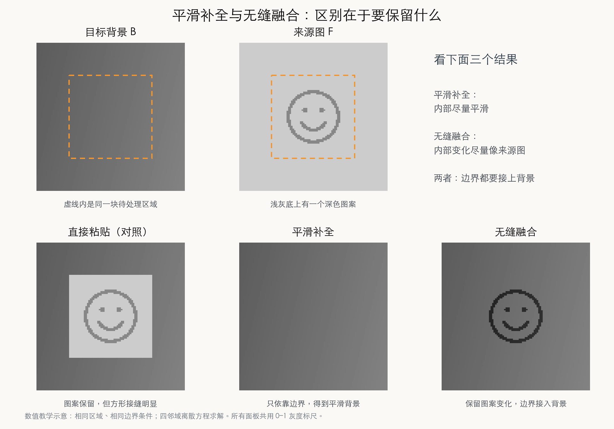
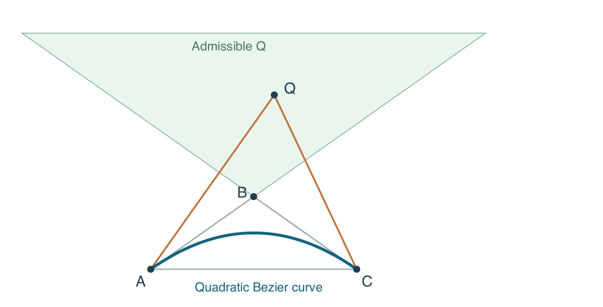

# 补充问答

## Q001 缩放倍数和 rate 有什么关系？

- 原始问题：那这个缩放倍数和 Rate 的关系是什么
- 原始提问日期：当前对话记录未提供，未补写。
- 整理日期：2026-10-12
- 出处：本对话中学习 Lab 1 超采样时的提问；主讲义第 11.3–11.4 节。
- 对应位置：11.3

### 解答

**缩放倍数决定一个输出像素对应输入图像中的多大范围；rate 决定在这个范围内取多少个样本。** 它们分别由尺寸和采样设置决定。

输入宽度为 100、输出宽度为 10 时，横向缩放倍数为 $100/10=10$。如果高度也缩小到十分之一，一个输出像素对应输入图上的一个 $10\times10$ 区域。

- `rate=1`：在这个区域的中心采一个样本。
- `rate=2`：把区域分为 $2\times2$ 份，在每份中心采样，共 4 次。
- `rate=10`：采 $10\times10=100$ 个样本，再平均成一个输出像素。

因此，**rate 等于 10 也不代表没有缩放**：输出仍然只有 10 像素宽。变的是每个输出像素汇总的样本数，不是输出尺寸。

样本落在输入像素之间时，先用双线性插值得到该位置的颜色；然后对所有样本颜色求平均。这是两个不同层次的计算。

## Q002 S、M、L 三类视锥分别是什么？波长响应范围重叠是什么意思？

- 原始问题：S、M、L 三类的波长响应范围重叠 展开说一下这三类
- 原始提问日期：2026-10-12
- 整理日期：2026-10-12
- 出处：本对话中阅读主讲义第 2.1 节时的提问。
- 对应位置：2.1 光谱为什么能用三个数来表示
- 核对来源：`ppt资料/02-color.pdf`，PDF 第 10、14 页（视锥类型与敏感度）；Stockman 与 Rider，[Formulae for generating standard and individual human cone spectral sensitivities](https://pmc.ncbi.nlm.nih.gov/articles/PMC10946592/)（响应曲线重叠及不同敏感度表述）。

### 解答

**S、M、L 是视网膜中三类视锥细胞，分别对短波、中波、长波更敏感。** 三类含有不同的感光色素，因此对不同波长的敏感程度不同。

这里的“更敏感”可以直观理解为：光的强度相同时，某些波长更容易使这一类细胞产生较强的响应。波长用 nm（纳米）表示；可见光中，紫、蓝一端的波长较短，红一端较长。

| 类型 | 名称含义 | 课件第 10 页列出的近似峰值 | 怎样理解 |
|:--|:--|:--|:--|
| S | Short，短波敏感 | 420 nm | 对偏紫、蓝的短波段更敏感 |
| M | Medium，中波敏感 | 534 nm | 对偏绿的中波段更敏感 |
| L | Long，长波敏感 | 564 nm | 峰值相对另外两类更靠近长波一侧，在黄绿附近；对红色长波光也有响应 |

**峰值表示“最敏感的位置”，不表示“只接收这个波长”。** 课件第 14 页另列了 419、531、558 nm。两页数值略有不同，这里分别保留出处，不把它们当成精确且唯一的生理常数。感光色素的吸收曲线和考虑眼内光学过滤后的整体敏感度也不是完全相同的曲线；当前先理解三类的相对位置即可。

### “响应范围重叠”具体是什么意思？

假设有一束波长约 530 nm 的绿色光进入眼睛，它通常会同时引起 M 类和 L 类的明显响应；S 类在这一波长的响应相对很弱。并不是 M 类收到光后，L 类就完全收不到。

可以把响应曲线想成三座位置不同、山坡互相交叠的山：横轴是波长，纵轴是敏感程度。在横轴上选定一个波长，向上看三条曲线，就会得到三种不同的敏感程度。尤其是 M、L 两条曲线，重叠很大。

这个“山”的说法只是帮助读图的比喻。严格说，重叠表示**同一个波长处，不止一类视锥的光谱敏感度显著大于零**；它描述的是波长响应，和细胞在视网膜上是否挤在一起是两回事。

### 为什么这样还能分辨颜色？

视觉系统会综合比较三类视锥的响应组合。例如，中波绿光和长波红光都可能刺激 M、L 两类，但刺激它们的相对程度不同，因此能提供辨色的信息。实际颜色感觉还受到亮度、适应状态和周围环境影响，不能仅凭“哪类响应最大”就直接给颜色命名。

因此，不宜把 S、M、L 当作三个分别只识别蓝、绿、红的探头。特别是 L 类，名称中的“长波”是相对另外两类而言，**不表示它最敏感的位置一定在红色区域**。

回到本节标题：在通常的明视觉三色模型中，一束光即使包含许多波长，也可以先概括成 S、M、L 三类各自的总体刺激量。这三个数保留了用于三色匹配的信息，却没有保存光谱的每个细节；不同光谱可能产生相同的三类刺激量。这些生理刺激量也不能直接当成屏幕 RGB 的三个通道值。


## Q003 怎样理解 RGB、CMYK 与“能表示更多颜色”？

- 原始问题：我觉得这份讲义很多地方说的太笼统了 很多地方我都很难理解 比如不是“CMYK 一定比 RGB 能表示更多颜色” 这个具体指的是什么 他们的区别 我不是说下一份讲义把这样一个具体问题解决就可以了 而是把类似的内容解释清楚 因为我的基础你可以理解为只做过lab1 对其他内容完全不了解 重新整理讲义 将网站和pdf整理好给我
- 原始提问日期：2026-10-12
- 整理日期：2026-10-12
- 出处：本对话对讲义第 2.2 节的反馈；颜色 PPT 的加色、减色与色域内容。
- 对应位置：2.2、2.4；此次同时据反馈展开全书的前置知识，不将问题局限于这一处。

### 解答

RGB 分别表示红、绿、蓝三个分量。屏幕通过基色光的组合产生颜色，光的贡献在相加，所以叫加色。CMYK 分别表示青、品红、黄、黑墨；普通纸上的油墨不主动发出图像的光，而是吸收入射光中的一部分，让剩余反射光进入眼睛，所以叫减色。

在理想模型里，青墨主要吸收红光，黄墨主要吸收蓝光，两者叠加主要留下绿光。三色充分叠加趋向黑，但真实油墨和纸张不理想，所以加黑墨 K 获得更实用的黑色。K 并不是一束独立的第四种彩色光。

“更多颜色”要先问是在数编码组合，还是在比较实际能覆盖的颜色范围。前者与通道、位数有关；后者叫色域，与基色定义、具体屏幕、油墨和纸张等有关。四个通道不自动比三个通道有更大的色域。因此打印用 CMYK 的核心原因是符合油墨吸光的机制，不能用“四比三多”解释。

主讲义现在先解释光如何到达眼睛，再介绍通道、加减色和色域；其他章节也补充首次出现的概念、公式含义和中间步骤。此记录不表示用户已经掌握这些知识。

## Q004 饱和度越低越接近黑色吗？S 为 0 时是什么颜色？

- 原始问题：这个饱和度越高，差异变得更大，那就是饱和度越高越鲜明，对吗？饱和度越低，越与黑色相同。那如果说饱和度为 0 的时候，那都是跟黑色没有区别，对吧
- 原始提问日期：2026-10-12
- 整理日期：2026-10-12
- 出处：本对话中阅读主讲义第 2.4 节时的提问。
- 对应位置：2.4 RGB、HSV、色域和色深
- 核对来源：主讲义第 2.4 节的 HSV 定义；`ppt资料/02-color.pdf` 的 HSV Color Space 部分；[Microsoft Learn：HSV Color Spaces](https://learn.microsoft.com/en-us/windows/win32/wcs/hsv-color-spaces)（零饱和度对应灰度）。

### 解答

**前半句基本对：在 HSV 中，保持色相 H 和明度 V 不变，且 V 不为 0，饱和度 S 越高，颜色通常越鲜明。需要改的是后半句：饱和度越低，越接近灰度颜色，不一定越接近黑色。**

H 表示红、绿、蓝等色相；S 表示彩色倾向有多强；V 是 RGB 三个通道的最大值。这里先把 RGB、S、V 都用 0 到 1 表示。

| 调节方式 | RGB | HSV 中的 S、V | 看到的颜色 |
|:--|:--|:--|:--|
| 从红色开始 | (1, 0, 0) | S=1，V=1 | 鲜红色 |
| V 保持 1，降低 S | (1, 0.5, 0.5) | S=0.5，V=1 | 浅红、粉红色 |
| V 保持 1，S 降到 0 | (1, 1, 1) | S=0，V=1 | 白色 |
| S 保持 0，降低 V | (0.5, 0.5, 0.5) | S=0，V=0.5 | 灰色 |
| V 降到 0 | (0, 0, 0) | 通常约定 S=0，V=0 | 黑色 |

**S 为 0 表示三个通道相等，不表示三个通道都等于 0。** 它们可以同时是 1，同时是 0.5，也可以同时是 0；分别对应白、灰、黑。

### “差异变大”指什么？

用 M 表示 RGB 中最大的通道值，m 表示最小的通道值。只要 M 大于 0，HSV 的定义就是

$$
V=M,\qquad S=\frac{M-m}{M}.
$$

所以，在 V 固定且不为 0 时，M 固定，S 越大就表示最大值与最小值的差越大。比如从 (1, 1, 1) 到 (1, 0.5, 0.5)，再到 (1, 0, 0)，差依次是 0、0.5、1，颜色从白变成粉红，再变成鲜红。它不是说任意两个通道之间的差都必须增加；这个例子里 G 和 B 始终相等。

当 S=0 且 M>0 时，分子必须为 0，所以最大值等于最小值，三个通道就都相等。但它们共同的大小仍由 V 决定。M=0 时三个通道全为 0，是黑色，公式会出现除以 0，因此常规 RGB 转 HSV 实现单独约定 S=0。

S=0 时没有唯一的可见色相；代码即使给 H 存了一个数，也不会因此让灰色变成彩色。另外，V 是这个模型的数值，不等于人眼感知的亮度：固定 V 的红色变白，看起来仍可能更亮。

- 表述澄清记录（2026-10-12）：将正文“通道之间的差别变大”明确为“固定且非零 V 下，最大与最小通道值的差变大”，并补充零饱和度下的白、灰、黑例子。

## Q005 色深是什么？8 bit、10 bit 和“分多少档”怎么理解？

- 原始问题：这里面的色深指的是什么 通俗解释一下
- 原始提问日期：2026-10-12
- 整理日期：2026-10-12
- 出处：本对话中阅读第 2.4 节时的提问及所附截图；截图内容为“色深 bit depth：在编码范围内分多少档？同一通道从 8 bit 增至 10 bit，等级由 256 增至 1024；范围未必扩大”。
- 对应位置：2.4 RGB、HSV、色域和色深 → 色域、色深、分辨率与 HDR 分别在问什么
- 核对来源：主讲义第 2.4 节；[Adobe：Bit depth in Photoshop](https://helpx.adobe.com/photoshop/desktop/adjust-color/color-modes/bit-depth-in-photoshop.html)（每通道位数、256 档与 RGB 组合数）。

### 解答

**色深可以理解成：给颜色的“调节旋钮”分了多少档。档位越多，颜色就能调得越细。** 这是帮助理解的比喻；实际记录的是每个像素各通道的数字。

先只想一张从黑到白的灰度图：

| 能记录的档数 | 可以选哪些灰度 |
|:--|:--|
| 2 档 | 黑、白 |
| 4 档 | 黑、深灰、浅灰、白 |
| 256 档 | 黑白之间有很多细微的灰色可选 |

假设要画一片慢慢变亮的天空，档数少时，相邻区域可能只能用明显不同的颜色，看起来像一条条色带；档数多时，可以记录更细的过渡，渐变更容易平滑。实际效果也取决于图像本身和显示条件，并非增加位数就一定能看出改善。

### 截图里的 8 bit、10 bit 是什么？

bit 是二进制位，每一位只能是 0 或 1。1 位有 2 种组合；2 位有 00、01、10、11，共 4 种组合。每多一位，可记录的组合数就翻倍。

用 b 表示位数，则可记录的档数是 $2^b$。因此：

- 8 bit：$2^8=256$ 档，完整的无符号整数编码是 0 到 255。
- 10 bit：$2^{10}=1024$ 档，完整的无符号整数编码是 0 到 1023。

彩色 RGB 有红、绿、蓝三个通道，相当于三个旋钮。截图说的是**每个通道**的位数：每通道 8 bit 时，红、绿、蓝各有 256 档，各选一档就组成一个像素的颜色。例如 (255, 0, 0) 是红色，(255, 128, 128) 是浅红、粉红色。

因此，“每通道 8 bit”不是整张彩色图只能有 256 种颜色。三个通道组合起来有 $256\times256\times256=16777216$ 种 RGB 编码；不计透明度时，每个像素共用 $8\times3=24$ bit，所以也会看到“24 位 RGB”这个说法。读题时要分清是每通道位数，还是每像素的总位数。

### 为什么说“范围未必扩大”？

想象同一把尺子，从只标厘米变成还标毫米：它能量得更细，却没有因此变长。类似地，在同样的颜色范围里，8 bit 变成 10 bit，可以只是把中间的档位分得更密，两端仍然不变。

所以，色深关注**能记录得多细**，色域关注**能覆盖哪些颜色**。色深高不表示颜色更深、更暗，也不自动表示饱和度更高。

## Q006 Gamma 中的 L、V 是什么？点处理为什么用幂函数？

- 原始问题：这里 `V` 是编码数值，`L` 是归一化线性亮度，`γ` 是指数。**解码**是从存储数字求光强，用 `Vγ`；**编码**是把线性光强转回存储数字，用 `V=L1/γ`。严格 sRGB 是分段传递函数，2.2 只是本节教学近似。这个所说的 L 就指的是光强，然后 V 指的这个编码数值，嗯，有什么实际的含义吗
- 原始提问日期：2026-10-12
- 整理日期：2026-10-12
- 出处：本对话中阅读主讲义第 2.5 节时的提问；原问题中的指数按原始文本保留，解答中用乘方形式排版。
- 对应位置：2.5 Gamma 不要只记“变亮”
- 核对来源：`ppt资料/02-color.pdf` 的 Gamma Correction 部分；主讲义第 2.5 节；[W3C：Specification of sRGB](https://www.w3.org/Graphics/Color/srgb.pdf)（整数编码归一化、逐通道转换及分段传递函数）。数值例子采用讲义的 2.2 近似。
- 追问原文：另一个容易混淆的用法是点处理 这个点处理指的是什么？我能理解这个数学的意思，但是我不太理解什么是点处理，为什么突然要乘一个 p 次方
- 追问日期：2026-10-12
- 追问核对来源：`ppt资料/04-image(1).pdf` 的 Image processing、Point processing 部分；主讲义第 4.1 节；[爱丁堡大学 HIPR2：Point Operations](https://homepages.inf.ed.ac.uk/rbf/HIPR2/pntops.htm)。

### 解答

**在本节的简化模型里，L 可以先理解为“实际光有多强”，V 则是“用哪个数字来记录它”。** 两者都能写成 0 到 1，但数值的含义不同。

先只看灰色像素，把参考白的线性亮度设为 1，并在这个理想化模型里把黑设为 0。这里“归一化”就是用参考值作为单位来表示比例。“线性”表示数值和相应的光量成正比，所以 L=0.5 是参考白一半的线性亮度；这不保证人眼主观感觉也恰好是“一半亮”。

### V 在实际图像中是什么？

上一问提到，常见的 8 bit 通道可以存 0 到 255。V 就是这类编码数字除以 255 后得到的数。

例如，一个灰色像素的 RGB 都是 128，取其中任一通道：

$$
V=\frac{128}{255}\approx0.502.
$$

这个数说明“编码值在 0 到 255 的范围里大约处于中间”。它本身不能说明物理发光强度也在中间，必须按约定的规则解释。

本节用指数 $\gamma=2.2$ 近似这个规则，解码是

$$
L\approx V^{2.2}.
$$

为方便手算，把 V 近似取为 0.5：$L\approx0.5^{2.2}\approx0.218$。也就是说，**编码值约在中间，对应的线性亮度却只有参考白的约 22%**。这里的 $V^{2.2}$ 是 V 的 2.2 次方，不是 V 乘以 2.2。

### 如果我想记录“一半的光量”呢？

这次已知 L=0.5，要反过来求 V，也就是编码：

$$
V\approx L^{1/2.2}=0.5^{1/2.2}\approx0.730.
$$

要存进 8 bit 通道，再乘以 255 并取整：$0.730\times255\approx186$。因此，按这个近似模型，要记录参考白一半线性亮度的灰色，RGB 应约为 (186, 186, 186)，而不是 (128, 128, 128)。取整会带来很小的误差。

可以按这个顺序理解：**想表示的线性光量 L → 编码 → 存储数值 V → 按同一规则解码 → 恢复对应的线性光量。** 编码后数字变大，不表示原来的光真的被增强了，只是换了一种记录方式。

### 本节的使用约定

- 这里的 V 是编码值，不是 HSV 中取最大通道值的那个 V，也不是电压单位。
- 上面先用灰度解释。对于彩色图像，要分别处理 RGB 通道，解码结果是线性 RGB 分量；整个像素的亮度需要再由这些分量计算。
- L 是相对参考值的线性量，不是屏幕每平方米发出多少亮度的绝对读数。实际显示结果还取决于显示设备和设置。
- 精确 sRGB 使用分段公式，上面的 0.218、0.730、186 都属于 2.2 幂函数近似的例子，不能当成精确 sRGB 转换结果。

- 表述澄清记录（2026-10-12）：正文明确灰度下 L 的含义、V 与 8 bit 存储值的关系，以及彩色通道解码值与整个像素亮度的区别；将符号含义移到公式之前。

### 追问：什么是点处理？为什么突然取 p 次方？

**点处理就是独立处理每一个像素：按选定的规则，只看它自己的原值，算出它的新值，不需要看邻居。** 这里的“点”是图像中的一个像素，不是说整张图只处理一个点。

例如，给整张灰度图定一条规则：“每个像素都开平方。”像素 A 原来是 0.25，就改成 0.5；像素 B 原来是 0.81，就改成 0.9。A 不用知道 B 是多少，B 也不用知道 A 是多少，各自在原来的位置改数值。相比之下，模糊通常需要把周围像素拿来一起平均，属于邻域处理。

“点处理”只规定计算时看哪些像素，**不规定一定使用哪条公式**。例如，把每个灰度值改成“1 减去原值”也属于点处理，效果是明暗反转。取 p 次方只是其中一种可选规则。

这里用 v 表示原灰度，范围是 0 到 1；p 是我们选定的正数，用来控制调整方式。选择幂函数 $v^p$ 的实际目的，是方便地调整中间灰度：

- $0<p<1$：中间值增大。例如 p=0.5，0.25 变成 0.5，按同样的显示规则会更亮。
- $p>1$：中间值减小。例如 p=2，0.25 变成 0.0625，按同样的显示规则会更暗。
- $p=1$：原值不变。

这条规则还有几个方便之处：p 大于 0 时，纯黑的 0 仍是 0，纯白的 1 仍是 1，结果不会跑出 0 到 1；原来较亮与较暗像素的先后顺序也保持不变。因此，它适合用作一种可调的灰度变换。这里是“取 p 次方”，不是“乘以 p”，也不是重复处理 p 遍。

**讲义突然提它，是要区分同样的乘方运算在不同场景中的目的。** 前面编码、解码是按约定转换同一个光量的表示；这里则是在输入、输出编码约定相同的前提下，主动修改像素，让图像外观改变。p 是这个例子里的调整参数，不要求等于 2.2。

从实现方式看，编码、解码同样可以逐像素独立进行，也属于点处理。所以“点处理”和“编码”不是互相排斥的类别：前者讲计算依赖，后者讲计算目的。

- 更正与补充记录（2026-10-12）：在正文首次使用“点处理”前解释像素独立变换，并说明选择幂函数的目的；将调亮条件从笼统的“p<1”收紧为“0<p<1”，确保包含黑端点的 0 到 1 灰度范围内定义有效。

## Q007 索引色怎样查表？两种存储量公式怎样计算？

- 原始问题：**索引色**像给颜色编号码：每个像素只存一个 0 到 255 的编号，另一张表说明“17 号对应哪个 RGB”。我可以理解为，就是说有一张表上，比如说这个 17 号这个位置的 R，比如这个红色吧，它是 255，那么它对应的 RGB 应该是多少？就比如说红色是 255，绿色是 255，蓝色是 255，然后那个另外一张表上对应着这三个 255 应该对应哪个 RGB 吗？还是什么意思
- 原始提问日期：2026-10-12
- 整理日期：2026-10-12
- 出处：本对话中阅读主讲义第 3.2 节时的提问。
- 对应位置：3.2 帧缓存与存储题
- 核对来源：`ppt资料/04-image(1).pdf` 的 Color Image Storage: Colormaps (LUT’s) 页面；主讲义第 3.2 节。以下颜色编号为说明原理而设定的例子。
- 追问原文：若用 8 bit 索引和 256 项 RGB8 调色板，总大小为 `WH+256×3` Byte，而非 `3WH`。课件中“96 bit/像素”的例子是 `(24+8+16)×2`：24 bit RGB、8 bit alpha、16 bit 深度，按两套完整缓冲计算。**这只是给定配置，不是所有系统固定采用 96 bit。** 文件经过压缩后，也不能用这个公式直接推断磁盘文件大小。 这两个计算讲一下
- 追问日期：2026-10-12
- 追问核对来源：`ppt资料/04-image(1).pdf` 的 Color Image Storage: Full-color (RGB)、Colormaps (LUT’s) 与 Deeper framebuffers 页面；后者明确写出两套缓冲都包含 alpha 和 z。

### 解答

**像素里存的是“颜色编号”，颜色表里存的是“完整的 RGB 三个数”。** 这三个数本身就是 RGB，不需要再用另一张表把它们转换成 RGB。

例如，我们规定一张颜色表，其中几个条目是：

| 颜色编号 | R | G | B | 显示颜色 |
|:--|:--|:--|:--|:--|
| 0 | 0 | 0 | 0 | 黑色 |
| 17 | 255 | 0 | 0 | 红色 |
| 18 | 255 | 255 | 255 | 白色 |
| 19 | 255 | 255 | 0 | 黄色 |

某个像素如果存着 17，显示时就去找颜色表里编号为 17 的条目，读出这一行完整的三个数 (255, 0, 0)，把该像素显示为红色。

**像素存 17 → 查颜色表的 17 号条目 → 得到 RGB=(255,0,0) → 显示红色。**

你说的“红色是 255，绿色是 255，蓝色是 255”，写成三元组就是 RGB=(255,255,255)，它表示白色。上面的表把白色编成 18 号，所以想显示白色的像素存 18 即可。

这里容易混淆的是：**17 号条目保存一整组 RGB，不是只保存 R。** 只知道 R=255 还不能确定颜色，要同时知道 G 和 B。例如 (255,0,0) 是红，(255,255,255) 是白，虽然它们的 R 都等于 255。

整幅图像有两部分：

- **像素编号数组**：按照图像的位置排列。例如某一行三个像素存的是 17、18、17。
- **一张共享的颜色表**：告诉我们各个编号对应哪组三通道值。查上表后，这一行就显示为红、白、红。

颜色表也叫调色板或 LUT（查找表）。多个红色像素都可以存 17，共享表里同一组 RGB，而不必在每个像素位置重复存三通道值。编号与颜色的对应关系由具体调色板决定；换一张表，17 号也可以表示蓝色。这里的 0 到 255 是使用 8 bit 索引的例子，并非所有索引色都固定使用 8 bit。

- 表述澄清记录（2026-10-12）：正文增加完整的“编号 → RGB”例子，并明确 0 到 255 的编号范围以 8 bit 索引为前提。

### 追问：WH＋256×3 Byte 是怎么来的？

先记住：W 是图像的宽，H 是高，WH 是像素个数；8 bit 等于 1 Byte。这里分别计算“像素编号数组”和“一张共享调色板”的大小。

| 保存的内容 | 有多少个 | 每个多大 | 总大小 |
|:--|:--|:--|:--|
| 像素编号 | WH 个 | 8 bit，也就是 1 Byte | WH Byte |
| 调色板中的 RGB 颜色条目 | 256 项 | R、G、B 各 8 bit，共 3 Byte | 256×3=768 Byte |

两部分相加，得到

$$
\text{总大小}=WH\times1+256\times3=WH+768\quad\text{Byte}.
$$

**调色板只存一份，供所有像素共享。** 如果一万个像素都使用 17 号颜色，这一万个像素分别存编号 17，而 17 号对应的 RGB 仍只在调色板里存一次。

$3WH$ Byte 是直接 RGB8 的另一种存法：每个像素自己存完整 RGB，一共 3 Byte，WH 个像素就是 3WH Byte。它没有通过编号查调色板这一层。

例如图像宽、高都是 100，有 10000 个像素：8 bit 索引加完整的 256 项 RGB8 调色板占 10000+768=10768 Byte；直接 RGB8 占 3×10000=30000 Byte。这只是按给定存法计数；索引图使用这张表时最多选择其中 256 个颜色条目，并不是可以无损替代任意颜色数量的 RGB 图像。

### 追问：(24＋8＋16)×2＝96 bit/像素 是怎么来的？

这次计算的是另一种配置：为显示和绘制图像，在每个像素位置保存颜色、alpha 和深度，并准备两套完整缓冲。第一步先数一套需要多少：

| 一套缓冲中保存的内容 | 每个像素位置所占 bit | 换成 Byte | 用途 |
|:--|:--|:--|:--|
| RGB | 24 | 3 | 保存颜色 |
| Alpha | 8 | 1 | 保存不透明度等合成信息 |
| 深度 z | 16 | 2 | 比较前后遮挡 |
| 合计 | 48 | 6 | 三部分相加 |

第二步再数套数。双缓冲可以理解为：一套正在显示，另一套在后台绘制下一幅画，画好后交换角色。**课件这个例子明确两套都包含 RGB、alpha 和深度**，因此每个像素位置对应的总存储量为

$$
(24+8+16)\times2=96\quad\text{bit}=12\quad\text{Byte}.
$$

整幅图有 WH 个位置，所以两套缓冲的总大小是 $12WH$ Byte。还是以 100×100 为例，一套占 10000×6=60000 Byte，两套占 120000 Byte。

这里的“96 bit/像素”是把两套缓冲的各类数据都算进来的存储开销，**不是说 RGB 颜色本身用了 96 bit**。不要把第一个公式的索引、调色板再自动加进来：这两个例子给定的是不同的存储配置。

这些公式计算的是给定布局下的数据量，不计文件头、行对齐等额外因素，也不能直接当成压缩后图片的磁盘大小。其他系统可能采用不同位数或共享某些缓冲，不能见到“双缓冲”就不看题目条件把所有数据乘 2。

## Q008 Sobel 怎么算？权重 2、方向与幅值是什么意思？有哪些用途？

- 原始问题：Sobel 横向核可按“右列加权和减左列加权和”读，中间一行权重为 2；它在做方向差分时，也对另一个方向作了加权平滑。若左列全 0、右列全 1，则 `Gx=(1+2+1)−0=4`。上下相同，`Gy=0`，幅值就是 4。幅值表示强弱，符号则能区分从暗到亮还是从亮到暗。这里是怎么计算的？还有sobel的作用是什么 在什么场景下应用
- 原始提问日期：2026-10-12
- 整理日期：2026-10-12
- 出处：本对话中阅读主讲义第 4.3 节时的提问。
- 对应位置：4.3 Sobel：两个方向的差分
- 核对来源：`ppt资料/04-image(1).pdf` 的 Examples: edge filter 页面；主讲义第 4.3、4.4 节；[爱丁堡大学 HIPR2：Sobel Edge Detector](https://homepages.inf.ed.ac.uk/rbf/HIPR2/sobel.htm)。以下 3×3 数字和纸张场景为教学例子。
- 追问原文：edge和sobel分别在什么情况下使用
- 追问日期：2026-10-12
- 追问核对来源：`src/VCX/Labs/1-Drawing2D/tasks.cpp` 的 Edge 实现（中心 8、八邻居 -1、逐通道取绝对值并裁剪）；[爱丁堡大学 HIPR2：Laplacian/Laplacian of Gaussian](https://homepages.inf.ed.ac.uk/rbf/HIPR2/log.htm)（二阶差分的边缘用途与噪声敏感性）。

### 解答：Sobel 先在找什么？

**Sobel 用来估计图像在左右、上下方向的灰度变化，变化明显的位置常常对应边缘。** 例如黑色背景上有一个白色方块，背景内部全黑、方块内部全白，都没有太大变化；从背景跨到方块的交界处，灰度明显改变，就容易产生较大的 Sobel 响应。

它不是只看当前像素亮不亮。一个全白区域虽然很亮，但邻近像素都一样，方向差分仍然是 0。

### 怎样算出 4 和 0？

先定义符号：A 是当前中心像素附近的 3×3 灰度块；Kx、Ky 是两个核，也就是权重表；Gx、Gy 是按这两个表分别算出的左右、上下变化响应。0 表示黑，1 表示白。

给出一个满足讲义条件的完整例子：

$$
A=\begin{bmatrix}0&0.5&1\\0&0.5&1\\0&0.5&1\end{bmatrix},\qquad
K_x=\begin{bmatrix}-1&0&1\\-2&0&2\\-1&0&1\end{bmatrix}.
$$

把 A 和 Kx 对应位置相乘，再把九项相加。逐行看：

- 上行：$(-1)\times0+0\times0.5+1\times1=1$。
- 中行：$(-2)\times0+0\times0.5+2\times1=2$。
- 下行：$(-1)\times0+0\times0.5+1\times1=1$。

所以 $G_x=1+2+1=4$。中间一列乘的权重都是 0，因此对 Gx 没有直接贡献。把正项、负项分开看，同一个计算就是

$$
G_x=(1+2\times1+1)-(0+2\times0+0)=4.
$$

竖直核采用课件的“上行减下行”约定：

$$
K_y=\begin{bmatrix}1&2&1\\0&0&0\\-1&-2&-1\end{bmatrix}.
$$

中间一行的权重都是 0。上、下两行的加权和分别是：

- 上行：$0+2\times0.5+1=2$。
- 下行：$0+2\times0.5+1=2$。

因此 $G_y=2-2=0$。这说明这个例子有左右变化，但上下没有变化。仅知道左列全 0、右列全 1，还需给出上、下行中间像素的关系，才能确定 Gy；本例将两者都设成 0.5。

G 表示合并两个方向后的变化强度，也叫梯度幅值，计算为

$$
G=\sqrt{G_x^2+G_y^2}=\sqrt{4^2+0^2}=4.
$$

这里算出的是**中心位置的一个结果**。要处理整张图，再把这个 3×3 窗口移到其他位置，重复计算；图像边界处还要按题目约定处理。

### 为什么中间权重是 2？“另一个方向平滑”是什么意思？

Sobel 横向核不是只看中间一行的左右差，而是把上、中、下三行的左右差按 **1、2、1** 汇总，中间一行更靠近当前中心位置，贡献更大。它把附近几行的信息合起来，减少对单行扰动的依赖。

这正是“沿左右方向做差分，同时沿上下方向加权平滑”。把 1、2、1 除以总和 4，就是 1/4、1/2、1/4 的加权平均；本节用整数核，省略了这个缩放，所以响应值也放大了。1、2、1 是 Sobel 的既定设计，不是任何差分都必须使用这组数。平滑也不能保证完全去除噪声。

### 方向、符号和 4 的含义

- Gx 测量左右变化，所以对**竖直边缘**敏感；不要把“横向差分”误解成只找横着的边。
- 按这里“右减左”的核，Gx 为正表示加权比较后右边更亮；黑白对调则得到 Gx=-4，但幅值仍是 4。核若整体换号，响应符号也会换号。
- 4 是原始滤波响应，可以超出输入的 0 到 1 范围。手算时保留它；若要显示为图像，再单独做适当缩放等处理。
- 本例按核原样逐项乘加，属于互相关约定；若题目要求严格卷积，需要按定义翻转核，并留意方向响应的符号。幅值不受核整体换号影响。

### 哪些场景会用到它？

1. **边缘与轮廓定位。** 例如白纸放在深色桌面上，可以先用 Sobel 得到变化强度图，再挑选较大的响应，为寻找纸张边界提供线索。
2. **分割或测量之前提取线索。** 例如寻找零件边界，为后续分开物体与背景、测量尺寸做准备；Sobel 本身不会直接给出物体类别或尺寸。
3. **图像边缘效果。** 把较强响应显示得亮、较弱响应显示得暗，可以生成突出线条的效果图。

它检测的是灰度变化，阴影、纹理和噪声也可能响应，因此结果不一定就是干净的物体轮廓。你的 Lab 1 中 Edge 使用的是另一种八邻域二阶差分型核，不等于 Sobel；题目要求 Sobel 时，按这里的两个核计算。

- 表述澄清记录（2026-10-12）：正文补齐原示例的 3×3 灰度块，明确 Gy=0 需要上、下行加权和相等，并区分方向响应、幅值与显示用像素值。

### 追问：Edge 和 Sobel 分别在什么情况下使用？

**两者都可以突出边缘，选择主要取决于想测量什么，而不是画面里是什么物体。** 这里的 Edge 专指 Lab 1 中的函数，不是所有边缘检测算法的统一名称；Sobel 本身也是一种边缘检测方法。

| 想解决的问题 | 更直接的选择 | 原因与用途 |
|:--|:--|:--|
| 哪些地方发生明显变化，变化朝哪个方向？ | Sobel | 分别得到左右、上下变化，可求强度和方向，供轮廓定位、边缘方向分析使用 |
| 哪些位置比周围明显更亮或更暗？ | Lab 的 Edge | 比较中心和八邻居平均，可突出局部亮点、暗点、细线和突变，生成局部差异效果图 |
| 只想大致突出物体边界 | 两者都可以尝试 | 都会对边界附近的变化响应，但结果形态与噪声影响不同 |
| 课程题或 Lab 指定某种核 | 按指定核计算 | 不能因为都能突出边缘就互相替代 |

例如寻找纸张或零件轮廓，还需要知道边缘方向时，Sobel 提供的两个分量很有用。它比较的是一侧与另一侧，近似一阶导数。Lab 的 Edge 则近似二阶差分：把中心与周围整体比较；暗背景中的孤立亮点会有明显响应，但不能据此认定那一定是真实细节，也可能是噪点。

可以直接比较前面算过的灰度块：三行都是 (0, 0.5, 1)。

- Sobel 在中心给出 Gx=4、Gy=0：**左右确实不同**。
- Lab 的 Edge 在中心给出 $8\times0.5-4=0$：八邻居之和是 4，平均是 0.5，**中心正好等于周围平均**。

所以同一个位置，一个有响应、另一个没有响应，并不矛盾。前者测量两侧的变化，后者测量中心相对周围的偏离。

实际代码中，Lab Edge 对 RGB 每个通道分别计算，然后取绝对值并裁剪到 0 到 1。最后这张效果图不提供 Sobel 那样的 Gx、Gy 方向分量，也不保留原始响应的正负号。二阶差分通常对噪声敏感，实际应用常先平滑；这个 Lab 实现没有先平滑，不能当成已经包含降噪的完整轮廓检测流程。Sobel 自带另一个方向上的加权平滑，但也不能保证排除噪声和纹理。

## Q009 准备第一次测试，第 4.7 节需要掌握到什么程度？

- 原始问题：这一部分如果说是准备第一次测试的话需要掌握吗
- 原始提问日期：2026-10-13
- 整理日期：2026-10-13
- 出处：本对话中阅读第 4.7 节“卷积的完整定义与有限图像下标”时的提问。
- 对应位置：4.7；关联第 4.1–4.6 节的滤波手算与边界处理。
- 核对来源：`往年题/小测复习/第一次测试/Quiz_Review_01.md` 的“图像滤波—卷积”部分；`往年题/小测复习/第一次测试/25秋测试一无答案.pdf`，PDF 第 2 页第三大题第 1 题；主讲义第 4.7 节。已直接检查往年卷扫描页。

### 解答

**要掌握基础概念，但不必把这一节的每个公式都按“必须熟练推导、必须背诵”的强度复习。** 当前更值得优先练熟的是前面几节的滤波手算，不建议因为通用下标公式很长而一直卡在这里。

### 这个判断依据什么？

现有复习笔记确实列出了连续卷积、离散卷积以及有限图像下标公式，所以不能直接把整节视为考试范围之外。

25 秋卷第三大题第 1 题的滤波部分共 20 分，具体要求是：

- 8 分：解释模糊滤波、边缘滤波的原理，比较应用场景。
- 6 分：设计一个 3×3 模糊滤波器，计算给定图像块滤波后的中心像素。
- 6 分：使用 Sobel，计算同一个图像块中心位置的梯度幅值。

**这道往年题直接考的是理解和具体手算，没有要求连续积分计算或通用求和上下界推导。** 这能指导复习顺序，但不能据此断言今年不会考其他内容；目前没有据此确认今年教师的具体命题要求。

### 建议掌握到什么程度？

| 优先级 | 内容 | 建议达到的程度 |
|:--|:--|:--|
| 优先练熟 | 核与图像块的逐项乘加；均值、高斯近似、Sobel | 给出 3×3 数字时，能写出核、算出中心值或两个方向响应及幅值，并解释用途 |
| 基础概念要理解 | 卷积与互相关的区别 | 知道一维翻转、二维旋转 180°；不是只转置；中心对称核翻转后不变 |
| 定义要能读懂 | 连续积分与离散求和式 | 知道哪个是输入、哪个是核、哪个是输出位置，求和变量在遍历什么；离散二维式尽量能自己写出并解释 |
| 边界处理要会判断 | 下标越界、补零与复制边界 | 知道负下标不能直接访问，能按题目给的规则处理一个具体边角例子 |
| 基本性质先记含义 | 交换律、结合律、分配律 | 知道分别在交换、合并或拆开什么，不急于证明；不要把交换律误解成输出图像左右对称 |
| 可以后置 | 连续卷积的复杂积分、性质证明、任意尺寸核的 max/min 上下界推导与背诵 | 第一轮先知道上下界是在保证图像和核的下标同时合法，基础手算熟悉后再补 |

如果目前是那串 max/min 公式看不进去，可以先记住：“图像下标必须合法，核下标也必须合法，所以求和范围取两者的交集”，然后继续往后学。先能独立完成第 4.5 节一类中心像素计算，再回头细看通用公式，会更容易建立联系。

以上是基于已有材料给出的复习优先级，不是对今年考试范围的保证，也不表示用户已经掌握表中的内容。

## Q010 平滑补全与无缝融合的区别是亮度吗？图像效果有什么不同？

- 原始问题：平滑补全和无缝融合的区别是亮度不同吗 介绍一下在图像显现上的区别
- 原始提问日期：2026-10-13
- 整理日期：2026-10-13
- 出处：本对话中阅读第 5.2 节时的提问；附图并列展示平滑补全与无缝融合的优化目标和相同的背景边界条件。
- 对应位置：5.2 优化目标、边界条件和方程
- 核对来源：`ppt资料/04-image(1).pdf` 的 Image Inpainting、Poisson Editing 部分；主讲义第 5.2–5.3 节；[MIT Computational Photography：Poisson image editing](https://people.csail.mit.edu/fredo/comp-photo-book/05-edges-matter-01-poisson-image-editing.html)。
- 示意图来源：本地生成的合成灰度图，使用相同处理区域和背景边界，分别求解四邻域离散平滑补全与源梯度引导的融合方程；不是实拍效果承诺。生成脚本为 `work/qa-q010/make_comparison.py`，数值校验记录为 `work/qa-q010/verification.json`。

### 解答

**主要区别是填入区域要不要保留来源图的纹理和形状，并不只是亮度不同。** 两种方法都要与背景边界接上，但对区域内部的要求不同。



先看上排：左边是目标背景，橙色虚线圈出待处理区域；右边的来源图有一个笑脸图案。背景比来源图的底色暗。

再看下排三个结果：

- **直接粘贴**：将来源区域的像素原样搬过来，笑脸在，但浅色方块的边界也很明显，像贴了一张纸。
- **平滑补全**：不读取来源图的笑脸，只根据背景边界把区域内部平滑地填满。因此得到连续的灰色背景，没有笑脸。
- **无缝融合**：参考来源图的变化，尽量留下笑脸的圆圈、眼睛和嘴，同时让区域边界与背景相接。图案还在，浅色方块的接缝在这个例子中消失了；图案的绝对灰度也随之改变。

这张图由给定公式的离散版本实际求解，并非把粘贴结果的边缘手动模糊。平滑补全没有使用来源图，融合使用了来源图的梯度；所有面板使用同一灰度标尺，便于比较。

### 对应到截图里的公式

U 是最终填入区域的图像，F 是来源图，B 是目标背景；梯度描述相邻位置怎样变化，边界条件要求区域边缘与 B 一致。

- 平滑补全压低 U 自身的梯度，意思是：**内部尽量平滑，不凭空制造明显变化。**
- 无缝融合压低 U 的梯度与 F 的梯度之间的差异，意思是：**内部的变化尽量像来源图。** 花瓣、五官和纹理等细节都包含这样的变化。

因此，融合可以允许整体明暗改变，却尽量保留邻近像素的明暗差。例如来源灰度从 0.6、0.7、0.9 变成 0.3、0.4、0.6，绝对值变暗，但相邻差值仍是 0.1、0.2，原来的变化模式没有丢掉。实际调整不一定处处减去同一个常数，取决于边界与来源内容。

### 在真实画面中怎样理解？

平滑补全适合拿平滑背景的小缺口作直观例子：灰墙上的小缺损补完后，希望看不出洞；如果缺的是人脸的眼睛或复杂砖纹，这个简单模型没有足够信息恢复原来的内容，结果可能显得平滑、模糊或缺少结构。这里说的是截图里的平滑模型，不代表所有图像修复算法都只能这样做。

无缝融合适合拿“把另一张图里的花朵或人脸区域贴入当前图”作例子：既希望来源内容仍可辨认，又希望没有突兀的剪贴接缝。它保留的是来源的变化线索，不保证所有颜色原样不动，也不能保证任意两张图片融合后都自然。

**平滑补全也不一定得到纯色**：边界各处颜色不同，内部可以是平滑渐变。两者在某些输入下甚至可以得到相同结果，例如来源图在相关区域是常量、梯度为零时，融合的目标就退化成平滑补全。可见它们的根本区别是目标不同，而不是结果一定有某个亮度差。

## Q011 五点差分这一节在做什么？意义是什么？

- 原始问题：这一节没明白在干什么 意义是什么
- 原始提问日期：2026-10-13
- 追问原文：最后恢复 `U=F+g`。所以 `g` 不是最终颜色，可以为负；边界必须是 **背景减前景**。例如背景 0.2、前景 0.5，修正量为 `−0.3`，加回前景才得到 0.2。解释这一句
- 追问日期：2026-10-13
- 后续追问原文：这个内部迭代和五点差分法很像 是吗
- 后续追问日期：2026-10-13
- 整理日期：2026-10-13
- 出处：本对话中阅读第 5.3 节“五点差分与符号”时的提问。
- 对应位置：5.3；关联 5.2 的优化目标与 5.4 的 Lab 迭代。
- 核对来源：`ppt资料/04-image(1).pdf` 第 62–67 页的连续到离散、网格有限差分、离散拉普拉斯与边界条件（核对已有课件文本提取稿）；主讲义第 5.2–5.4 节；`src/VCX/Labs/1-Drawing2D/tasks.cpp` 的 `Inpainting` 实现。

### 解答：把“想要什么效果”变成“像素应该填多少”

**第 5.2 节提出图像处理要求，第 5.3 节把要求写成每个像素的方程，第 5.4 节再让电脑算出这些像素的值。** 因此，五点差分是从数学模型走到程序计算的中间一步。

上一节的公式把图像看成连续变化的函数，用导数描述变化。但电脑里的图像是一格格的像素。有限差分就是用相邻像素值的加减，近似导数，把连续方程改写成网格上的算式。

### 先用一个待填像素理解“五点”

先看灰度图：0 表示黑，1 表示白。令 U 表示中心待填像素的灰度，四个邻居已经知道：

```text
        0.2
   0.4   U   0.6
        0.8
```

中心加上、下、左、右，一共五个点，所以叫“五点”。这里没有用四个斜角。

上一节平滑补全要求拉普拉斯为零。拉普拉斯记作 $\Delta U$，是横向与纵向二阶导数之和；本节用“五点算式”近似它。像素间距取 1 时，离散方程为：

$$
0.2+0.4+0.6+0.8-4U=0.
$$

移项得到：

$$
U=\frac{0.2+0.4+0.6+0.8}{4}=0.5.
$$

**图像上的意思是：让中心取周围的平均，避免它相对邻居突然凸出一个过亮或过暗的点。** 这是当前平滑补全模型离散后的条件，不是所有图像的像素都必须满足的规律；也不意味着整块区域都要变成同一种灰度。

### 一个洞里有很多像素时怎么办？

上面的例子只有一个未知量，所以一次平均就能求出。实际缺损里可能有成百上千个未知像素：计算中心时，旁边的像素也还不知道。

这时就要给**每个未知像素写一个方程**，要求它们同时满足各自的邻居关系；洞周围已经知道的背景值作为固定边界。把这些方程放在一起，就是线性方程组。可以直接求解，也可以先给内部一个初值，再固定边界、反复更新内部，逐渐逼近解。它不是对一张完整图只做一遍均值模糊。

正文里的矩阵与求和符号，正是在整理这件事：**未知像素放在等号左边，已知边界及其他已知项放在右边。** 它们没有另外引入一种修复目标。

### 无缝融合也用这套方法吗？

用的是同一个五点差分模板，但方程的要求不同。令 F 表示来源图，U 表示融合结果：

- 平滑补全要求 $\Delta U=0$，离散后中心等于四邻居平均。
- 无缝融合要求 $\Delta U=\Delta F$，来源图提供已知的变化信息，最终颜色通常不能直接写成四邻居平均。

第 5.4 节的 Lab 把未知量换成修正量 $g=U-F$，即“在来源颜色上加多少”。这样内部满足 $\Delta g=0$，才可以反复平均 g；最后用 $U=F+g$ 恢复颜色。因此，Lab 平均的是修正量，不是直接把来源图的纹理平均掉。

### 标题里的“符号”在提醒什么？

例如平滑补全的“邻居之和减四倍中心等于 0”，也能写成“四倍中心减邻居之和等于 0”。两式等价，只是整体乘了 −1。有来源项或已知边界项时，同样必须把等号两边整体变号，不能只改左边。这是在保证整理后的方程仍表示同一个问题。

阅读顺序可以先抓住：**要算洞里的像素 → 用五点差分给每个像素列方程 → 加上已知边界 → 解方程得到补全或融合结果。** 再回头看二阶差分如何推导、下标与矩阵如何整理，会更容易知道每一步的用途。

### 追问：为什么恢复 U=F+g？为什么 g 能为负，边界要用背景减前景？

**g 表示“在原来的前景颜色上加多少”，不是颜色本身。** F 是来源图（前景）原来的颜色，U 是融合后的颜色，B 是对应位置的背景颜色。这里定义 $g=U-F$，移项就是 $U=F+g$：原来的颜色加上调整量，得到最后的颜色。

先用灰度说明，0 表示黑，1 表示白。在与背景接触的边界上，前景原来是 $F=0.5$，背景是 $B=0.2$。为了接上背景，要求这个边界点最终成为 $U=0.2$。因此：

$$
g=U-F=B-F=0.2-0.5=-0.3.
$$

最后加回前景：

$$
U=F+g=0.5+(-0.3)=0.2.
$$

**负号表示调暗，并不表示负的颜色。** 就像余额 50 元，变动金额可以是 −30 元，最后余额是 20 元；变动金额与余额是两回事。反过来，如果原来为 0.2、需要变成 0.5，修正量就是 +0.3，表示调亮。RGB 图像对三个通道分别加对应修正量，每个通道的修正量可以不同。

“背景减前景”的顺序由这里 $g=U-F$ 的定义决定：边界上要求 $U=B$，因此 $g=B-F$。如果误写成前景减背景，本例会得到 +0.3，加回前景变成 0.8，就接不上背景的 0.2 了。

**这个直接用 B−F 确定修正量的要求只用于边界。** 内部的 g 通过固定边界、反复取四邻居平均求出，最后各自加回前景；不能把整个区域的 g 都直接设成 B−F，否则最后整块都会变成背景，来源内容也就被抹掉了。

Lab 代码先在边界计算 `inputBack - inputFront`，最后用 `g[...] + inputFront.At(x, y)` 写入结果，正好对应上述两步。

### 追问：内部迭代和五点差分法很像，是吗？

是的，它们直接连在一起：**内部迭代的四邻居平均规则，就是由五点差分方程移项得到的。** g 是颜色修正量，内部要求它的拉普拉斯为零。用五点差分离散后：

$$
g_{\text{上}}+g_{\text{下}}+g_{\text{左}}+g_{\text{右}}-4g_{\text{中心}}=0.
$$

移项就得到：

$$
g_{\text{中心}}=\frac{g_{\text{上}}+g_{\text{下}}+g_{\text{左}}+g_{\text{右}}}{4}.
$$

但内部邻居的值也没有确定，因此程序先给内部初值，再用邻居当前的数值更新中心；邻居随后也会更新，所以还要继续下一轮。边界始终固定，内部逐渐逼近同时满足所有这些方程的结果。一次更新满足当前使用的邻居关系，不代表所有像素已经同时满足方程。

**五点差分负责列出方程，内部迭代负责求解这些方程。** 五点差分本身不是某一种迭代算法；Lab 使用的是原地更新的 Gauss–Seidel 型迭代。这里迭代的是修正量 g，最后才通过 $U=F+g$ 恢复颜色。

## Q012 准备第一次测试，5.5、5.6 必须理解哪些内容？

- 原始问题：5.5 5.6我必须理解哪些内容 对我必须理解的加以解析
- 原始提问日期：2026-10-13
- 整理日期：2026-10-13
- 出处：本对话中阅读第 5 章时的提问；按此前准备第一次测试的目标安排复习优先级。
- 对应位置：5.5 合成与抠图；5.6 从一阶差分到方程组。
- 核对来源：主讲义第 5.5–5.6 节；`往年题/小测复习/第一次测试/Quiz_Review_01.md` 的图像编辑、图像分割与抠图；`ppt资料/04-image(1).pdf` 的差分、线性方程组、Jacobi、Matting 和蓝幕部分（核对已有文本提取稿）；`往年题/小测复习/第一次测试/25秋测试一无答案.pdf` 第 2 页第三大题第 2 小题（检查扫描页）；Lab 1 `tasks.cpp` 的 `Inpainting` 实现。

### 复习优先级与依据

**5.5 要会解释合成与抠图、会做简单计算；5.6 要能把“五点差分 → 方程组 → 迭代求解”连起来。** 不需要一开始就钻大型矩阵分解或收敛证明。

原复习笔记包含这两节知识。25 秋卷图像修复题共 10 分，其中 6 分要求描述无缝融合目标并写出优化目标与边界条件，4 分要求写二维拉普拉斯的离散表达式。该小题没有要求大型矩阵求解，也没有考蓝幕计算；但不能据此排除今年考查抠图等其他内容。以下是基于现有材料的复习建议，不是教师公布的必考清单，也不表示用户已经掌握。

### 5.5：理解 alpha，并能计算一次合成

F 是前景原来的颜色，B 是背景颜色，C 是混合后的颜色，alpha 是前景贡献的权重。对本节直通颜色、背景不透明的模型：

$$
C=\alpha F+(1-\alpha)B.
$$

- alpha=1：只看到前景，C=F。
- alpha=0：只看到背景，C=B。
- alpha=0.25：25% 前景加上 75% 背景。

例如灰度 $F=0.8,B=0.2,\alpha=0.25$，则 $C=0.25\times0.8+0.75\times0.2=0.35$。RGB 三个通道分别这样算，共用这个像素的 alpha。前景不透明时，其颜色仍可能是黑的；alpha 描述贡献比例，不是灰度或亮度。

### 5.5：合成与抠图的方向相反，抠图为什么需要额外信息？

**合成是知道原料和比例，求混合结果；抠图是拿到混合结果，反过来估计前景及其 alpha。** 一般模型里，每个像素只有 RGB 三个观测，却有前景三个通道、背景三个通道和一个 alpha，共七个未知量。

同一个灰度 0.5，可以来自不透明的 0.5 灰，也可以来自白色前景与黑色背景各占一半。因此，仅凭该像素无法唯一倒推，需要已知背景、前景标注或其他假设。

### 5.5：能读懂蓝幕假设，算出 alpha 和前景颜色

小写下标 r、g、b 分别表示红、绿、蓝通道。课程简化模型假设背景已知且纯蓝，即 $B=(0,0,B_b)$、$B_b\ne0$，同时前景没有蓝分量，即 $F_b=0$。代入合成式得到：

$$
C_r=\alpha F_r,\qquad C_g=\alpha F_g,\qquad C_b=(1-\alpha)B_b.
$$

拍到的蓝色全部来自背景，所以 $C_b/B_b$ 是背景贡献比例；用 1 减去它就是前景比例：

$$
\alpha=1-\frac{C_b}{B_b}.
$$

例如背景 $B=(0,0,1)$，拍到 $C=(0.2,0.1,0.6)$：

1. 背景贡献为 0.6，故 alpha=0.4。
2. 拍到的红色只占原前景红色的 40%，所以 $F_r=0.2/0.4=0.5$。
3. 同理 $F_g=0.1/0.4=0.25$；按假设 $F_b=0$。

所以 $F=(0.5,0.25,0)$。代回合成式可得到原来的 C，验证一致。

需要一起记住：背景蓝通道不一定是 1，公式不能总简化为 $1-C_b$；alpha=0 时不能除以 alpha，此时前景没有贡献，无法由观测确定前景颜色。前景本身有蓝色或受蓝幕反光污染时，简化假设会失效。绿幕同理，只是换通道。

### 5.5：能区分二类硬分割与抠图

二类硬分割给像素分配前景或背景标签，常用 0/1 蒙版。抠图估计连续 alpha，可以表达半透明、毛发边缘或像素部分覆盖的情况；例如 alpha=0.3 表示模型中前景贡献为 30%，不是“有 30% 的概率属于前景”。

### 5.6：会从像素关系列一个小方程组

对平滑补全的像素值，或 Lab 中的修正量，四邻居平均意味着“4 倍中心减去四邻居之和等于 0”。若两个相邻未知量为 a、b，各自其余三个已知邻居的和分别为 0.6、1.2，则：

$$
4a-b=0.6,\qquad 4b-a=1.2.
$$

**4 来自四邻居平均，−1 是移到左边的未知邻居的系数，右侧是已知边界贡献。** 从第一式得到 $b=4a-0.6$，代入第二式得到 $15a=3.6$，所以 a=0.24、b=0.36。

向量只是把未知数排成一列；矩阵把每条方程的系数排成一行。同样两条方程可以写为：

$$
\begin{pmatrix}4&-1\\-1&4\end{pmatrix}
\begin{pmatrix}a\\b\end{pmatrix}
=\begin{pmatrix}0.6\\1.2\end{pmatrix}.
$$

这就是 $A\mathbf u=\mathbf b$：A 存系数，向量 u 存未知量，右侧向量 b 存已知项（不要与示例中第二个未知像素 b 混淆）。像素多时方程更多，但组织方法相同。直接求融合结果 U 时，右侧还含来源图的差分项，不能只留背景项。

### 5.6：会说明边界、迭代与残差的作用

Dirichlet 边界条件就是直接规定边界的数值。Lab 固定边界修正量为背景减前景，内部才反复平均；这样迭代才能受目标背景约束。

- **Jacobi**：整轮都读上一轮的旧数组，结果写到新数组，整轮结束再交换。
- **Gauss–Seidel**：按顺序原地更新，已经更新的邻居立即使用新值。当前 Lab 属于这种更新方式。
- **直接法与迭代法**：前者通过矩阵分解等方法求解，后者从初值出发反复更新近似解。五点差分负责列方程，并不限定只能采用哪一种求解方法。

残差衡量“目前的值还多不满足方程”。例如 $4a-b=0.6$，暂取 a=0.2、b=0.3，左边为 0.5，与右边相差 0.1。按右边减左边的约定，残差为 0.1。整个系统要检查所有方程，而不只是一条；残差小不等于直接知道与精确解相差多少。

### 5.6：差分推导掌握到哪一步？

建议能顺着写出简短推导。U 表示像素值，i 是横向位置下标，h 是相邻像素间距（暂省略纵向下标）。右侧斜率近似为 $(U_{i+1}-U_i)/h$，左侧为 $(U_i-U_{i-1})/h$。右侧斜率减左侧斜率，再除以两斜率所在位置的间距 h：

$$
\frac{(U_{i+1}-U_i)/h-(U_i-U_{i-1})/h}{h}
=\frac{U_{i+1}-2U_i+U_{i-1}}{h^2}.
$$

纵向同理。横向与纵向相加，中心的两个 −2 合起来是 −4，就得到五点拉普拉斯。要能写出“四邻居之和减四倍中心，再除以间距平方”；单位网格 h=1 时省掉分母。完整泰勒展开及误差阶证明可以后置。

### 其余术语先读懂，不急于证明

| 内容 | 第一轮理解到什么程度 |
|:--|:--|
| 稀疏 | 每个像素只直接联系少数邻居，所以矩阵绝大多数系数是 0；每行通常最多 5 个非零项 |
| 对称 | a 的方程中 b 的系数，与 b 的方程中 a 的系数相同；这里都为 −1 |
| 弱对角占优 | 中心系数的绝对值 4，不小于该行其他系数绝对值之和（最多四个 1） |
| 空间局部性 | 邻近位置通常有联系，所以用邻居提供信息 |
| 奥卡姆剃刀原则 | 缺乏证据时，不凭空给缺损区域添加复杂结构；这不保证恢复真实纹理 |
| 加权 Jacobi | omega 控制每轮往目标平均值移动多少；omega=1 完全采用平均值，0<omega<1 只走一部分 |

例如旧值为 0.2，四邻居平均为 0.6，omega=0.5，新值为 $0.2+0.5(0.6-0.2)=0.4$。讲义末尾另一种残差写法里的 alpha 是迭代系数，与 5.5 的合成权重 alpha 含义不同；换残差方向时，要同步改变系数符号。

大型矩阵分解、完整收敛证明、误差阶证明和最优迭代参数选择可放到基础概念与小题计算之后。自查应看能否解释上述概念、独立列式与代数计算，不能只以“读过”为标准。

## Q013 圆算法里的 d 算出来有什么用？

- 原始问题：这个D算出来的目的是什么
- 原始提问日期：2026-10-13
- 追问原文：这一段只是解释，下一段才是具体应用，是吧？就是刚才我问你的那一段是具体怎么用吗
- 追问日期：2026-10-13
- 追问截图：第 6.6 节的 F 定义、两个候选点的 F 增量与八向对称。
- 整理日期：2026-10-13
- 出处：本对话中阅读第 6.7 节时的提问；截图给出 $d=2(x+1)^2+2y^2-2y+1-2r^2$。
- 对应位置：6.7 为什么圆的代码出现 4x+6；关联 6.6 圆的误差函数与八向对称。
- 核对来源：主讲义第 6.6–6.7 节的决策量定义与整数圆算法示例代码；由 $F(x,y)=x^2+y^2-r^2$ 直接代入核对公式。这里按截图中的小写 d 讲解，不与画直线时的 D 混用。

### 解答

**d 是用来选择下一个像素位置的判断值。** 真正的圆弧通常不会正好穿过像素中心，因此算法需要决定下一格画在哪儿。

这里圆心先取原点，r 是半径，$(x,y)$ 是当前选中的像素位置，使用 y 向上增大的数学坐标。从圆顶 $(0,r)$ 沿八分之一圆弧向右下走时，下一步 x 总是加 1，只需选择 y 保持不变还是减 1：

| d 的判断 | 选择的候选点 | 动作 |
|:--|:--|:--|
| d<0 | $E=(x+1,y)$ | 向右，保持高度 |
| d≥0 | $SE=(x+1,y-1)$ | 向右下，高度下降一格 |

所以可以把 d 理解成：**帮助程序判断“这一步该不该往下走”的数。** 这套正负号规则对应本节的定义和坐标约定，不应直接套到定义不同的变量上。

### 为什么这个公式能用于判断？

前一节定义 $F(x,y)=x^2+y^2-r^2$：F<0 表示在圆内，F>0 表示在圆外，F=0 表示在理想圆上。它是隐式函数误差，不是到圆的实际距离。

本节将两个候选的误差相加：

$$
d=F(x+1,y)+F(x+1,y-1)
=2(x+1)^2+2y^2-2y+1-2r^2.
$$

在这里扫描的圆弧上，E 的高度比 SE 高，F(E) 也更大。若两点分别在圆外、圆内，d 的符号就在比较两边隐式误差的大小：d<0 时选 E，d>0 时选 SE。若两点都在圆内，选择较高的 E；若都在圆外，选择较低的 SE，也与这个符号规则一致。本节代码把等号归入 SE 分支。

初读不必先展开所有平方，先理解：**d 把选点判断变成了一个符号判断。** 它既不是新的坐标，也不是像素颜色。

### 用半径 5 看一步

从 $(0,5)$ 开始，初始 $d=3-2r=3-10=-7$。由于 d<0，下一点选 $(1,5)$。

也可检查两个候选：$F(1,5)=1$，$F(1,4)=-8$，所以 d=1−8=−7。本例选择隐式误差绝对值较小的 $(1,5)$，不急着下降。

选择后，利用旧 x=0 更新 d：$d\leftarrow-7+(4\times0+6)=-1$，再令 x 加 1，供下一轮判断使用。后面的 4x+6 等式就是快速更新这个决策量，不是另一个选点目标。这样不需要每一步重新求圆弧的平方根，也不必反复计算完整的平方表达式。

### 追问：6.6 是原理解释，6.7 是具体怎么用吗？

对，可以理解为 **6.6 先讲原理，6.7 把原理组织成具体的画圆算法**。刚才问的 d，就是算法中实际负责选点的判断值。

但 6.6 也有具体用途：F 评价一个位置在圆内还是圆外；$2x+1$、$2x-2y+2$ 说明移到候选点后 F 改变多少，为增量计算作准备；八向对称则用于后面代码的 `draw_8_pts`，由一个点画出其他对称点。

6.7 再串成完整流程：**定义 d → 按正负选下一点 → 更新 d → 继续画。** 其中 $4x+6$、$4(x-y)+10$ 更新的是 d，与前一节 F 的增量不同，不能混用。

另外，“候选点在圆外”本身并不足以决定要下降。上面的半径 5 例子中，$(1,5)$ 虽在圆外，但另一候选 $(1,4)$ 的隐式误差绝对值更大，所以仍选 $(1,5)$。具体选点应按本节的 d 规则判断。

- 表述澄清记录（2026-10-13）：正文第 6.6 节原来的内外方向提示容易被读成完整选点条件；现明确区分 F 的增量与 d 的决策规则，不改变公式和算法。

## Q014 为什么点的递推用 i、i+1，Bernstein 权重递推用 i、i−1？

- 原始问题：为什么这两个一个是上一行的第 i 项和第 i+1 项，一个是上一行的第 i 项和 i-1 项
- 原始提问日期：2026-10-13
- 整理日期：2026-10-13
- 出处：本对话中阅读第 8 章时的提问；两张截图分别展示 de Casteljau 点递推和 Bernstein 基函数递推。
- 对应位置：8.2 de Casteljau；8.3 二次表达式与 Bernstein 基函数。
- 核对来源：主讲义第 8.2–8.3 节的定义、二次展开与一般表达式；对第一轮插值后的控制点贡献直接展开核对。

### 解答：一个在算点，一个在收集权重

**算新点时，找它用了谁；算旧控制点的最终权重时，找谁用了它。** 两个公式递推的对象不同，不能把两边的“上一行”当成同一种东西。

- $P_i^{(k)}$ 是第 k 轮的第 i 个点，括号中的 k 是轮数，不是乘方。每轮点数少一个。
- $B_i^n(t)$ 是 n 次曲线中第 i 个控制点的权重，是一个随参数 t 变化的数。上标 n 表示次数；从 n−1 次到 n 次，完整的一排基函数数目反而从 n 个增至 n+1 个。
- t 是插值参数，同一次计算中各轮使用同一个 t。

### 先看为什么算点时用 i 与 i+1

把第一轮的新点暂时叫 $Q_i=P_i^{(1)}$，就有：

$$
Q_i=(1-t)P_i+tP_{i+1}.
$$

这句话在问“第 i 个新点在哪里”，答案是把第 i、第 i+1 个旧点按比例混合。例如：

$$
Q_0=(1-t)P_0+tP_1,\qquad
Q_1=(1-t)P_1+tP_2.
$$

### 再看为什么收集权重时用 i 与 i−1

现在盯住旧控制点 $P_i$，找它出现在哪里：

$$
Q_i=(1-t)P_i+tP_{i+1},\qquad
Q_{i-1}=(1-t)P_{i-1}+tP_i.
$$

**它被第 i 个新点和第 i−1 个新点使用了。** 在 $Q_i$ 中，它乘以 1−t；在 $Q_{i-1}$ 中，它乘以 t。

原来有 n+1 个控制点，第一轮后剩下 n 个新点。继续对这些新点做插值，相当于计算一条 n−1 次曲线，所以它们的最终权重分别是 $B_i^{n-1}(t)$、$B_{i-1}^{n-1}(t)$。于是旧控制点 $P_i$ 的总权重来自两条路径：

| 经过哪个新点 | 该新点在最终结果中的权重 | 该新点中 P_i 的比例 | 对 P_i 总权重的贡献 |
|:--|:--|:--|:--|
| $Q_i$ | $B_i^{n-1}(t)$ | 1−t | $(1-t)B_i^{n-1}(t)$ |
| $Q_{i-1}$ | $B_{i-1}^{n-1}(t)$ | t | $tB_{i-1}^{n-1}(t)$ |

把两份贡献相加，正好得到：

$$
B_i^n(t)=(1-t)B_i^{n-1}(t)+tB_{i-1}^{n-1}(t).
$$

**i−1 是从“哪个新点的右边那个旧点是 P_i”找出来的：那个新点的编号就是 i−1。** 不是把原来的点插值公式随意改了一个下标。端点处少一条路径，将对应不存在的基函数视为零即可。

### 三个控制点的小例子

第一轮是上面的 $Q_0,Q_1$，第二轮为 $S=(1-t)Q_0+tQ_1$。只收集原控制点 $P_1$ 的贡献：

- 它经由 $Q_0$ 到达 S，权重为 $(1-t)t$。
- 它经由 $Q_1$ 到达 S，权重为 $t(1-t)$。

总计 $2t(1-t)$，即 $B_1^2(t)$。按 Bernstein 递推写就是 $B_1^2=(1-t)B_1^1+tB_0^1$，其中 $B_1^1=t$、$B_0^1=1-t$。当 t=0.5 时，两条路径各贡献 0.25，总权重为 0.5。

因此可以分别记成：**计算 Q_i，向 P_i、P_{i+1} 取值；追踪 P_i，向 Q_i、Q_{i-1} 收集贡献。**

## Q015 通俗理解 Bézier 原理、端点切向与 Q 点可行区域题

- 原始问题：针对贝塞尔曲线 也就是说，通过这种每一层乘参数t跟一些参数t的方式，实现的是用一点来控制线上多点，然后再光滑的连接 是吗 请你再把贝塞尔曲线的原理通俗讲一遍 然后端点切向控制效果那一章节没有太看懂 后续的那个题再细致讲一下
- 原始提问日期：2026-10-13
- 整理日期：2026-10-13
- 出处：本对话中阅读第 8 章时的提问；“后续的那个题”按紧接端点切向之后的 8.5 节 Q 点可行区域题解释。
- 对应位置：8.2–8.5；关联 Q014 的点递推与权重递推区别。
- 核对来源：主讲义第 8.2–8.5 节的递推、导数与原题条件；25 秋卷第 2 页的二次 Bézier 三问（本会话已检查扫描页）；本地既有图 `assets/bezier-q-region.png`。下文坐标是教学例子，不是原题给定坐标。

### 先调整一下理解：控制点定形状，t 选曲线位置

“移动一个控制点，会影响曲线上的很多点”是对的。但曲线不是先经过控制点，再额外做一次光滑连接。**反复插值本身就给每个 t 定义了曲线位置 S(t)；t 连续变化时，这些位置描出曲线。** 屏幕显示才会采样有限多个位置，用短线段等方式近似显示。

固定控制点，改变 t，是沿着同一条曲线取不同位置；固定 t，移动控制点，是改变曲线形状，重新计算这个位置。两件事要区分。

### 1. 用三个点做两轮插值

统一使用 $A=(0,0),B=(1,1),C=(2,0)$。A、C 是端点，B 是中间控制点，位置较高。t 是 0 到 1 的插值参数，不一定是真实时间，也不是走过的弧长比例。

第一轮在 AB、BC 上按同一个比例 t 取点，分别叫 L、R：

$$
L=(1-t)A+tB,\qquad R=(1-t)B+tC.
$$

第二轮仍按同一个 t，在 LR 上取点：

$$
S(t)=(1-t)L+tR.
$$

例如 t=0.5，第一轮得到 $L=(0.5,0.5),R=(1.5,0.5)$；第二轮得到 $S=(1,0.5)$。这是曲线上的一个点，并不是 B=(1,1)。

改用 t=0.25，第一轮得到 $L=(0.25,0.25),R=(1.25,0.75)$；第二轮得到 $S=0.75L+0.25R=(0.5,0.375)$。每一层都用 0.25，不是每层重新选 t。

将两轮展开：

$$
\begin{aligned}
S(t)&=(1-t)[(1-t)A+tB]+t[(1-t)B+tC]\\
&=(1-t)^2A+2t(1-t)B+t^2C.
\end{aligned}
$$

中间控制点 B 有两条贡献路径，合计得到 $2t(1-t)$。这也联系前一问 Q014。

| t | 本例曲线位置 S(t) |
|:--|:--|
| 0 | (0,0)，起点 A |
| 0.25 | (0.5,0.375) |
| 0.5 | (1,0.5) |
| 0.75 | (1.5,0.375) |
| 1 | (2,0)，终点 C |

这五个位置只是便于观察，真正的曲线包含 t 在整个区间内对应的所有位置。坐标是 t 的多项式，所以不需要另加“让它光滑”的步骤；本例 A、B、C 不共线，曲线是平滑的弧。一般退化配置可能出现零导数等情况，不能仅凭多项式就保证任何控制点配置都有非零切向。

### 2. 为什么一个控制点能影响曲线上很多点？

设只把 B 移动一个向量 $\delta$（例如向上移动 0.2，对应 $\delta=(0,0.2)$），A、C 不变。新曲线减去旧曲线得到：

$$
S_{\mathrm{new}}(t)-S_{\mathrm{old}}(t)=2t(1-t)\delta.
$$

因此，每个位置的移动量是“B 的移动量乘以该处的权重”。在 $0<t<1$ 时权重为正，内部所有参数位置都受到影响；t=0、1 时权重为零，两端不动。t=0.5 时权重最大，为 0.5，所以 B 往上移 0.2，这个参数位置往上移 0.1。

**控制点是调形状的把手，不是曲线必须经过的路标。** 对这个二次例子，曲线在中间被 B 拉起，但不会走到 B。本节讨论单段曲线；多段曲线的控制范围要另看分段和连接关系。

### 3. 端点切向：从哪里出发、沿什么方向到达？

切向可以理解为沿曲线行走时“此刻朝哪个方向”。$S'(t)$ 是导数向量，描述 t 增加一点时位置怎样变化；方向给出切向，长度给出相对于参数的变化速度。

对上面的二次式逐项求导：

$$
\begin{aligned}
S'(t)&=-2(1-t)A+(2-4t)B+2tC\\
&=2(1-t)(B-A)+2t(C-B).
\end{aligned}
$$

起点 t=0 时第二项消失，终点 t=1 时第一项消失：

$$
S'(0)=2(B-A),\qquad S'(1)=2(C-B).
$$

B−A 是从 A 指向 B 的向量；C−B 是从 B 指向 C 的向量。乘以正数 2 不改变方向，所以**曲线从 A 沿 A→B 方向出发，沿 B→C 方向到达 C**。不要求途中经过 B。

在本例中，$S'(0)=(2,2)$ 指向右上，$S'(1)=(2,-2)$ 指向右下。若只画切线，就在 A 处画 AB 所在直线，在 C 处画 BC 所在直线；若画带箭头的导数方向，终点必须是 B→C。

也可以不先依赖求导直觉。将曲线减去起点整理成：

$$
S(t)-A=2t(B-A)+t^2(A-2B+C).
$$

t 很小时，平方项比一次项小得多，所以刚离开 A 的位移方向趋近 B−A。这就是起点切向为什么由第一条控制边决定。

### 4. 移动控制点怎样改变端点切向？

固定 A、C 后，移动 B 会同时改变 B−A 和 C−B，因此二次曲线两端切向相互牵制。例如本例把 B 改成 (1,2)，两端导数变成 (2,4)、(2,−4)，曲线的起步与收尾都更陡。

一般 n 次曲线的端点导数为 $n(P_1-P_0)$、$n(P_n-P_{n-1})$。n 是次数，P_0、P_n 是两端点；首尾相邻控制边分别决定两端切向。

三次曲线有四个控制点 $P_0,P_1,P_2,P_3$，起点导数为 $3(P_1-P_0)$，终点导数为 $3(P_3-P_2)$。固定端点后，可以分别调整 P_1、P_2 来控制两端导数。这不意味着 P_1 只影响起点附近的曲线形状：单段曲线内部仍会受到它的影响。

### 5. 后面的 Q 题：曲线固定，另找一个包围它的三角形

**Q 是三角形的新顶点，不是新的曲线控制点。** A、B、C 和原曲线都不动，只改变 Q，问三角形 AQC 能不能包含整条曲线。“包含”允许曲线落在三角形边界上，否则端点 A、C 本身就不满足。



图中蓝线是固定曲线，灰边组成原控制三角形 ABC，橙边组成选定的 AQC，绿色表示 Q 可选的位置。绿色区域向外无限延伸，图片上沿只是截断画幅，不是范围边界。

### 6. 先找肯定可行的 Q：让 AQC 包含 B

在 0≤t≤1 时，曲线式中三个权重都非负，而且：

$$
(1-t)^2+2t(1-t)+t^2=1.
$$

所以 S(t) 是 A、B、C 的加权平均，始终在三角形 ABC 内。这叫凸包性质。

如果三角形 AQC 连 B 都包含了，它就包含 A、B、C 三个点，也包含它们之间的整个三角形 ABC。因此曲线一定在 AQC 内。这一步说明哪些 Q **肯定可以**，还没有单独证明这些就是全部答案。

### 7. 为什么不能选更小或偏向一侧的三角形？看两端切向

曲线刚离开 A 时沿 AB 方向。如果 AQ 向曲线一侧压过了这条起点切线，曲线在 A 附近就会跑到三角形外。终点同理：CQ 不能挡住曲线接近 C 的方向。

在 C 处观察三角形内部时，是从 C 朝曲线内部看，所以比较的是 C→B 的方向；曲线按 t 增加到达 C 时的运动方向仍是 B→C。两者是观察方向不同，不是终点导数换了符号。

因此，从 A 经 B 延长 AB，从 C 经 B 延长 CB，**以 B 为顶点、两条向外射线之间的区域**就是全部可行 Q，包含射线及 B 本身。这是本题 A、B、C 不共线的情况下的结论。

用本例坐标看更具体。令 $Q=(q_x,q_y)$，q_x、q_y 是 Q 的横纵坐标。AB 的直线为 y=x，CB 的直线为 y=2−x；可行 Q 必须同时处在这两条直线的上方或线上：

$$
q_y\ge q_x,\qquad q_y\ge 2-q_x.
$$

这形成从 B=(1,1) 向上张开的区域，不是“只要比 B 高就行”。例如 Q=(1,2) 可以，Q=(3,2) 虽然更高，却不满足 $q_y\ge q_x$。

再看 Q=(1,0.8)：它高于曲线的最高点 (1,0.5)，仍然不够。曲线上 t=0.1 的点是 (0.2,0.18)，而三角形 AQC 在 x=0.2 处的上边界 AQ 只有 y=0.16，曲线已经露到外面。**只包住曲线最高点，不能保证包住靠近端点的部分。**

### 8. 两个不等式为何确实来自两端？

以下是本例的代数核对，可在看懂图后阅读。曲线为 $S(t)=(2t,2t(1-t))$。若 Q 能包住曲线，必有 q_y>0。三角形在高度 y 处的左右边界横坐标分别是 $q_xy/q_y$ 和 $2+(q_x-2)y/q_y$，由线性插值得到。

把曲线的 x、y 代入“左边界≤x≤右边界”，对 0<t<1 整理为：

$$
q_y\ge q_x(1-t),\qquad q_y\ge(2-q_x)t.
$$

令 t 趋近 0，第一个条件给出 $q_y\ge q_x$；令 t 趋近 1，第二个条件给出 $q_y\ge2-q_x$。这说明离端点再近的曲线也不能漏掉，两端限制缺一不可。反过来满足这两个条件时，也满足全部中间 t 的不等式，所以它们给出了完整范围。

### 9. 讲义中的向量答案怎样读？

一般位置下，不必使用“上方”这个依赖画图朝向的说法。设 u、v 是两个非负系数（不是参数 t），则可行位置为：

$$
Q=B+u(B-A)+v(B-C),\qquad u,v\ge0.
$$

意思是从 B 出发，沿 A→B 的延长方向走 u 倍，再沿 C→B 的延长方向走 v 倍。u=v=0 得到 Q=B；其中一个为零时落在一条边界射线上；两个都为正时在两条射线之间。

本例 $B-A=(1,1),B-C=(-1,1)$，所以 $Q=(1+u-v,1+u+v)$，恰好满足前面的两个不等式。

最后把公式移项，可得到简短的充分性证明：

$$
B=\frac{u}{1+u+v}A+\frac{1}{1+u+v}Q+\frac{v}{1+u+v}C.
$$

右边系数非负且和为 1，所以 B 在 AQC 内；再用凸包性质，曲线也在 AQC 内。完整答题时，用“两端切向限制”解释为什么不能超出区域，用“凸包性质”解释为什么区域中的 Q 全部可行。

## Q016 Hermite 和 B 样条一定要掌握吗？内容太复杂时怎样安排复习？

- 原始问题：## 9.3 Hermite：直接给端点和切向9.4 B 样条的节点与基函数 里面的内容一定要掌握吗 感觉很复杂
- 原始提问日期：2026-10-13
- 整理日期：2026-10-13
- 出处：本对话中阅读第 9.3、9.4 节时的提问；结合此前准备第一次测试的目标回答。
- 对应位置：9.3 Hermite；9.4 B 样条；关联 8.4 端点导数。
- 核对来源：主讲义第 9.3–9.4 节；`往年题/小测复习/第一次测试/Quiz_Review_01.md` 的 Hermite、B 样条部分；`ppt资料/06-curve(1).pdf` 的 Hermite、B-Splines and Basis 部分（核对已有课件文本提取稿，对应印刷页号 56–67）；25 秋卷第 1–2 页曲线大题（本会话已核对扫描页）。

### 复习建议

**核心概念要理解，第一轮不必把所有长公式、递推下标和矩阵都背熟。** 这两节在课件和原复习笔记中都有，不能直接认定为考试范围之外。25 秋卷的曲线大题为 18 分，考二次 Bézier 的递推构造、端点切向和 Q 点范围；该题没有要求 Hermite 权重多项式或 B 样条递推计算。这支持先练熟 Bézier，但不能保证今年只考这些。

以下是学习顺序建议，不是教师确认的必考清单；也不表示用户已经掌握前面的内容。

### 9.3 先理解：用两端位置和导数指定一段三次曲线

Hermite 给出的四个输入是起点 A、终点 B、起点导数向量 T_A、终点导数向量 T_B。H(t) 表示曲线位置，参数取 0 到 1，要求：

$$
H(0)=A,\quad H(1)=B,\quad H'(0)=T_A,\quad H'(1)=T_B.
$$

通俗说就是“从哪里出发、在哪里结束、怎样出发、怎样到达”。导数向量不仅有方向，还有大小；只给两条方向而不给大小，并不能等同于给出完整的 Hermite 数据。

三次 Bézier 用四个控制点指定曲线，三次 Hermite 用两个位置和两个导数指定曲线，它们可以表示同一条三次曲线。若参数区间同为 [0,1]，对应的 Bézier 控制点是：

$$
P_0=A,\quad P_1=A+T_A/3,\quad P_2=B-T_B/3,\quad P_3=B.
$$

这个“除以 3”来自前面学过的端点导数 $3(P_1-P_0)=T_A$、$3(P_3-P_2)=T_B$。先理解并会从端点导数推出这个对应关系，比孤立背诵 Hermite 的四个三次多项式更有帮助。

例如 A=(0,0)、B=(3,0)，两端导数都是 (3,0)，转换后是 (0,0)、(1,0)、(2,0)、(3,0)，得到一条直线。若起点导数改成 (0,3)，第二个控制点变成 (0,1)，曲线就从起点向上出发。

第一轮应能说清四个输入、读懂四个端点约束，并借端点导数完成简单转换。四个 Hermite 基函数的完整展开与推导可以稍后复习，不必现在靠死背解决。

### 9.4 先理解：控制点、节点、基函数不是同一种东西

| 名称 | 含义 |
|:--|:--|
| 控制点 P_i | 几何空间中的位置，用来控制曲线形状 |
| 节点 u_i | 参数 t 轴上的数值，划分参数区间；不是画面中的控制点 |
| 基函数 N_{i,p}(t) | 当参数为 t 时，第 i 个控制点的权重；p 是次数 |

曲线仍是熟悉的加权和：

$$
C(t)=\sum_iN_{i,p}(t)P_i.
$$

这里的关键是：**一个基函数只在一部分参数区间内非零。** 移动 P_i 时，只有它权重非零的那些参数位置改变；其他位置的权重是 0，不受影响。这就是 B 样条的局部控制。

对比单段 Bézier：其内部参数处通常所有控制点的权重都非零，所以移动一个控制点会影响整段内部。不要把这种比较误读成所有分段 Bézier 都没有局部编辑能力。

再记住三条基础性质：一般不经过所有控制点；在有效参数区间，权重非负且和为 1，具有凸包性质；三次 B 样条在简单内部节点处通常保证 C² 连续，即位置、一阶导、二阶导连续，重复节点会改变这个保证。

### 长递推式先掌握到哪里？

第一轮先知道“低次基函数按权重组合成高次基函数”，能读懂最简单的零次情况：在指定节点区间里为 1，在其他位置为 0。随后练一次基函数即可。

例如节点 0、1、2 对应一个一次帽形基函数：在 [0,1) 上权重为 t，在 [1,2) 上权重为 2−t，其余位置为 0。t=0.5 时权重为 0.5，t=1.5 时也为 0.5。它说明“权重只在一小段参数范围内起作用”，不需要先展开三次递推才能理解。

第二轮再练习给定节点和公式算一次简单递推，注意重复节点造成零分母时按约定将对应整项置零。完整 Cox–de Boor 公式的默写、任意非均匀节点下高次递推、三次矩阵和权重多项式的展开证明，都可放在基础概念和 Bézier 题之后；有教师明确要求时再相应提高优先级。

目前可以按“先理解上述核心概念 → 继续后续章节 → 回头补小计算”的顺序推进。暂时看不懂长公式，不代表必须卡在这一页，也不能因此把整个主题当成不需要学习。

## Q017 有序抖动的输出尺寸与灰度档数：一个具体例子

- 原始问题：举一个具体例子我看一下
- 原始提问日期：2026-10-13
- 整理日期：2026-10-13
- 出处：本对话中阅读第 10.3 节“有序抖动：输出尺寸与灰度档数”时的提问。
- 对应位置：10.3；Lab 1 Task 1 有序抖动。
- 核对来源：主讲义第 10.3 节；`src/VCX/Labs/1-Drawing2D/tasks.cpp` 中 `DitheringOrdered` 的矩阵、阈值比较与输出坐标。

### 输入一个灰度为 0.3 的像素

灰度 g=0.3，0 表示黑，1 表示白。按本节 Lab 的做法，把这一个像素扩成一个 3×3 黑白块，用白点比例近似它的灰度。

矩阵 M 存的是每个位置变白的顺序编号，T 是实际阈值；行列编号分别为 i、j：

$$
M=\begin{bmatrix}6&8&4\\1&0&3\\5&2&7\end{bmatrix},\qquad
T_{ij}=\frac{M_{ij}+0.5}{9}.
$$

算出的阈值约为：

$$
T\approx\begin{bmatrix}
0.722&0.944&0.500\\
0.167&0.056&0.389\\
0.611&0.278&0.833
\end{bmatrix}.
$$

**每个位置都用同一个输入灰度 0.3，与该位置自己的阈值比较：大于阈值就设白，否则设黑。** 不是把 0.3 平均分给九个格子。

例如左上角阈值为 6.5/9≈0.722，0.3 小于它，输出黑；中心阈值为 0.5/9≈0.056，0.3 大于它，输出白。

最终只有 M=0、1、2 的位置变白，结果为：

```text
黑 黑 黑
白 白 黑
黑 白 黑
```

用 0、1 表示就是：

$$
\begin{bmatrix}0&0&0\\1&1&0\\0&1&0\end{bmatrix}.
$$

九格中三格白、六格黑，块平均为 $3/9\approx0.333$，近似原来的 0.3。每个小像素仍然只有黑白两种值；从足够远处看，细小黑白点混合产生类似灰色的观感，并非每格真的存了 0.333。

### 输出尺寸为什么变大？

每个输入像素都替换成一个 3×3 块，所以宽、高分别乘 3。例如输入宽 100、高 50，输出宽 300、高 150；像素数量从 5000 变为 45000，是原来的 9 倍。

代码中的 `output.At(3*x+dx, 3*y+dy)` 就是在写这个块：x、y 是输入像素位置，dx、dy 分别取 0、1、2，定位块内九个格子。

### 为什么是 10 档，而不是 9 档？

白点数可以是 0、1、2、3、4、5、6、7、8、9，一共十种。因此块平均可以是：

$$
0,\frac19,\frac29,\frac39,\ldots,\frac89,1.
$$

0 个白点是全黑，9 个白点是全白，两端都要数进去。固定矩阵后，输入灰度逐渐增大，九个位置按阈值顺序依次变白，给出十种块平均。

**10 档说的是整块的平均值，不是每个输出像素有十种颜色。** 本例没有增加原图的细节，而是用更多黑白像素来表现原来一个像素的灰度。

这属于 Lab 的扩块实现。若在原尺寸上周期铺阈值矩阵，输出尺寸保持不变；同样的均匀灰度区域可以出现上述点阵，但不能再说每个输入像素都生成九个输出像素。
